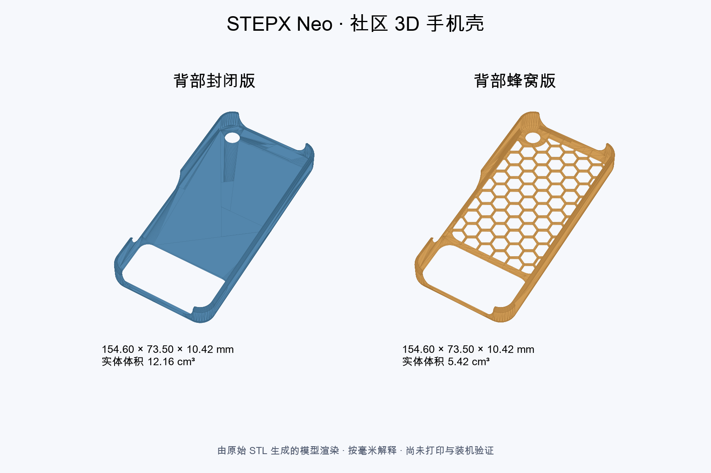
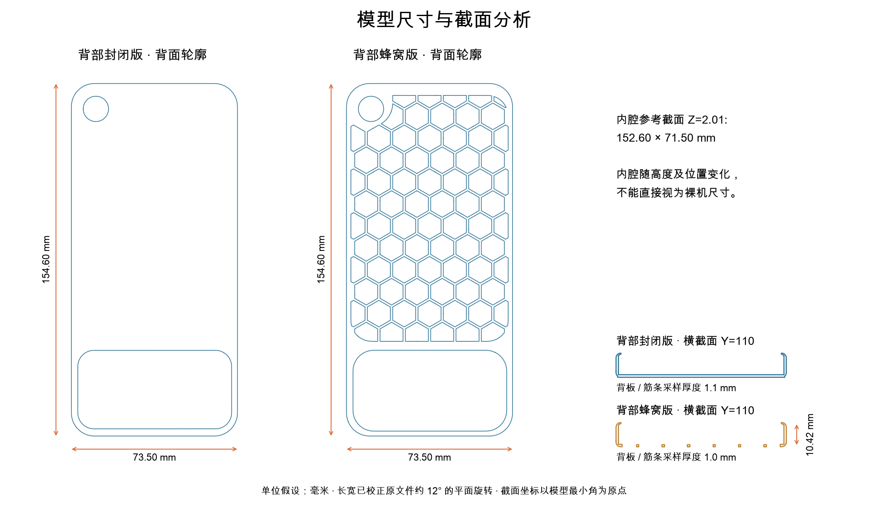

# STEPX Neo 社区 3D 手机壳

[研究所首页](../../README.md) · [3D 打印与配件分区](../../sections/3d-printing.md)

社区提供的两款 STL：**背部封闭版**与**背部蜂窝版**。收录日期：2026-10-21。模型属于社区作品，研究所负责整理和几何分析；作者暂不标记。原始出处链接、设计版本及许可未提供，不视为开源许可或商业使用授权。

以上图片直接由所附 STL 网格生成，颜色用于区分款式，不代表实物材质或打印成品。

## 模型与下载

| 款式 | STL 文件 | 文件大小 | 主要区别 |
| --- | --- | --- | --- |
| 背部封闭版 | [下载 / 查看 STL](models/stepx-neo-case-closed.stl) | 232,884 字节 | 主背板连续，仍保留大矩形开孔与小圆孔，并非整个背面无孔 |
| 背部蜂窝版 | [下载 / 查看 STL](models/stepx-neo-case-honeycomb.stl) | 380,684 字节 | 主背板改为蜂窝镂空，外框尺寸与封闭版一致 |

下载页可使用 GitHub 的 Raw / Download 获取原始文件；GitHub 的 STL 预览可用时可旋转查看。公开文件仅规范化了文件名，内容与提供的 STL 逐字节一致，没有旋转或修补原件。[SHA-256 校验](SHA256SUMS.txt) · [结构化测量数据](measurements.json)。

## 整体尺寸与内腔

**这里测量的是手机壳，不是手机裸机。** STL 本身不记录长度单位；下表按 1 模型单位 = 1 mm 解释，仍需在切片软件与实物上核对比例。原文件的长宽方向相对坐标轴旋转约 12°，已在分析时校正，避免把斜放包围盒误作真实长宽。

| 项目 | 封闭版 | 蜂窝版 | 测量含义 |
| --- | --- | --- | --- |
| 外形长 × 宽 × 高 | 154.60 × 73.50 × 10.42 mm | 154.60 × 73.50 × 10.42 mm | 校正摆放角度后的外形包络，非裸机三围 |
| 内腔长 × 宽 | 152.60 × 71.50 mm | 152.60 × 71.50 mm | Z=2.01 mm 水平截面的内轮廓包络，非全高恒定空间 |
| 背板 / 实体筋条采样厚度 | 约 1.10 mm | 约 1.00 mm | 在实体位置沿 Z 射线采样；镂空位置没有背板 |
| 直边侧壁采样厚度 | 约 1.00 mm | 约 1.00 mm | Y=77、Z=5 mm 右侧直边，非全壳最小壁厚 |
| 实体几何体积 | 12.162 cm³ | 5.418 cm³ | 网格封闭实体体积，非切片耗材、打印时间或重量 |
| 三角面数 | 4,656 | 7,612 | 原 STL 三角片数量 |
| 连通实体 | 1 | 1 | 各自为一个连通网格 |
| 网格封闭 / 绕序一致 | 是 / 是 | 是 / 是 | 几何拓扑检查，不等于打印或装机通过 |

内腔参考截面比外形长宽各小约 2.00 mm，与两侧各约 1.00 mm 的壁厚线索相符。上沿存在收口，侧边与端部存在开口，因此不能将这个截面当作整块手机的可用长方体空间，也不能用壳高减背板厚度直接推算裸机厚度。尺寸显示至 0.01 mm 仅便于比较，不代表打印或测量公差达到 0.01 mm。

蜂窝版的实体体积比封闭版少约 **55.5%**。这是两份模型整体的比较，既包含镂空，也包含主背板厚度等差异；不代表同样比例的强度、散热或成品重量变化。

## 开孔与结构差异

以分析坐标（长边为 Y、短边为 X、背板外表面为 Z=0）为准：

- 封闭版在 Z=0.5 mm 截面保留约 **66.80 × 34.10 mm** 的大开孔，以及约 **11.00 mm** 的小圆孔。孔位与实际摄像头、背屏及其他部件的对应关系仍需装机确认。
- 蜂窝版同一截面有 **75 个额外蜂窝区域孔洞**，包含边缘裁切和局部合并轮廓。典型完整六边形孔在该截面约 **10.00 × 11.55 mm**，不同方向的尺寸不能互换。
- 两者都保留侧边和端部避让。蜂窝版遮挡背部的连续面积较少；是否影响点阵图案可读性、是否碰到镜头、按键与插头，尚未实测。
- 网格封闭表示每条实体表面边界正常连接；手机壳本身仍有功能开孔。这两个概念并不矛盾。

## 能推断哪些整机信息

模型给出的装配线索是：手机处于约 **152.6 × 71.5 mm 的内腔参考尺度**，装壳后的外形包络约 **154.6 × 73.5 × 10.42 mm**。前者还包含设计间隙、收口与圆角影响；后者只有装配关系核对后才能作为带壳整机尺寸参考。

本轮未获得可以确认裸机长、宽、厚的官方尺寸表，也未用卡尺测量手机，**裸机精确三围暂不填值**。检索到的第三方规格存在不一致，未将其混入模型数据。[官方产品入口](https://www.stepx.com/)供后续核对；它不是上述几何测量数值的来源。

## 打印与装机状态

已完成：两份原件校验、摆放角度校正、外形包络、水平截面与局部厚度采样、实体体积、连通性、网格封闭与绕序检查，以及真实网格渲染。

待验证：模型单位、切片预览、打印材质与收缩、插入及拆卸、屏幕与镜头保护高度、按键、USB-C 插头、麦克风与扬声器避让、背屏可读性、握持与耐用性。尚未打印、尚未装机，不标记“适配通过”。

如果继续制作，先核对裸机尺寸和切片比例，检查约 1 mm 的侧壁、蜂窝筋条及上沿收口能否被所用打印工艺可靠生成，再打印局部试装件。材质、支撑和收缩补偿应根据实际打印机与耗材确定；这里不提供已经验证的切片参数。

## 分析方法

执行客户端：Codex；分析日期：2026-10-21。使用 Trimesh 5.1.1：读取二进制 STL，以 XY 最小面积旋转矩形恢复长宽方向，保留 Z，平移至外形最小角；用水平截面测量内外轮廓，以射线交点检查局部厚度，封闭网格积分计算体积。图片使用 Matplotlib 从真实网格和截面生成。

[可复现测量脚本](measure.py)只读取本目录 `models/` 下的文件。依赖安装：`pip install trimesh==5.1.1 numpy shapely networkx rtree`，运行：`python measure.py`。采样厚度不代表全模型最小厚度；封闭与绕序检查不包含完整自相交、薄壁制造性或受力仿真。
