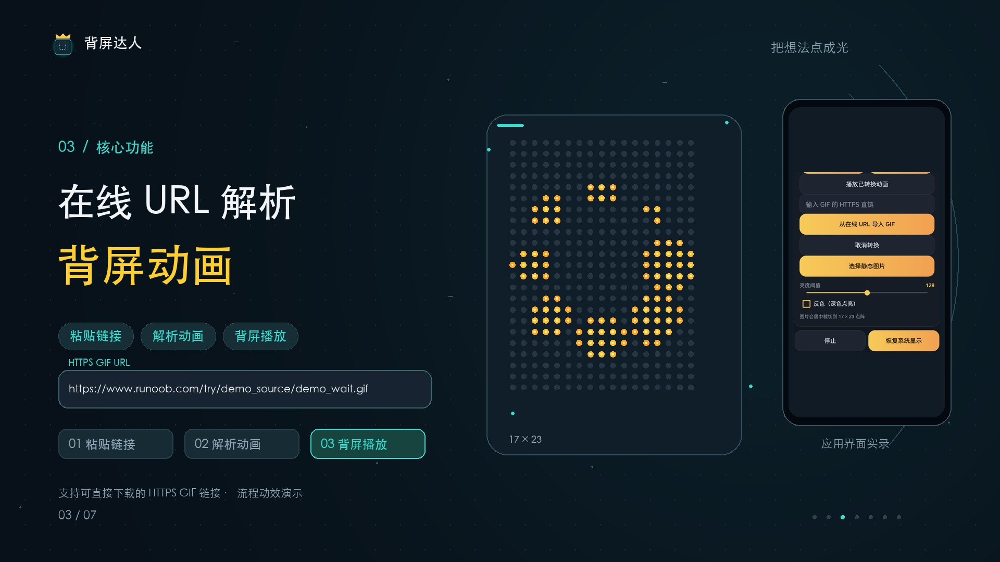

# 背屏达人 · 安全修订 4.0.1

[社区应用](../../sections/community-apks.md) · [研究所首页](../../README.md) · [使用教程](usage.md) · [安全报告](security-4.0.1.md)

把 GIF、文字、表情和手绘图案变成 Neo 背屏上的像素动画。**原作：鸿渐 · 来源：社区群；安全修订：JIAYU STUDIO / StepX Neo 研究所。** 原始工程和签名私钥未提供，4.0.1 是基于 4.0 APK 的独立安全修订，采用独立包名和新签名，可与原版并存。

**[下载 4.0.1 安全修订版 APK](https://github.com/JiayuStudio/stepx-neo-lab/releases/download/community-backscreenfun-v4.0.1-secure/backscreenfun-4.0.1-secure.apk)** · [发行说明与校验](https://github.com/JiayuStudio/stepx-neo-lab/releases/tag/community-backscreenfun-v4.0.1-secure)

## 核心功能：在线 URL 解析背屏动画

**粘贴链接 → 解析动画 → 背屏播放。** 在“自定义背屏 → 动画”中粘贴可直接下载的 **HTTPS GIF 文件链接**，点击“从在线 URL 导入 GIF”，转换后播放。支持灰度、黑白、反色、完整适配与铺满裁切，转换为 17×23 点阵；取前 30 秒、每秒 12 帧，最多 360 帧。

链接指 GIF 文件直链；没有新增任意作品网页的 GIF 提取器。指定 Tenor 页面与媒体直链先前在手机连接阶段超时，电脑下载后本地转换为 29 帧播放；详细条件见[教程](usage.md)。

**[播放 / 下载 60 秒宣传片](https://github.com/JiayuStudio/stepx-neo-lab/releases/download/community-backscreenfun-v4.0/backscreenfun-4.0-promo-60s.mp4)**：沿用 4.0 功能演示，19–31 秒介绍在线 URL 核心流程，配完整 Suno 音乐。应用界面实录与绘制点阵，无外置摄像头画面。该片不演示安全修订，也不作为 4.0.1 实机通过证据。

## 修复了什么

| 4.0 的问题 | 4.0.1 的处理 |
| --- | --- |
| 状态与诊断未鉴权读取 | 所有接口验证配对令牌；诊断不返回 UID、账号或原始错误 |
| 未鉴权重置 | `/quit` 要求令牌和 POST |
| 外部广播可改状态 | 接收器禁用、不导出，处理函数关闭 |
| 请求及字段限制不足 | 限制请求行、头部、正文、字段、频率、线程、队列与读取期限 |
| 鉴权失败仍返回 HTTP 200 | 缺失或错误凭证返回 401；方法、格式和超长请求使用对应错误码 |

令牌由 8 位十六进制增至 32 位（128 位随机值），私有保存、支持轮换；应用内配对帮助已更新。对外集成使用已配对的本机 HTTP，不再使用旧广播。[补丁源码与测试](security-patch-4.0.1/README.md)。

## 验证与安全状态

**🛡️ 未完全通过；安全修订版可下载。** 本轮已通过 65 项虚构数据离线协议回归、最终 APK 反编译回查、清单检查、签名校验及独立包名安装，启动到协议页。针对已报告问题的代码路径已修改；手机服务运行、独立未授权应用和实体背屏复测尚未完成，不授予“已通过哆啦A梦安全验证✅”。[查看版本绑定的报告与局限](security-4.0.1.md)。

原版 **4.0 仍为 ❗ 安全风险，继续暂停其 APK 下载**；原报告与历史资料保留。新包的结论不回溯覆盖原包。[4.0 安全报告](security-4.0.md) · [4.0 收录记录](history-4.0.md)。

**[4.0 图文实机报告 PDF](https://github.com/JiayuStudio/stepx-neo-lab/releases/download/community-backscreenfun-v4.0/backscreenfun-4.0-device-report.pdf)**：9 页，含实体背屏照片、音乐律动、熄屏条件与帧率记录。它对应原版 4.0，不能代替新签名、新包名的运行验证。媒体和点阵实现沿用原包，仍须分别记录新版复测结果。

## 安装与校验

- 应用显示：背屏达人·安全修订 4.0.1；versionCode：40001。
- 包名：`com.jiayu.backscreenfun.secure`；保留原类命名用于兼容，不代表原作者签名。
- 文件大小：374,669 字节。
- SHA-256：`d4600c1bd04c4edfd2e6cdc7ad05d334b07dd218783e0f2ce6892503cd1c3835`。
- APK v2/v3 签名通过，证书使用通用产品和工作室名称；原版数据不自动迁移。
- 最低 Android 8.0，背屏功能需要 Neo 系统接口。原作源码许可尚未提供；独立修订不意味着原作已开源或原作者认可。

## 历史

[4.0 收录记录](history-4.0.md) · [4.0 安全报告](security-4.0.md) · [3.0 收录记录](history-3.0.md) · [3.0 安全报告](security-3.0.md)。旧记录只对应当时文件与验证范围。
