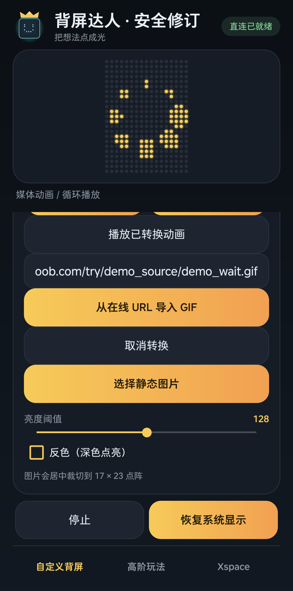

# 背屏达人安全修订 4.0.1 · 修改与回归报告

[应用与下载](README.md) · [4.0 原报告](security-4.0.md) · [补丁源码](security-patch-4.0.1/README.md)

**结论：🛡️ 未完全通过；可下载本独立安全修订版。** BSF4-01 至 BSF4-05 对应路径已完成静态与手机定向回归。65 项离线检查、31 项手机接口检查、2 项令牌轮换检查、7 项状态/恢复检查通过；另使用不同 UID、不同签名、无配对凭据的独立 Android 应用，验证 10 种未授权请求、广播、慢速/并发/频率边界与恢复。核心在线 GIF 在修订版转换并播放。完整流量、媒体模糊、桥接端与独立包名的实体背屏/深度待机仍未覆盖，不授予安全完全通过标记。原版 4.0 继续限制下载。

## 检查对象与来源

| 项目 | 内容 |
| --- | --- |
| 日期 | 2026-10-21 |
| 原作 / 安全修订 | 鸿渐 / JIAYU STUDIO · StepX Neo 研究所 |
| 版本 / versionCode | 4.0.1 / 40001 |
| 独立包名 | `com.jiayu.backscreenfun.secure` |
| 字节数 | 374,669 |
| SHA-256 | `d4600c1bd04c4edfd2e6cdc7ad05d334b07dd218783e0f2ce6892503cd1c3835` |
| 原始工程 | 未提供；基于 4.0 APK 定向修改，非原工程可复现构建证明 |
| 签名 | 新独立产品证书，RSA 3072 位，APK v2/v3 完整性通过 |
| 安装方式 | 独立安装，不覆盖原包或迁移其数据 |

基包哈希为 `3dc9333bf7ddada0fd10f6ffab255152c6017edb13856003e0bce472c373918e`。新写四个修复类，以 Java / D8 编译为 DEX 后替换对应 smali，更新版本、清单、名称及配对说明，再重建、对齐和签名。其余媒体、点阵、界面及素材沿用原包。没有原签名私钥，不冒充官方升级；没有发布完整第三方反编译源码。

最终 APK 再次反编译为 26 个 Java 输出文件，核对实际包内代码而非只检查工作源文件。一个 DEX，无原生库、嵌套 APK 或私钥文件。`debuggable=false`、`allowBackup=false`；服务不导出，广播接收器禁用且不导出。权限清单未新增。

## 五项问题的修复证据

| 编号 | 修改 | 静态与离线证据 | 手机结果 |
| --- | --- | --- | --- |
| BSF4-01 信息读取 | `/status`、`/feed`、`/alive` 及所有其他路径统一认证；feed 固定返回最小状态，不引用原诊断字符串 | 源码与最终 DEX 回查；各路径缺失、错误凭证均为 401；授权读取正常 | 独立应用 10 种请求均 401，未返回虚构消息；不同 UID 与签名已核验 |
| BSF4-02 重置 | `/quit` 仅 POST 且鉴权 | 缺失/错误令牌 401，合法 GET 405，合法 POST 重置成功 | 未授权 POST 401，合法 GET 405；合法 POST 后读回空闲状态 |
| BSF4-03 广播 | 清单 `enabled=false`、`exported=false`，移除 action，接收器处理函数为空 | 最终清单与 DEX 回查；处理函数无副作用 | 独立应用发送定向广播，未改变先前虚构状态；API 发送本身未抛异常，不写成权限异常 |
| BSF4-04 输入/资源 | 有界字节读取、字段验证、连接限流、线程池与队列上限 | 超长、歧义、编码、正文和绝对期限离线检查；最终 DEX 有界池与关闭路径 | 空闲与慢速请求 408；8 并发中 2 个 503；64 次突发有 40 个 429，之后合法写入恢复 |
| BSF4-05 状态码 | 401/403/405/408/413/414/415/429/431/503 等错误区分 | 离线响应与合法业务结果检查 | 手机 401/400/403/404/405/413/414/431 及资源相关状态码实测 |

错误返回不包含请求、地址、凭证或异常正文。读接口加 `Cache-Control: no-store`；不提供浏览器 CORS 授权，拒绝 Origin；Host 限于本机回环名称。凭据建议放 `Authorization: Bearer`，兼容单个 `X-BSF-Token` 或表单/查询 token，但拒绝多处凭据和重复字段。

## 配对与明确上限

- `SecureRandom` 生成 16 字节（128 位）随机值，显示为 32 位十六进制。旧短值不再接受。
- 私有 SharedPreferences 同步保存；轮换使旧值失效，保存失败不继续接受新值；使用 `MessageDigest.isEqual` 比较。
- 请求行最多 2048 字节；头部总计 4096 字节、24 项；正文最多 2048 字节；参数最多 8 项。
- 工具名最多 32 个限定字符；消息最多 40 个 Unicode 码点，拒绝控制与双向覆盖字符；状态采用允许值。
- 不接受重复头、重复字段、冲突凭据、畸形百分号/UTF-8、chunked 或不支持的正文类型。
- 2 个工作线程、4 个排队位置；每秒最多接纳 24 个连接；读取空闲和排队期限 1200 毫秒，解析总期限 3000 毫秒。停止时关闭监听、客户端和工作线程。

这些上限用于控制本应用的资源占用，不能保证同机恶意应用无法占端口或影响整个系统。

## 已运行的回归

65 项离线检查使用虚构消息和内存设置替身，不接触真实 UID、账号或私人内容：

- 令牌长度、短令牌迁移、稳定读取、QR 载荷容量、大小写兼容、轮换和旧值拒绝。
- 七条路径缺失/错误凭证、无未授权写入，合法读取/事件/重置、中文 UTF-8 消息和状态映射。
- 禁止 GET 修改、重复凭据/参数/头部、未知 Host、浏览器 Origin、字段/状态/长度约束。
- 畸形编码、请求行/头部/正文超长、正文截断、重复或负 Content-Length、chunked、内容类型和无副作用。
- 绝对解析期限、禁用接收器函数无副作用。

本机 Java 客户端建连约 3 秒，影响主机套接字部分；该失败没有计为通过。网络实测使用手机本地 TCP 和独立 Android 探针，绕开主机建连环境的影响，不修改系统代理或安全设置。探针只持有普通联网权限，不接收配对凭据，与目标包不同 UID、不同签名，未进入正式 APK。

| 实机检查 | 观察结果 |
| --- | --- |
| 31 项协议/输入检查 | 全部符合预期；拒绝无凭据、错误凭据、GET 修改、超长及歧义输入，原虚构状态不变 |
| 界面轮换 | 旧令牌 401、新令牌 200；测试令牌未公开 |
| 独立应用 10 种请求 | 全部 401，无虚构状态消息或未经授权内容回显 |
| 定向广播 | 发送调用返回，目标状态未变；与禁用且不导出的清单一致 |
| 读取空闲 | 返回 408 |
| 持续慢速输入 | 3016 毫秒返回 408，符合 3000 毫秒解析总期限的实际调度误差 |
| 8 个并发连接 | 6 个受限连接最终 408、额外 2 个 503 |
| 64 次突发请求 | 24 次接纳处理、40 次 429，无传输异常；恢复后未授权仍 401、合法读写正常 |
| 事件与重置 | 合法事件状态映射正确；合法 POST 重置后状态为空闲 |
| 核心 URL 功能 | 公开加载环 GIF 转换为 8 帧，应用“媒体动画 / 循环播放”，播放计数前进 |
| 停止与清理 | 停止播放并恢复系统显示；进程与端口关闭，探针卸载、临时文件和测试令牌副本删除，原版保留 |

[完整结构化结果](security-results-4.0.1.json) 绑定同一 APK 哈希，不包含真实令牌、UID、设备标识或私人日志。

修订版实际手机截屏，裁去系统状态栏；只裁切和缩放，未改应用画面。该图与播放状态证明应用转换/播放，不替代新包的实体背屏摄像验收。

## 信息与权限检查

最终包成员、字符串、签名元数据和公开材料已检查，未发现本机个人/计算机标识、硬编码凭据、私钥或测试令牌。签名密钥只在维护者本机保存。此项不等于全面运行流量分析。

没有新增联系人、短信、定位、相机、无障碍或安装其他应用权限；没有在本轮授予通知、投影、麦克风、电池或冻结例外。原版 4.0 实拍、音乐和熄屏结果仅作为历史功能资料，不能代替独立包名版本的权限、后台及实体显示复测。

## 修改建议与可能风险

1. 后续每次修改 APK 都应重新绑定哈希并执行相同定向回归，不能沿用本版结果。
2. 独立包名会改变系统权限和后台识别，应复测代表功能、实体背屏、停止恢复及熄屏条件。
3. 保留 GIF 下载地址检查与实际连接之间的 DNS 变化待核事项；未进行完整流量捕获、畸形媒体模糊测试或桥接端审计。
4. 原始源码和源码许可未提供；应争取原作者在正式工程中合并修复，减少定向 APK 重建的维护成本。
5. 深度待机、长期耗电、多机型与固件兼容仍待验证。本报告不声称绝无漏洞或全功能通过。
