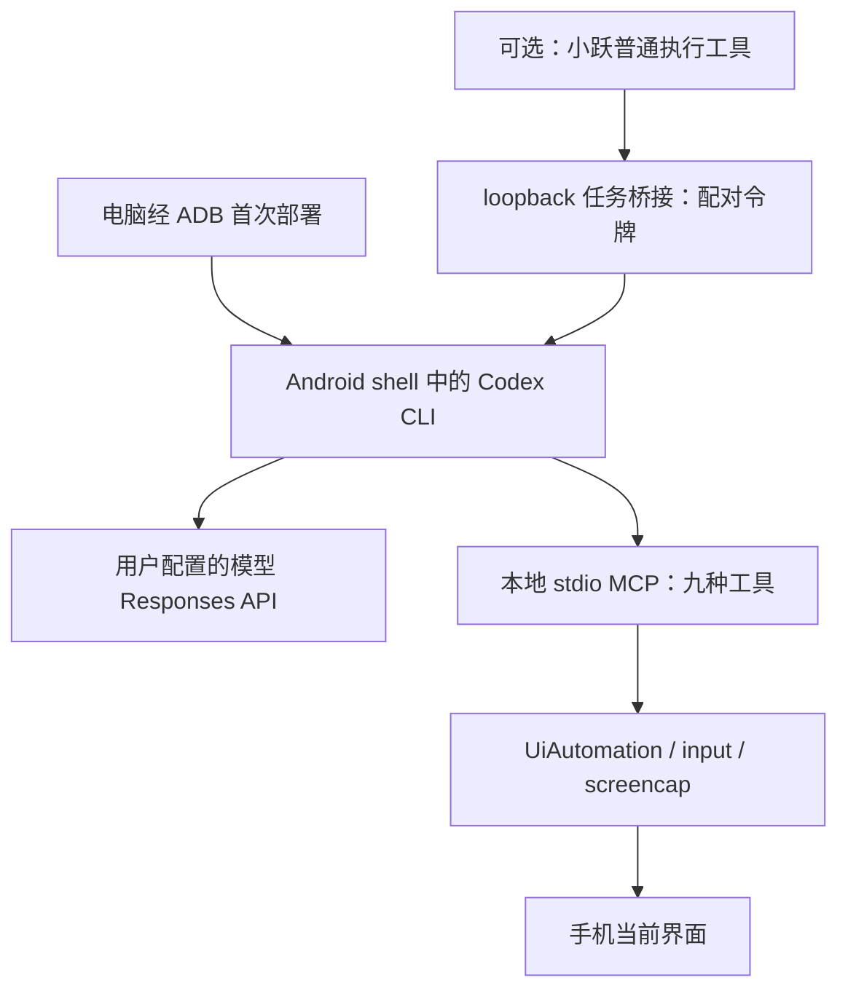

# 社区手机控制：Codex CLI + MCP

**原分享署名：当当946（社区群分享）。** 用户提供分享包与演示视频；本页及逆向分析由 JIAYU STUDIO 使用 Codex 整理，2026-10-21。未独立核实原创作者身份或原始仓库，署名表示本次材料来源，不据此推断全部代码著作权。Codex CLI 归 OpenAI，jq 归其上游项目。

这套方案把 Codex CLI 运行在 Android 的 ADB shell 环境，用自定义 MCP 读取界面、截图、点击和输入；可选桥接让内置小跃提交任务。分享材料含脚本和 Java 源码，因此本次采用**源码审查 + 附带 DEX 反编译核对 + 虚构数据隔离测试**。

**状态：🛡️ 未完全通过。** 已完成文件校验与本地定向审查，不授予“安全验证通过”或“Neo 实机认证”。没有安装到研究所设备，没有调用模型服务或在真实账号上执行关注、发消息等操作。

[完整逆向与安全分析](analysis.md) · [原分享教程](materials/README.md) · [可选小跃委托](materials/docs/小跃委托.md) · [文件清单与 SHA-256](manifest.json) · [28 项隔离检查](checks.json)

[下载整理分享包](https://github.com/JiayuStudio/stepx-neo-lab/releases/download/community-codex-phone-20261021/codex-phone-community-20261021.zip) · [下载包校验值](https://github.com/JiayuStudio/stepx-neo-lab/releases/download/community-codex-phone-20261021/SHA256SUMS.txt)

下载包仅整理外层目录名和 ZIP 元数据，内部 16 个文件与收到的材料逐字节一致。没有代填模型配置、没有包含官方 CLI 或 jq 二进制，也没有附带 API Key、配对状态或任务日志。原材料未附开放源码许可证；本次按用户要求整理分享，不为上游材料另行授予开源或商业许可。

## 工作方式

| 入口 | 解决什么问题 | 边界 |
| --- | --- | --- |
| 手机本地 CLI + MCP | 让模型读屏并操作手机 | 依赖已授权的 ADB shell 权限、模型与平台兼容性 |
| 可选小跃桥接 | 从普通端侧执行工具提交任务并查询结果 | 需要可达 loopback、首次配对和服务存活 |
| 厂商原生 GUI Agent / Skill | 本包未实现或解锁 | 不替换默认聊天模型，不宣称原生 Skill 安装成功 |

九个工具：`phone_status`、`phone_ui`、`phone_screenshot`、`phone_tap`、`phone_swipe`、`phone_key`、`phone_launch`、`phone_click`、`phone_input`。输入使用 `ACTION_SET_TEXT` 并回读，不默认按发送键；坐标通常以缩放后的图片像素为准。

## 演示与验证范围

提供的视频约 20.43 秒，呈现从聊天委托进入短视频应用、搜索目标、打开个人页以及关注按钮状态变化。视频有剪辑/加速观感，仅凭画面不能核实内部每次模型调用、完整耗时和服务端状态。含账号页面与现场环境，原片保留本地，不作为公开附件。

作者材料声称的基线为 Android 16、ARM64、shell UID 2000、无 root，使用 Codex CLI 0.163.0；中文输入与小跃委托成功属于**提供材料中的实测说明**，本次未独立复现。

本次独立完成：15 份清单文件哈希校验、附带 JAR 解包与 DEX 反编译、脚本和 Java 代码审查、28 项隔离检查。`SHA256SUMS.txt` 不自校验；`manifest.json` 另覆盖全部 16 文件。JAR 的核心控制流程与所附源码相符，未做指定工具链逐字节重建证明。

## 使用前先读

优先阅读原教程和分析中的权限、配对及数据流说明。先在无个人内容的测试页面做只读任务，再测试输入。模型会接收工具返回的 UI 文本和截图；任务记录也可能保存这些内容。仅将接口地址替换为自己信任并能接受此类数据的服务。

当前主要待改进项：首次配对缺少独立的一次性确认码；模型进程权限依赖 CLI/Android 实际隔离，提示词不是强制访问控制；任务与工具日志没有完整的保留/清理策略。使用与修改建议见[分析报告](analysis.md)。
