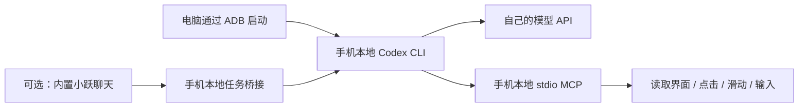

# 手机安装 Codex CLI，并通过 MCP 控制手机

这是一份基于 2026-10-21 实机结果整理的复现教程。实测基线是 **Android 16、ARM64、ADB shell UID 2000、无 root**；其他机型、系统版本需要重新验证。固定使用已验证的 **Codex CLI 0.163.0**，这不是“最新版安装器”，也不是 OpenAI 官方的 Android 支持说明。

分享包不含模型 Key、登录文件、客户端令牌、设备序列号、无线调试地址或聊天记录。朋友需要配置自己的服务和凭据。

分享版已做文件、格式和脱敏检查；尚未在另一台全新手机上从零安装验收。

## 先理解这套方法



核心是：**在 Android shell 中运行 Codex，把手机操作封装为 MCP 工具，让模型调用工具。** CLI 安装在 `/data/local/tmp/stepneo-codex`，不需要进入厂商的 Ubuntu rootfs。它没有解锁厂商 GUI Agent 或原生 MCP。

| 部件 | 作用 |
|---|---|
| `phone/codex` | 设置运行目录、网络和证书，启动手机 CLI |
| `phone/network.sh`、`provider-connect.sh` | 由 Android 处理模型服务域名解析，保留端到端 TLS 校验 |
| `phone/phone-mcp.sh` | 提供九种手机工具，使用 stdio，不监听网络端口 |
| `phone/phone-ui-helper.jar` | 读取可访问性树、处理截图尺寸、点击控件和 Unicode 输入 |
| `templates/config.toml` | 不含凭据的配置模板 |
| `optional/` | 内置小跃委托使用的可选任务桥接与客户端 |
| `src/` | UI helper 源码和构建说明 |

## 1. 准备环境

电脑需要 `adb`、Python 3 和可用的 `tar`。手机打开开发者选项及 USB 调试，授权这台电脑，解锁屏幕。先从有线 USB 开始，方便排错。

在解压后的分享目录打开 PowerShell：

```powershell
adb devices
$device = Read-Host '输入上面列表中你自己的设备序列号'
adb -s $device shell id
adb -s $device shell getprop ro.product.cpu.abi
adb -s $device shell getprop ro.build.version.release
adb -s $device shell 'command -v app_process; command -v nc; command -v flock; command -v timeout'
```

下面步骤要求 ARM64。`id` 应能取得 shell 身份；如果设备不允许 shell 截图、注入输入或使用 UiAutomation，单纯安装 CLI 不能补出这些权限。所需 `nc` 是这次设备上带 `-L`、`-W` 参数的 Android 实现；其他设备先核对 `nc --help`。

## 2. 下载已验证版本的官方原生包和 jq

下载在电脑上进行，手机侧直接执行原生二进制，不依赖手机安装 Node.js。以下包名及布局来自本次实际安装的 npm 原生包：

```powershell
New-Item -ItemType Directory -Force -Path downloads | Out-Null
Invoke-WebRequest -Uri 'https://registry.npmjs.org/@openai/codex/-/codex-0.163.0-linux-arm64.tgz' -OutFile '.\downloads\codex.tgz'
Invoke-WebRequest -Uri 'https://github.com/jqlang/jq/releases/download/jq-1.8.2/jq-linux-arm64' -OutFile '.\downloads\jq'

$sha512 = [Security.Cryptography.SHA512]::Create()
try {
    $actual = [Convert]::ToBase64String($sha512.ComputeHash([IO.File]::ReadAllBytes((Join-Path $PWD 'downloads\codex.tgz'))))
} finally {
    $sha512.Dispose()
}
$expected = 'IH2/R+4OarjGvsAf1ll3fdyLwrPgYLl3uzp6u9CyD9sj2Lw+ViDSe3QBZVHdcHJs0eIiZFg6Wprcuy4CRZaUGw=='
if ($actual -cne $expected) { throw 'Codex 下载包校验不一致，请停止' }
if ((Get-FileHash '.\downloads\jq' -Algorithm SHA256).Hash.ToLowerInvariant() -ne '8b85c817833814ddca00a144c33705546355afccf0cf39b188f3cdb48b852309') { throw 'jq 校验不一致，请停止' }

tar -xzf '.\downloads\codex.tgz' -C '.\downloads'
if ($LASTEXITCODE -ne 0) { throw '解压失败' }
$vendor = Join-Path $PWD 'downloads\package\vendor\aarch64-unknown-linux-musl'
```

升级版本需要重新核对布局和 Android 兼容性，不能只替换版本号后沿用这里的校验值。

## 3. 填自己的模型接口

先编辑两个文件，再上传：

1. `templates/config.toml`：把 `YOUR_MODEL_ID` 换为自己的接口实际提供的模型 ID，把 `https://api.example.com/v1` 换为自己的 **Responses API** 地址。
2. `phone/provider-connect.sh`：把两处 `api.example.com` 都换为上面地址的域名，只写域名，不带 `https://`、路径或端口。本模板固定 HTTPS 443。

CLI 使用 `wire_api = "responses"`。服务仅宣称“兼容 OpenAI”或只提供 `/chat/completions`，不代表能直接用于此方案。需要实际支持 Responses 流式响应及工具调用；看截图还需要模型和接口支持图片输入。

推理强度按服务商支持的值填写。模板没有强制设置；本次另一套配置验证过 `deepseek-v4.1-flash` 配合 `max`，这是特定接口的结果，不代表任意 DeepSeek 接口或模型均接受 `max`。

**不要把 Key 写进 TOML、脚本、提示词或群聊。** 后面用 CLI 的标准输入完成登录。

## 4. 上传 CLI、运行脚本和 MCP

以下用于新手机首次安装；已有同目录安装时，先保留原配置和凭据，避免直接覆盖。

```powershell
$phoneRoot = '/data/local/tmp/stepneo-codex'
adb -s $device shell "mkdir -p $phoneRoot/bin $phoneRoot/codex-path $phoneRoot/codex-resources $phoneRoot/home $phoneRoot/config $phoneRoot/tmp $phoneRoot/workspace"
adb -s $device shell "chmod 700 $phoneRoot $phoneRoot/home $phoneRoot/config $phoneRoot/tmp $phoneRoot/workspace"

adb -s $device push "$vendor\bin\codex" "$phoneRoot/bin/codex"
adb -s $device push "$vendor\bin\codex-code-mode-host" "$phoneRoot/bin/codex-code-mode-host"
adb -s $device push "$vendor\codex-path\rg" "$phoneRoot/codex-path/rg"
adb -s $device push "$vendor\codex-resources\bwrap" "$phoneRoot/codex-resources/bwrap"
adb -s $device push "$vendor\codex-package.json" "$phoneRoot/codex-package.json"
adb -s $device push '.\downloads\jq' "$phoneRoot/bin/jq"

adb -s $device push '.\phone\codex' "$phoneRoot/codex"
adb -s $device push '.\phone\network.sh' "$phoneRoot/network.sh"
adb -s $device push '.\phone\provider-connect.sh' "$phoneRoot/provider-connect.sh"
adb -s $device push '.\phone\phone-mcp.sh' "$phoneRoot/phone-mcp.sh"
adb -s $device push '.\phone\phone-ui-helper.jar' "$phoneRoot/phone-ui-helper.jar"
adb -s $device push '.\templates\config.toml' "$phoneRoot/config/config.toml"
adb -s $device shell "chmod 700 $phoneRoot/codex $phoneRoot/network.sh $phoneRoot/provider-connect.sh $phoneRoot/phone-mcp.sh $phoneRoot/bin/codex $phoneRoot/bin/codex-code-mode-host $phoneRoot/bin/jq"
adb -s $device shell "chmod 600 $phoneRoot/config/config.toml $phoneRoot/phone-ui-helper.jar"
```

留意每条 `adb push` 的返回结果，出现失败就先排查。脚本必须保持 LF 换行；不要用文本管道传 JAR 或其他二进制。

先做不调用模型的检查：

```powershell
adb -s $device shell "$phoneRoot/codex --version"
adb -s $device shell "$phoneRoot/codex mcp list --json"
adb -s $device shell "CLASSPATH=$phoneRoot/phone-ui-helper.jar app_process / PhoneUiHelper geometry"
adb -s $device shell "CLASSPATH=$phoneRoot/phone-ui-helper.jar app_process / PhoneUiHelper ui"
```

应看到 CLI 版本、`stepneo-phone` 配置，以及当前屏幕尺寸和 UI 数据。`mcp list` 本身只说明已配置，最后两条和实际工具调用用于确认 helper 能运行。Codex 启动的 Java 子进程需要 Android 的运行环境，因此模板显式转发了公开的 `BOOTCLASSPATH` 等变量，不要随手删掉。

## 5. 私密输入自己的 API Key

电脑使用 Python 的隐藏输入，Key 通过子进程标准输入送到手机 CLI，不出现在命令行参数中：

```powershell
@'
import getpass
import subprocess
import sys

device = sys.argv[1]
key = getpass.getpass('输入你自己的 API Key（不回显）：')
if not key.strip():
    raise SystemExit('没有输入 Key')
result = subprocess.run(
    ['adb', '-s', device, 'shell', '-T',
     '/data/local/tmp/stepneo-codex/codex', 'login', '--with-api-key'],
    input=(key + '\n').encode('utf-8'),
    check=False,
)
del key
raise SystemExit(result.returncode)
'@ | python - $device

adb -s $device shell "$phoneRoot/codex login status"
adb -s $device shell "chmod 600 $phoneRoot/config/auth.json"
```

登录文件会保存在这部手机的 `config/auth.json`。不要打开它截图、发给别人或加入分享包。它位于 shell 专用目录，不是厂商 App 的私有数据目录；已经授权的 ADB shell 可以访问它。

## 6. 让 Codex 真正调用手机工具

先做读取测试。为避免 Windows 到 Android 的中文及引号转义问题，提示词用 UTF-8 无 BOM 文件传递：

```powershell
$promptPath = Join-Path $PWD 'check-prompt.txt'
[IO.File]::WriteAllText($promptPath, '只使用 stepneo-phone MCP 的 phone_status、phone_ui 和 phone_screenshot，概述当前页面，不点击或输入，不读取凭据。', [Text.UTF8Encoding]::new($false))
adb -s $device push $promptPath "$phoneRoot/workspace/check-prompt.txt"
adb -s $device shell "$phoneRoot/codex exec --json --skip-git-repo-check --sandbox read-only --color never - < $phoneRoot/workspace/check-prompt.txt"
```

这一步开始会产生自己模型接口的正常用量。确认读取正常后，手动打开一个无敏感内容的测试输入框，把提示词换为：

> 只使用 stepneo-phone MCP。先读取 UI，找到当前唯一的测试输入框，使用 phone_input 写入“中文输入测试 ABC 123”，核对精确回读，再截图。不要按 Enter，不要搜索、发送或提交；找不到可靠输入框就停止并说明。

重新写入同一个本地提示词文件并 `adb push` 后执行即可。输入框允许的任务验收完，再尝试打开计算器等操作。

模板为本机六个交互工具配置了允许执行，适合本人明确授权的手机任务。`--sandbox read-only` 是 CLI shell 的沙箱选项，**不等于禁止 MCP 操作手机**；手机工具按 ADB shell 的权限执行。应通过任务指令和工具启用范围限定实际操作。

## 九个工具怎么用

| 工具 | 用法 |
|---|---|
| `phone_status` | 读取手机身份、原屏与图片尺寸 |
| `phone_ui` | 读取当前可访问性节点和图像坐标 bounds |
| `phone_screenshot` | 返回实际屏幕 PNG，默认不存系统图库 |
| `phone_tap` | 默认接收图片像素坐标，自动换算原屏 |
| `phone_swipe` | 同样默认使用图片坐标 |
| `phone_key` | HOME、BACK、ENTER 等有限按键 |
| `phone_launch` | 按包名解析真实 launcher，或使用已核对的组件 |
| `phone_click` | 按唯一 `resource_id` 或目标文字点击，可限制包名 |
| `phone_input` | `ACTION_SET_TEXT` 输入 Unicode，支持 replace/append，精确回读 |

输入优先“读取 UI → 点击唯一目标或指定输入框 → `phone_input` → 验证”。不要让模型逐个点击软键盘来拼中文。输入工具不自动发送，也不把输入文本作为 shell 命令执行。

UI 和截图已经统一为图片坐标，**不要手动再缩放**。确实持有原屏坐标时，显式传 `coordinate_space="screen"`。不要写死别人手机的分辨率。

## 常见问题与边界

| 现象 | 检查方向 |
|---|---|
| 有 Ubuntu rootfs，为什么不进去安装？ | 本方案用 Android shell；rootfs 存在不代表普通 ADB 有进入权限 |
| CLI 能打印版本，但请求失败 | 核对 Responses 兼容性、模型 ID、自己的 Key、域名白名单及系统 CA 路径 |
| CONNECT 返回 403 | `provider-connect.sh` 的两处域名与 TOML 的 HTTPS 域名不一致，或用了非 443 端口 |
| `bwrap`、`rg` 或 git 不可用 | 本机 Linux 沙箱及随包部分工具不兼容 Android；MCP 控屏实测成功不代表完整 Linux 编程环境可用 |
| UI 返回空、输入失败 | 解锁屏幕并确认当前应用；自绘控件、不暴露可访问性节点的输入框可能无法使用 `ACTION_SET_TEXT` |
| 截图看得到，UI 文本为空 | 可能是自绘界面，应结合截图判断 |
| 图库没有新图 | MCP 截图用于模型感知，当前没有存入图库的工具入口 |
| 重启后不能委托 | 目前没有完成自启、服务守护和重启验收，需要重新核对并启动服务 |

当前成功范围是本次手机的 CLI 推理、九工具实现，以及已实测的中文输入和小跃委托链路；不能据此保证所有手机、App、验证码场景或长时间脱离电脑运行。无需通过关闭 TLS 校验或关闭 Linux 沙箱来掩盖兼容问题。

## 可选：从内置小跃发起任务

参见同包 `docs/小跃委托.md`。它在手机 loopback 增加任务桥接，再由小跃的普通端侧执行工具调用。需要小跃自身具有能运行 Python 并访问本机 loopback 的工具。

这属于委托接入；厂商默认聊天模型保持原配置。普通使用说明加持久配对已经实测，原生 OpenClaw 技能安装没有完成，因此这里不提供“原生 Skill 一键安装”的说法。

## 包的校验与参考

`SHA256SUMS.txt` 记录本分享包文件的 SHA-256；不包含下载后的模型二进制、个人配置或凭据。`src/BUILD.md` 说明 helper 如何重建。

一般 Codex 用法可参考 OpenAI Docs：`https://developers.openai.com/codex/cli/`、`https://developers.openai.com/codex/mcp/`、`https://developers.openai.com/codex/config-reference/`、`https://developers.openai.com/codex/auth/`。这些是官方通用文档地址；Android 适配和兼容范围以本教程的实测说明为准。
