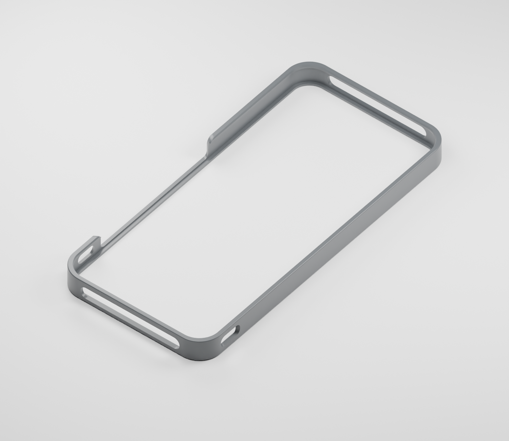
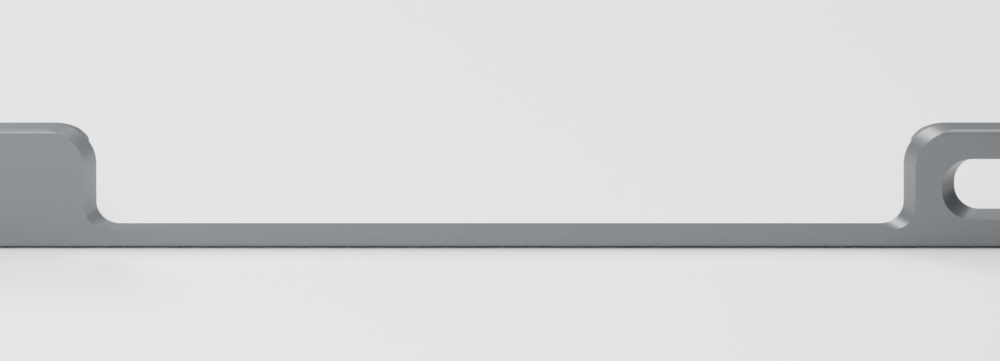

# STEPX Neo 纯边框保护框 v0.1.4 · STEP 实体版

[研究所首页](../../README.md) · [3D 打印与配件](../../sections/3d-printing.md)

一体式纯边框，正反面开放，无螺丝、磁铁或其他额外五金。面向 PLA / PETG 硬料试样。**本版仍待打印与实机试装验收。**



## 下载

| 文件 | 用途 |
| --- | --- |
| [STEP 实体](STEPX_Neo_Slim_Bumper_v0.1.4.step) | 主要 CAD 交付；毫米单位、AP214、一个有效实体 |
| [STL](STEPX_Neo_Slim_Bumper_v0.1.4.stl) | 由 STEP 回读生成的打印网格 |
| [3MF](STEPX_Neo_Slim_Bumper_v0.1.4.3mf) | 同一打印几何，不含切片参数或 G-code |
| [BREP](STEPX_Neo_Slim_Bumper_v0.1.4.brep) | OpenCASCADE 原生实体 |
| [参数化源码](build_step.py) | 修改顶部参数和孔位定义，重建实体 |
| [SHA-256 校验](SHA256SUMS.txt) | 下载文件一致性核对 |

在 GitHub 文件页使用 **Raw / Download raw file** 下载。STL 按毫米导入。

## 结构与修改

- 按键敞口两端上角为 **R3.5 mm** 圆弧，保留底部连接梁。
- 前卡边内收约 **0.8 mm**，背托边宽 **3.0 mm**。
- 前后限位面 Z=8.9 / 1.0 mm，限位间距 **7.9 mm**。
- 外框上下沿 **R0.4 mm**；保留加大的按键敞口、左右声孔和端部开口。
- 外形长 × 宽 × 高 **155.60 × 74.50 × 10.42 mm**。



**这些是保护框模型尺寸，非官方裸机三围。7.9 mm 是试装限位值，不是手机厚度。** 声孔位置来自标注图，尚未经实物尺寸核对；装入困难时不要强压屏幕，应调整限位间距。

## STEP 与验证

依据 v0.1.3 参数重建 CAD 实体，包含 104 个 CAD 面：平面、圆柱面、圆环面、圆锥面与 B 样条面。没有把每个 STL 三角片包装成一个 STEP 面。

- STEP 重新导入后：1 个有效实体、1 个闭合壳；前后限位回测为 7.9 mm。
- 双侧声孔中心及手指接近区的探针相交体积为 0。
- 与 v0.1.3 各抽样 6000 点做双向表面距离比较，最大抽样距离约 **0.01236 mm**，体积变化约 **+0.035%**。这是抽样结果，不是全表面严格误差上界。
- STEP 回读生成的 STL 为单一闭合连通体、法向一致；3MF 来自同一网格。

见 [STEP 检查](step-check.json)、[对比检查](comparison-check.json) 和 [参数记录](parameters.json)。CAD 真曲面与旧网格存在微小差异，不声称逐顶点完全相同。

**未完成本版切片、打印、实机适配或目标 CAD 软件交互验收**；贴膜干涉、装卸力度、按键手感、声孔对位、防脱及耐久仍待实物验证。未做跌落或声学测试。

## 编辑和复现

STEP 保留实体与曲面，不包含本脚本的参数／特征历史。修改尺寸可编辑 `build_step.py` 顶部的 `P` 字典与孔位定义；`parameters.json` 是导出的记录，不是输入配置。

```sh
python -m pip install -r requirements.txt
python build_step.py
python verify_step.py
```

构建不依赖参考网格；验证使用 `source/reference-v0.1.3.stl` 与旧版比较。实际复用了 [CadQuery](https://github.com/CadQuery/cadquery) 2.8.0 / OpenCASCADE 建模能力；[导入导出说明](https://cadquery.readthedocs.io/en/latest/importexport.html)。CadQuery 库采用 Apache-2.0，未复制上游模型。

## 来源与权利说明

JIAYU STUDIO 根据所提供蜂窝壳的参考尺寸、外形参考和试装反馈，编写参数化边框并迭代抓持、开孔与圆角；本版以 v0.1.3 为几何基准重建 CAD 实体。不是直接删除原蜂窝壳背板，也不声称依据官方精确裸机尺寸。

参考蜂窝壳的原作者与许可未明确，不替其声明开源或商业授权。本目录提供模型及源码供查阅，未另行授予开源或商业许可。STEPX 商标属于各自权利人，本模型非官方配件。

模型修订与收录日期：2026-11-06。
