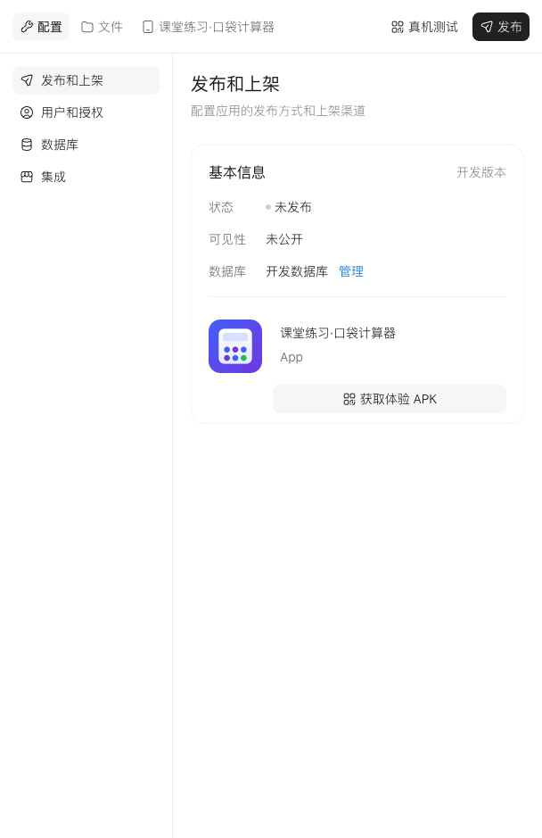

# 07 · 把作品整理成别人能用的版本

> **已归档：2026-10-20 早期版。** 保留当时的内容与验证记录，接口和界面可能已变化。[阅读新版课程](../../official-step-studio/README.md)。

[上一课](06-capstone.md) · [课程首页](README.md)

官方工作台有「发布」入口。先完成当前功能的预览与必要的真机检查，再按当前页面提示处理发布条件。课程不把按钮出现或构建成功写成公开上线成功。

## 先看当前版本状态

在 **配置 → 发布和上架** 查看状态与可见性。本次课堂项目仍是「未发布 / 未公开」，页面提供「获取体验 APK」。有体验入口并不代表作品已经公开上架。



## 给试用者四项信息

1. **用途**：一句话说明解决什么问题。
2. **开始方式**：入口、设备要求、第一步按哪里。
3. **已验证**：具体环境和可观察的结果。
4. **限制**：未测功能、失败时如何返回或停止。

```text
根据当前项目的真实实现和测试记录，写一份简短中文使用说明。
包含用途、开始步骤、设备或权限条件、已验证范围、已知限制与反馈需要的信息。
没有执行的检查标为待测，不写「全部兼容」或「完全稳定」。
只整理当前版本已有功能，不增加新的功能承诺。
```

## 发布界面怎么用

点击工作台「发布」后先读当前页面给出的范围、产物与条件。存在未完成配置、审核或构建步骤时逐项解决。安装包、网页链接和仅供本人真机测试的入口不是同一种交付物，说明中写清楚。

课程示范项目的实际状态见[案例记录](case-study.md)。发布入口和条件可能更新，本课程不替读者承诺某个账号一定能发布哪种产物。

## 按作品类型走发布流程

以下流程来自所收录知识库；先完成测试，再按当前页面确认条件。不要为了完成课程直接公开一个尚未检查的练习。

| 类型 | 文档中的操作顺序 | 如何判断进度 |
| --- | --- | --- |
| 应用 | 发布正式版本 → 选择可访问的版本分享；要进 AmooStore 则另行提交材料审核 | 有正式版本不等于已上架；分别检查可见性与审核状态 |
| 智能体 | 前置校验与开发者协议 → 发布并提交审核 | 文档将发布与上架作为同一动作；审核通过后才可在市场使用 |
| 技能 | 校验与机器审核后发布 → 如需市场分发，再提交上架人工审核 | 发布后可用于构建，不等于手机端用户已可从市场获取 |

知识库说明相关流程涉及开发者实名、年龄条件与协议，具体要求以对应构建器当前页面为准。本课的最小产物可以停在发布前说明，不要求为练习完成公开上架。

## 应用正式发布前再核对数据

开发与正式数据隔离，不直接沿用课堂测试数据。检查正式版本需要的配置与数据是否齐全，再生成并核对版本。知识库应用章节提示“上架后不支持回滚”；不能把开发对话里的「回退」当作上线恢复方案。遇到问题先保存现状，按平台支持的修复与重新发布流程处理。

完成条件：你能指出作品类型、当前版本、可见性、审核状态和已验证范围。没有执行发布时，明确写“未发布”，不把准备就绪写成上线完成。

资料依据：[应用第 15–16 页](../../../official/step-studio-knowledge/02-app-builder.md)、[智能体第 19–20 页](../../../official/step-studio-knowledge/03-agent-builder.md)、[技能第 22–23 页](../../../official/step-studio-knowledge/04-skill-builder.md)。本次融入资料未新增发布或上架实测。
