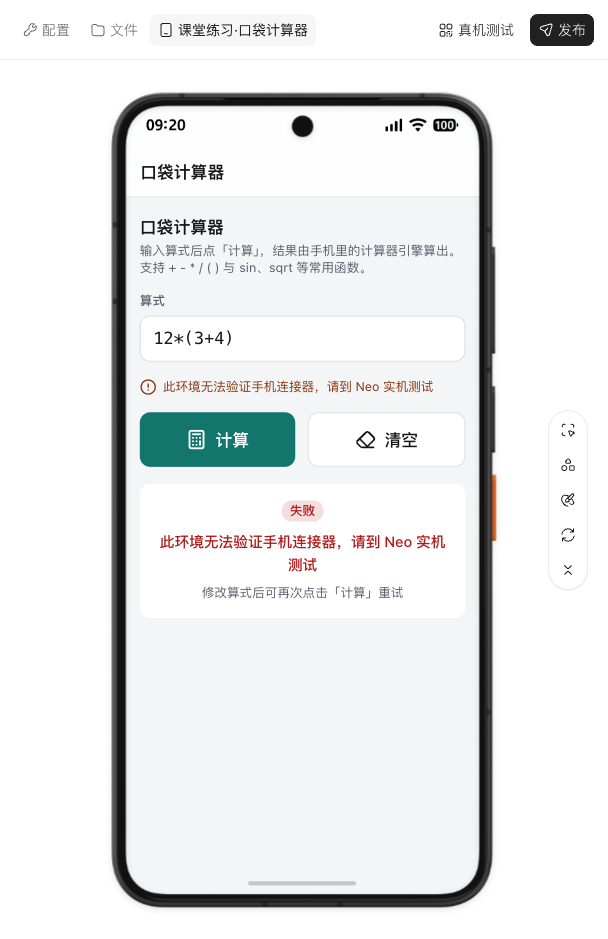

# 课堂案例：口袋计算器

> **已归档：2026-10-20 早期版。** 保留当时的内容与验证记录，接口和界面可能已变化。[阅读新版课程](../../official-step-studio/README.md)。

[课程首页](README.md) · [创建步骤与提示词](01-create.md) · [验收方法](04-test.md)

记录日期：2026-10-20。使用官方 Step Studio 登录账号新建「课堂练习·口袋计算器」，没有修改已有作品。本页只展示课堂内容。

## 从需求到界面

按第一课的需求创建 APP，官方平台生成了单页计算器，默认输入 `12*(3+4)`，提供计算、清空和结果状态区域。

**上图是官方网页里的手机外观预览，不是 Neo 真机照片。** 本次点击计算后，页面明确显示当前环境无法验证手机连接器；没有把预期答案 84 填成已实测结果。

## 确认连接器进入项目

生成完成后，打开 **配置 → 集成**，实际看到了「计算器」卡片。

添加菜单会先插入连接器草稿，生成完成后的集成列表才是本次核对的项目关联证据。它仍不等于手机调用已成功。

## 本次亲自检查的项目

| 检查 | 实际观察 | 结论 |
| --- | --- | --- |
| 页面打开 | 标题、默认算式、计算与清空按钮、状态卡可见 | 网页界面可查看 |
| 点击计算 | 显示需到 Neo 实机测试，并进入失败提示 | 环境限制有明确反馈；未取得真实计算结果 |
| 点击清空 | 输入框被清空 | 清空操作通过 |
| 空输入再点计算 | 显示「请输入算式」，没有持续加载 | 空输入提示通过 |
| 配置 → 集成 | 显示计算器卡片 | 项目关联可见 |
| 真机测试入口 | 出现安卓手机扫码下载弹窗 | 入口可打开；本轮未下载、安装或测试 APK |
| 配置 → 发布和上架 | 状态「未发布」、可见性「未公开」 | 课堂应用未公开发布 |

平台生成说明自述类型检查、构建和内部界面检查通过，其中部分状态使用临时模拟桥验证。本课程没有将这些自述或模拟检查计为独立真机验收。

## 留给读者的下一步

在自己的课堂项目中，通过「真机测试」入口按官方提示进入手机测试。使用正常算式、错误算式与空输入分别检查；确认结果真正来自设备，再填写练习记录。

本次没有验证手机计算结果、三角函数角度/弧度行为、APK 安装和公开发布。其他 30 个连接器练习也未在本轮逐项执行。
