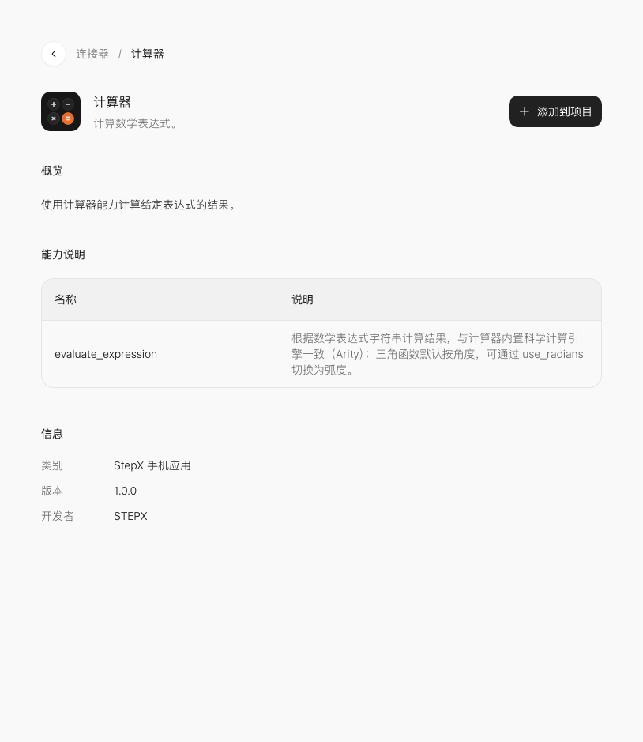

# 01 · 在官方网页创建课堂计算器

[上一课](00-start.md) · [课程首页](README.md) · [下一课](02-connectors.md)

本课产物是一个单页计算器。用它学习最小完整流程：选能力、说需求、生成、检查。

## 1. 选中计算器

打开[官方连接器目录](https://studio.stepx.com/connectors)，搜索「计算器」，进入详情。下图右上角的 **添加到项目** 是入口。



先确认这里真的列出了 `evaluate_expression`。点击「添加到项目」，在弹窗中选择 **创建项目**；已有课堂项目时选那个项目，不要误选正在维护的其他作品。

## 2. 写清楚第一版需求

进入「今天你想构建什么应用？」页面，产物选择 **APP**，在输入区写下面的需求，再点右下角的向上箭头「开始构建」。模型选项可能随账号调整，使用当前可用模型即可。


```text
创建一个名为「课堂练习·口袋计算器」的中文 APP，面向完全不会编程的新手。
只做一个页面：标题、算式输入框、计算按钮、清空按钮和结果卡。默认输入 12*(3+4)。
使用官方「计算器」连接器 evaluate_expression，先读取实际参数说明并确认项目已关联该连接器，不要编造接口。
点击计算时才调用；显示空闲、计算中、成功、失败四种状态，防止重复点击。空输入显示「请输入算式」，不完整表达式显示真实错误。
网页预览若不能调用手机能力，明确显示「此环境无法验证手机连接器，请到 Neo 实机测试」，不要用本地计算结果冒充连接器结果。
不要增加登录、数据库、付费、定位或其他连接器。采用简洁大字按钮，适配手机宽度。
完成后说明实际接入文件、预览方式和未验证事项。
```

上图记录本次实际输入；这里的可复制版本补充了“确认项目已关联”，以便从主页直接开始的读者也能复用。

## 先回应总控的确认

按知识库的应用流程，「总控」负责确认需求、追问细节，再安排助手实现。它询问页面、数据或目标时，按本课的一页计算器范围作答；不要把所有设想一次加入。智能体和技能构建器的流程不同，不能照搬总控这一环节。

可回复：

```text
确认本轮只做一页计算器，不增加账户、支付或后台。
保留刚才列出的正常、空输入、错误输入三类结果。
如果手机连接器不能在网页运行，请明确提示，不改成模拟成功。
```

## 3. 等待第一版，再逐项检查

进入工作台后，左侧是开发对话；右侧可看到 **配置、文件、应用预览、真机测试、发布**。等待本轮生成完成，不要连续发送同一条需求创建多个版本。

先检查标题、默认算式、计算与清空按钮、状态区域是否齐全。接着读[预览与真机验收](04-test.md)。页面画出来仅代表第一步完成。

实际生成结果、检查结果与限制记录在[课堂案例](case-study.md)，与通用教学步骤分开。

流程依据：[官方知识库应用构建器，第 10–11 页](../../official/step-studio-knowledge/02-app-builder.md)；截图与课堂结果仍以本课程案例记录为准。
