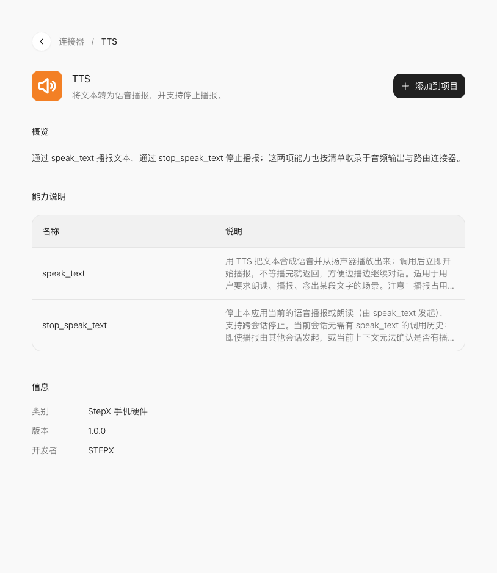
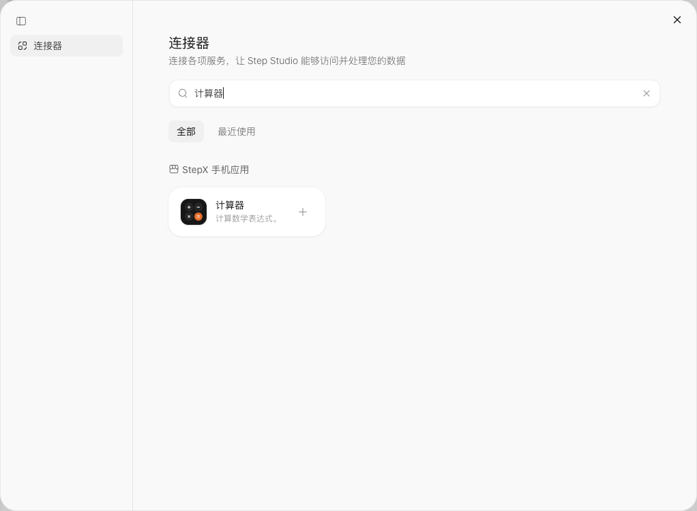

# 02 · 连接器不是一句万能口令

[上一课](01-create.md) · [课程首页](README.md) · [下一课](03-iterate.md)

连接器把应用与具体服务或手机能力接起来。同一个“打开”可能只是打开页面；“查询”返回数据；“修改”会改变设备或记录。先明确需要哪一种。

## 在详情页读懂三件事



1. **概览**：它适合什么场景。TTS 是文字播报，不是语音识别。
2. **能力说明**：有哪些真实方法。TTS 列出 `speak_text` 和 `stop_speak_text`；停止播报不等于暂停其他应用的音乐。
3. **添加到项目**：把需要的能力加入课堂项目。选择现有项目或创建新项目，选择后会把连接器卡片与接入文字放入消息草稿；补充需求并发送后，再检查是否真正关联。仅选中卡片不等于已经接好。

详情页通常不展示完整调用 schema。不要只看方法名猜参数，让 Studio 读取已添加连接器的实际说明再实现。找不到所需能力时，先缩小需求。

## 已有项目的添加路径

在工作台选择 **配置 → 集成 → 添加更多集成**，搜索连接器，点击卡片右侧的加号。它会回到开发对话，插入连接器卡片和「将这个连接器接入」草稿。保留卡片，补充具体要做的功能，再发送。



发送后，检查「配置 → 集成」以及生成结果，不以输入框里出现卡片作为接入完成的依据。


## 从界面到调用的四步

用户点击 → 检查输入 → 调用连接器 → 根据返回更新界面。权限拒绝、空结果、超时都属于正常分支，应该能回到可操作状态。

```text
请核对当前项目是否已关联「TTS」连接器，并读取其实际参数说明。
把「朗读」按钮接到 speak_text，把「停止」按钮接到 stop_speak_text。只朗读文本框中的课堂测试句。
空文本不调用；执行中显示状态，失败保留文本并允许重试。停止按钮只负责本应用的播报。
列出真实调用位置和仍需手机验证的事项，不用模拟播放状态冒充成功。
```

## 本轮先不学什么

高德地图、百度网盘需要开发者申请和配置外部凭证；支付宝涉及收款配置。本轮不提供申请步骤或接入作业，见[暂缓列表](connector-index.md#暂缓不进入本轮练习)。

手机弹出的相机、定位、通知等权限属于设备运行条件，不是让你申请第三方开发者 Key。是否需要权限以实际功能和系统提示为准。
