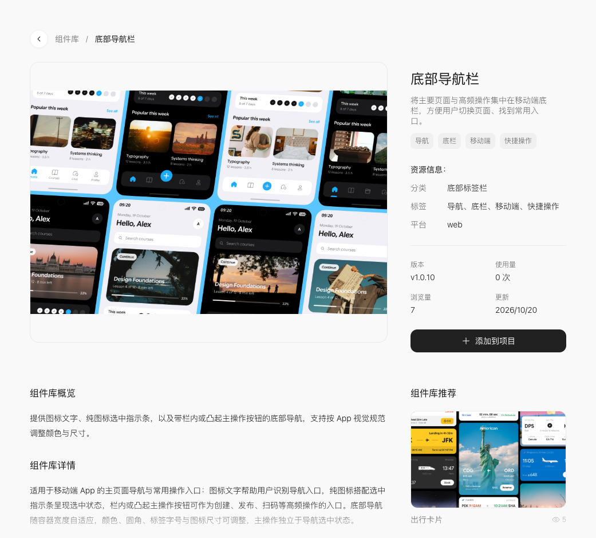

# 底部导航栏：三页作品目录

[新版课程](../README.md) · [8 个组件总表](../components.md) · [官方详情](https://studio.stepx.com/design/components/bottom-tab-bars)

核对日期：2026-10-20；官方版本：**v1.0.10**。下面是教学练习，尚未实际构建或在手机验收。

## 用来做什么

先在首页、作品、我的之间切换，再考虑独立的新增按钮。



上图为本次官网教学区域截图。右侧可核对版本并找到「添加到项目」；展示图属于官方示例，不是本课程已完成作品。

## 跟着做

1. 先完成[第一款应用](../01-create.md)的课堂项目，记住项目名称。
2. 打开上方官方详情，确认名称、用途与版本后点击「添加到项目」。
3. 在实际弹出的项目选择界面选择课堂项目；如先生成带组件的消息草稿，检查组件卡片后再发送。
4. 使用下面的提示词，只修改本课相关界面，保留已完成的功能。
5. 预览后按完成条件逐项检查，再在手机上确认触摸与布局。

## 可复制提示词

```text
在当前课堂项目使用官方「底部导航栏」（核对版本 v1.0.10，若当前版本变化先说明）。
设置首页、作品、我的三个带文字和图标的入口；选中项与当前页面保持一致，底栏避开系统手势区域。
先读取组件实际提供的用法与参数，不猜测导出名称或接口；不要仅把示例图片当成组件。
保留现有功能，只修改相关页面。完成后指出数据来源、交互入口与未完成部分。
```

## 完成条件

逐个点击三个入口；返回后状态正确；长标题和窄屏不遮挡内容。

## 常见问题

导航入口不是提交动作；切换页面时保留搜索词与滚动位置。

如果组件版本不可选，记录当前实际版本后重新阅读其说明，不手写旧接口硬凑。组件外观可见与业务行为成功应分别验证。
