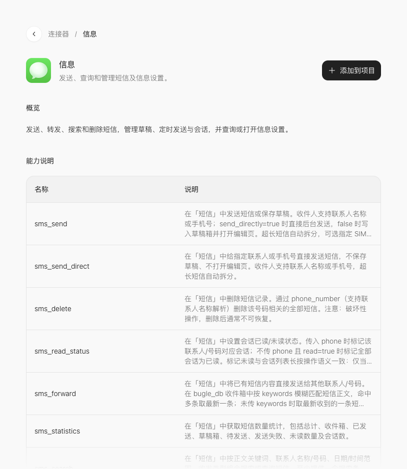

# 信息：短信草稿器

[课程首页](../README.md) · [连接器总表](../connector-index.md) · [添加连接器图解](../02-connectors.md)

阶段 5 · 日程与通信。本课不要求自行申请第三方 API 凭证；手机系统权限仍按实际功能提示处理。

## 这一课做什么

先在应用内编辑收件人与内容，生成确认卡，不默认发送。先做一项可核对的小功能，再扩展页面。

## 在官方页面找到它

打开[官方「信息」详情](https://studio.stepx.com/connectors/ic_atomic_450)，先看概览和能力说明，再点右上角 **添加到项目**，选择课堂项目；没有项目时选择 **创建项目**。



图中是 2026-10-20 官方网页的教学区域截图。能力名称在下方的折叠区可查；参数结构应以项目实际拿到的最新说明为准。

## 动手顺序

1. 用自己的话写清楚输入是什么、按哪个按钮、结果显示在哪里。
2. 将「信息」加入课堂项目；若出现带连接器卡片的消息草稿，保留卡片，补充下面的需求后发送。
3. 先检查界面状态与错误提示，再到支持该能力的环境执行。
4. 按本页验收条件记录结果；有设备行为时，观察手机上的实际效果。

## 本课先用哪些能力

- `sms_draft_save`
- `sms_draft_get`

先围绕这些方法完成上面的最小作品。加入项目后，让 Studio 读取方法的参数、必填字段和返回结构，再把页面输入逐项对应过去；不要直接把自然语言当成参数 JSON。

第一步只制作应用内草稿；需要保存到系统草稿箱时，再使用上述官方草稿能力。保存草稿与发送短信分别验收。

## 可复制提示词

```text
在当前官方 Step Studio 课堂项目中增加「短信草稿器」，使用官方「信息」连接器。
目标：先在应用内编辑收件人与内容，生成确认卡，不默认发送。
先读取已添加连接器的实际能力与参数说明，只使用官方存在的接口；缺少信息时指出缺口，不自行猜测方法或字段。
界面只保留本功能需要的输入、执行按钮、状态和结果。区分未执行、执行中、成功、失败；执行中防止重复点击，失败时保留输入并允许重试。
验收：检查修改收件人和取消流程；真实发送作为独立实机步骤。
范围：不要用真实联系人做公开案例，不把打开确认页写成已送达。
如果当前预览环境不支持该能力，显示明确的环境提示，不用模拟值冒充设备返回结果。
完成后列出改动位置、检查步骤和仍需在手机验证的项目。
```

## 怎么判断完成

检查修改收件人和取消流程；真实发送作为独立实机步骤。

填写一行练习记录：测试环境、输入、预期、实际结果、是否通过。能看到界面不等于调用成功；调用回执也不一定代表最终设备行为已经完成。

## 常见卡点与下一步

不要用真实联系人做公开案例，不把打开确认页写成已送达。

遇到失败，把「输入、点击动作、实际提示、预期结果」交给 Studio 定向修改；不要直接要求重做整个应用。完成后返回[课程路线](../README.md)选择同阶段下一课。

<details>
<summary>本页官方列出的能力名称（检索用）</summary>

- `sms_send`
- `sms_send_direct`
- `sms_delete`
- `sms_read_status`
- `sms_forward`
- `sms_statistics`
- `sms_search`
- `sms_draft_save`
- `sms_draft_get`
- `sms_draft_delete`
- `sms_schedule_send`
- `sms_thread_delete`
- `sms_settings_intelligent_msg`
- `sms_settings_notif_detail`
- `sms_settings_auto_retrieval`
- `sms_settings_risk_url`
- `sms_settings_expired_veri`
- `sms_settings_expired_pickup`
- `sms_settings_delivery_reports`
- `sms_settings_quick_reply`
- `sms_settings_center_num`
- `sms_settings_sim_messages`
- `sms_account_balance_inquiry`
- `sms_data_balance_inquiry`
- `sms_open_personal_list`
- `sms_open_notice_list`
- `sms_open_collected_list`
- `sms_open_settings_page`

这些名称来自官方详情页，并非本课程逐项执行通过的清单。

</details>

本页验证范围：已核对官方详情与截图；练习提示词为研究所编写，未逐课在 Neo 上执行。
