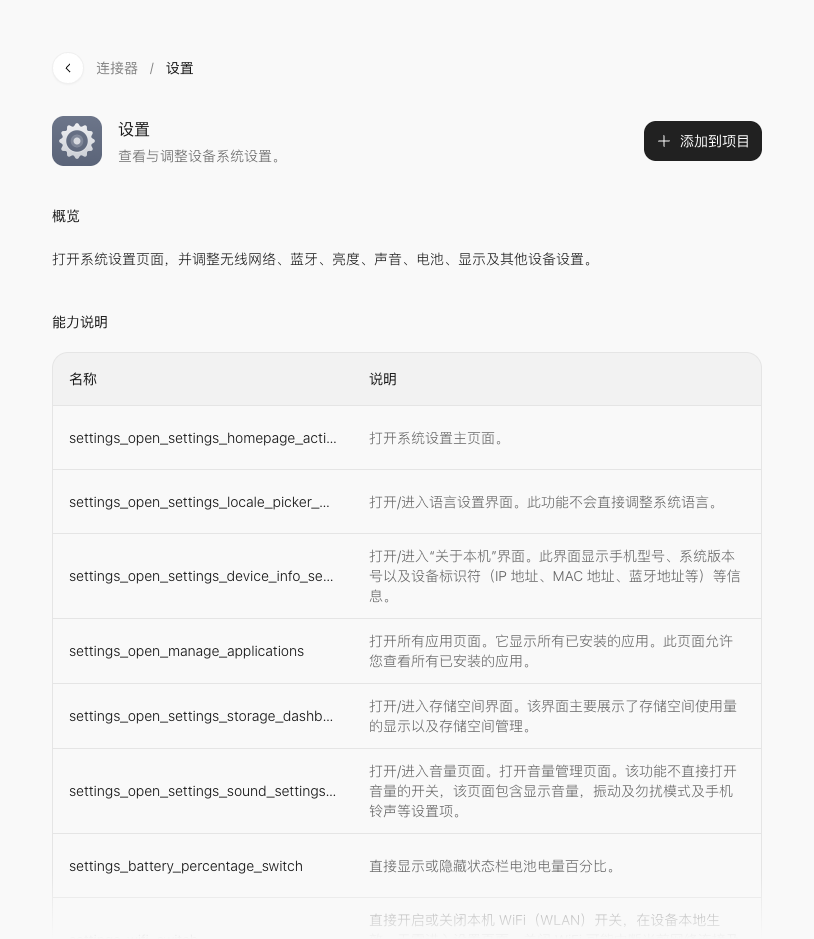

# 设置：设备状态小卡

[课程首页](../README.md) · [连接器总表](../connector-index.md) · [添加连接器图解](../02-connectors.md)

阶段 3 · 系统状态与设置入口。本课不要求自行申请第三方 API 凭证；手机系统权限仍按实际功能提示处理。

## 这一课做什么

只查询电量和深色模式状态，暂不修改设置。先做一项可核对的小功能，再扩展页面。

## 在官方页面找到它

打开[官方「设置」详情](https://studio.stepx.com/connectors/ic_atomic_464)，先看概览和能力说明，再点右上角 **添加到项目**，选择课堂项目；没有项目时选择 **创建项目**。



图中是 2026-10-20 官方网页的教学区域截图。能力名称在下方的折叠区可查；参数结构应以项目实际拿到的最新说明为准。

## 动手顺序

1. 用自己的话写清楚输入是什么、按哪个按钮、结果显示在哪里。
2. 将「设置」加入课堂项目；若出现带连接器卡片的消息草稿，保留卡片，补充下面的需求后发送。
3. 先检查界面状态与错误提示，再到支持该能力的环境执行。
4. 按本页验收条件记录结果；有设备行为时，观察手机上的实际效果。

## 本课先用哪些能力

- `settings_get_current_battery_level`
- `settings_get_dark_mode_state`

先围绕这些方法完成上面的最小作品。加入项目后，让 Studio 读取方法的参数、必填字段和返回结构，再把页面输入逐项对应过去；不要直接把自然语言当成参数 JSON。

## 可复制提示词

```text
在当前官方 Step Studio 课堂项目中增加「设备状态小卡」，使用官方「设置」连接器。
目标：只查询电量和深色模式状态，暂不修改设置。
先读取已添加连接器的实际能力与参数说明，只使用官方存在的接口；缺少信息时指出缺口，不自行猜测方法或字段。
界面只保留本功能需要的输入、执行按钮、状态和结果。区分未执行、执行中、成功、失败；执行中防止重复点击，失败时保留输入并允许重试。
验收：真实值和未知状态分开显示；拒绝或失败时可重试。
范围：不要为了刷新卡片切换系统开关。
如果当前预览环境不支持该能力，显示明确的环境提示，不用模拟值冒充设备返回结果。
完成后列出改动位置、检查步骤和仍需在手机验证的项目。
```

## 怎么判断完成

真实值和未知状态分开显示；拒绝或失败时可重试。

填写一行练习记录：测试环境、输入、预期、实际结果、是否通过。能看到界面不等于调用成功；调用回执也不一定代表最终设备行为已经完成。

## 常见卡点与下一步

不要为了刷新卡片切换系统开关。

遇到失败，把「输入、点击动作、实际提示、预期结果」交给 Studio 定向修改；不要直接要求重做整个应用。完成后返回[课程路线](../README.md)选择同阶段下一课。

<details>
<summary>本页官方列出的能力名称（检索用）</summary>

- `settings_open_settings_homepage_activity`
- `settings_open_settings_locale_picker_activity`
- `settings_open_settings_device_info_settings_activity`
- `settings_open_manage_applications`
- `settings_open_settings_storage_dashboard_activity`
- `settings_open_settings_sound_settings_activity`
- `settings_battery_percentage_switch`
- `settings_wifi_switch`
- `settings_bluetooth_switch`
- `settings_hotspot_switch`
- `settings_airplane_mode_switch`
- `settings_data_switch`
- `settings_vibration_switch`
- `settings_dark_mode_switch`
- `settings_disturb_mode_switch`
- `settings_adjust_sound`
- `settings_adjust_brightness`
- `settings_dialing_keypad_sound_switch`
- `settings_screen_lock_sound_switch`
- `settings_charging_notif_sound_switch`
- `settings_touch_sound_switch`
- `settings_auto_brightness_switch`
- `settings_auto_rotation_switch`
- `settings_one_handed_mode_switch`
- `settings_battery_saver_switch`
- `settings_choose_wifi`
- `settings_forget_wifi`
- `settings_set_screen_off_time`
- `settings_set_media_sound`
- `settings_get_battery_percentage_state`
- `settings_get_wifi_state`
- `settings_get_bluetooth_state`
- `settings_get_hotspot_state`
- `settings_get_airplane_mode_state`
- `settings_get_data_state`
- `settings_get_vibration_state`
- `settings_get_dark_mode_state`
- `settings_get_dialing_keypad_sound_state`
- `settings_get_screen_lock_sound_state`
- `settings_get_charging_notif_sound_state`
- `settings_get_touch_sound_state`
- `settings_get_auto_brightness_state`
- `settings_get_auto_rotation_state`
- `settings_get_one_handed_mode_state`
- `settings_get_battery_saver_state`
- `settings_get_app_lock_state`
- `settings_adjust_font_size`
- `settings_eye_protection_mode_switch`
- `settings_get_current_battery_level`

这些名称来自官方详情页，并非本课程逐项执行通过的清单。

</details>

本页验证范围：已核对官方详情与截图；练习提示词为研究所编写，未逐课在 Neo 上执行。
