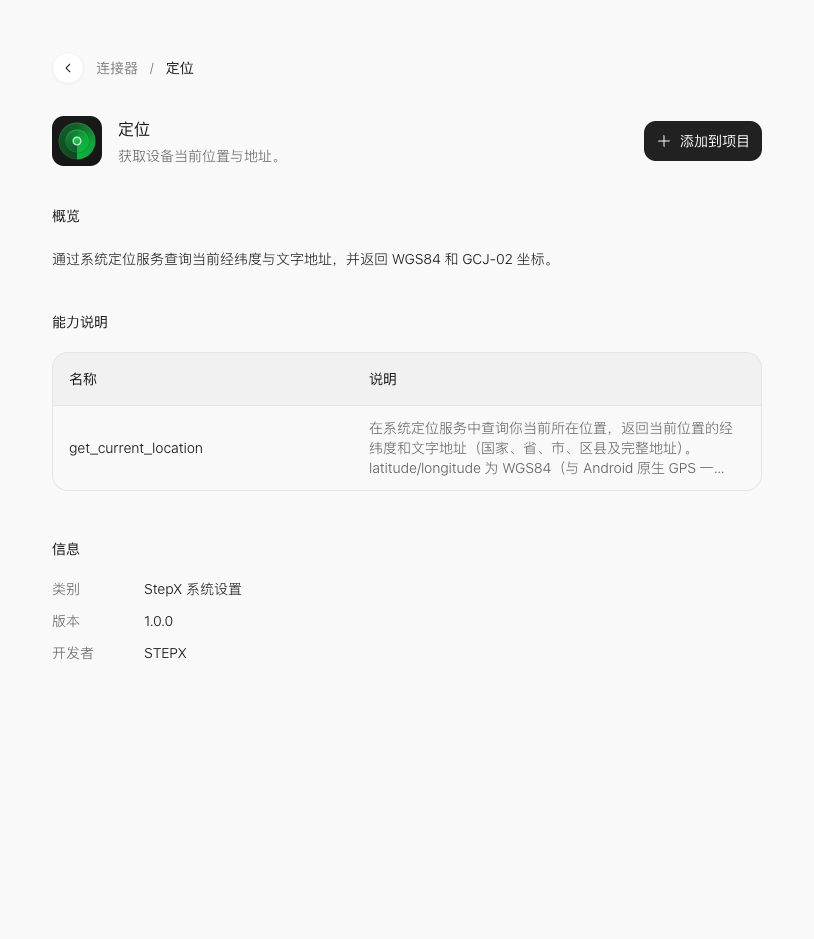

# 定位：位置卡片

[课程首页](../README.md) · [连接器总表](../connector-index.md) · [添加连接器图解](../02-connectors.md)

阶段 4 · 位置与天气。本课不要求自行申请第三方 API 凭证；手机系统权限仍按实际功能提示处理。

## 这一课做什么

用户点击后才请求当前位置，展示文字地址与定位状态。先做一项可核对的小功能，再扩展页面。

## 在官方页面找到它

打开[官方「定位」详情](https://studio.stepx.com/connectors/ic_atomic_473)，先看概览和能力说明，再点右上角 **添加到项目**，选择课堂项目；没有项目时选择 **创建项目**。



图中是 2026-10-20 官方网页的教学区域截图。能力名称在下方的折叠区可查；参数结构应以项目实际拿到的最新说明为准。

## 动手顺序

1. 用自己的话写清楚输入是什么、按哪个按钮、结果显示在哪里。
2. 将「定位」加入课堂项目；若出现带连接器卡片的消息草稿，保留卡片，补充下面的需求后发送。
3. 先检查界面状态与错误提示，再到支持该能力的环境执行。
4. 按本页验收条件记录结果；有设备行为时，观察手机上的实际效果。

## 本课先用哪些能力

- `get_current_location`

先围绕这些方法完成上面的最小作品。加入项目后，让 Studio 读取方法的参数、必填字段和返回结构，再把页面输入逐项对应过去；不要直接把自然语言当成参数 JSON。

## 可复制提示词

```text
在当前官方 Step Studio 课堂项目中增加「位置卡片」，使用官方「定位」连接器。
目标：用户点击后才请求当前位置，展示文字地址与定位状态。
先读取已添加连接器的实际能力与参数说明，只使用官方存在的接口；缺少信息时指出缺口，不自行猜测方法或字段。
界面只保留本功能需要的输入、执行按钮、状态和结果。区分未执行、执行中、成功、失败；执行中防止重复点击，失败时保留输入并允许重试。
验收：分别检查许可、拒绝和不可用分支。
范围：不把演示坐标当成当前位置；不在网页加载时自动查询。
如果当前预览环境不支持该能力，显示明确的环境提示，不用模拟值冒充设备返回结果。
完成后列出改动位置、检查步骤和仍需在手机验证的项目。
```

## 怎么判断完成

分别检查许可、拒绝和不可用分支。

填写一行练习记录：测试环境、输入、预期、实际结果、是否通过。能看到界面不等于调用成功；调用回执也不一定代表最终设备行为已经完成。

## 常见卡点与下一步

不把演示坐标当成当前位置；不在网页加载时自动查询。
这两个连接器均列出 `get_current_location`。一个项目通常先选其中一个，不必为了相同能力重复接入。


遇到失败，把「输入、点击动作、实际提示、预期结果」交给 Studio 定向修改；不要直接要求重做整个应用。完成后返回[课程路线](../README.md)选择同阶段下一课。

<details>
<summary>本页官方列出的能力名称（检索用）</summary>

- `get_current_location`

这些名称来自官方详情页，并非本课程逐项执行通过的清单。

</details>

本页验证范围：已核对官方详情与截图；练习提示词为研究所编写，未逐课在 Neo 上执行。
