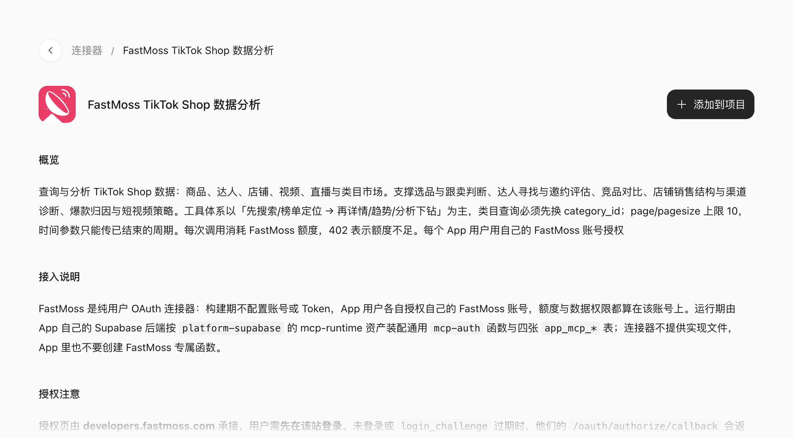

# FastMoss TikTok Shop 数据分析：商品趋势观察卡

[课程导航](../README.md) · [连接器总表](../connector-index.md) · [官方详情](https://studio.stepx.com/connectors/ic_fastmoss)

2026-11-17 核对；官方版本 **1.0.0**，当前能力表 **55 项**。本课提供开发步骤与验收方法，尚未代替你完成授权、调用或真机验收。

## 这一课做什么

选择一个类目，查看已结束周期的商品趋势并显示数据来源。

## 添加与准备

1. 打开官方 Step Studio，新建或进入一个测试用应用项目。
2. 打开「连接器」，搜索「FastMoss TikTok Shop 数据分析」，查看详情后选择「添加到项目」。选择刚建的测试项目。
3. 在项目中添加连接器，选择「网页授权」，由使用者登录自己的服务账号；授权范围与额度随该账号。不要把密码或令牌写入提示词、前端代码。
4. 让 Studio 读取当前连接器说明与参数，先完成一个最小动作。资料不足时先显示待配置，不用假数据冒充成功。



2026-11-17 官方详情页。

## 按顺序实现

先用关键词取得类目标识，查一页商品，再读取选定商品详情和趋势；日期用昨天、上周或上月等已结束周期。

增加前后周期对照；空结果显示未取到数据，不直接写成没有市场需求。

| 起步能力 | 用途 | 当前必填参数 |
| --- | --- | --- |
| `search_category_by_words` | 类目查询 | query |
| `product_search` | 商品搜索 | 无必填字段（仍核对可选项） |
| `product_detail_info` | 商品详情 | filter |
| `product_sales_trend` | 商品趋势 | filter |

参数类型、可选值和返回字段，以项目内当前 schema 为准；复制名字不等于接口已经接通。

## 可复制提示词

```text
使用官方「FastMoss TikTok Shop 数据分析」连接器做「商品趋势观察卡」。
目标：选择一个类目，查看已结束周期的商品趋势并显示数据来源。
先读取当前能力、inputSchema 和返回格式，不猜工具名和参数。
先展示页面及调用计划；只接入实现本目标所需的能力。
先用关键词取得类目标识，查一页商品，再读取选定商品详情和趋势；日期用昨天、上周或上月等已结束周期。
页面显示未连接、执行中、成功、无结果与失败状态；成功以真实返回为准。
修改、发送、支付、删除或批量操作前显示目标与影响，等待确认。
page/pagesize 不超过官方上限 10；402 额度不足时停止调用，交由用户决定。使用返回链接，不猜商品地址。
完成后给我逐项测试方法，并明确哪些只是代码完成、哪些已实际运行。
```

## 验收与下一步

- 正常输入：记录一次调用的输入、真实返回与页面结果；数字、单位和对象相互一致。
- 未授权或拒绝权限：显示需要连接或授权，不能显示成功。
- 空结果、无网络或服务错误：保留可理解的说明，恢复条件后再由用户重试。
- 写操作：只用测试对象；完成后在原服务或手机中读回，不把按钮点击视作成功。

page/pagesize 不超过官方上限 10；402 额度不足时停止调用，交由用户决定。使用返回链接，不猜商品地址。

<details>
<summary>本次官方能力名称（开发者查阅）</summary>

- `product_search`
- `creator_search`
- `shop_search`
- `video_search`
- `live_search`
- `search_category_by_words`
- `search_fastmoss_documents`
- `product_rank_top_selling`
- `creator_rank_top_ecommerce`
- `shop_rank_top_selling`
- `product_detail_info`
- `creator_profile_overview`
- `shop_base_info`
- `video_detail_analysis`
- `video_script_info`
- `product_sales_trend`
- `creator_data_trends`
- `shop_data_trends`
- `product_creator_analysis`
- `market_category_analysis`
- `fastmoss_detail_url_examples`
- `ad_data_overview`
- `ad_search`
- `agency_creator_analysis`
- `agency_product_analysis`
- `agency_product_list`
- `agency_profile_overview`
- `agency_rank_top`
- `agency_search`
- `agency_shop_analysis`
- `creator_cargo_summary`
- `creator_fans_distribution`
- `creator_product_list`
- `creator_rank_top_growth`
- `creator_rank_top_potential`
- `creator_video_analysis`
- `credit_usage_summary`
- `live_detail_analysis`
- `live_products_list`
- `market_category_author_sales_matrix`
- `market_category_ranking`
- `product_category_info`
- `product_investment`
- `product_overview`
- `product_rank_new_listed`
- `product_review_list`
- `product_sku`
- `product_video_list`
- `shop_creator_analysis`
- `shop_investment_analysis`
- `shop_live_analysis`
- `shop_product_analysis`
- `shop_sale_analysis`
- `shop_video_analysis`
- `video_data_trends`

</details>
