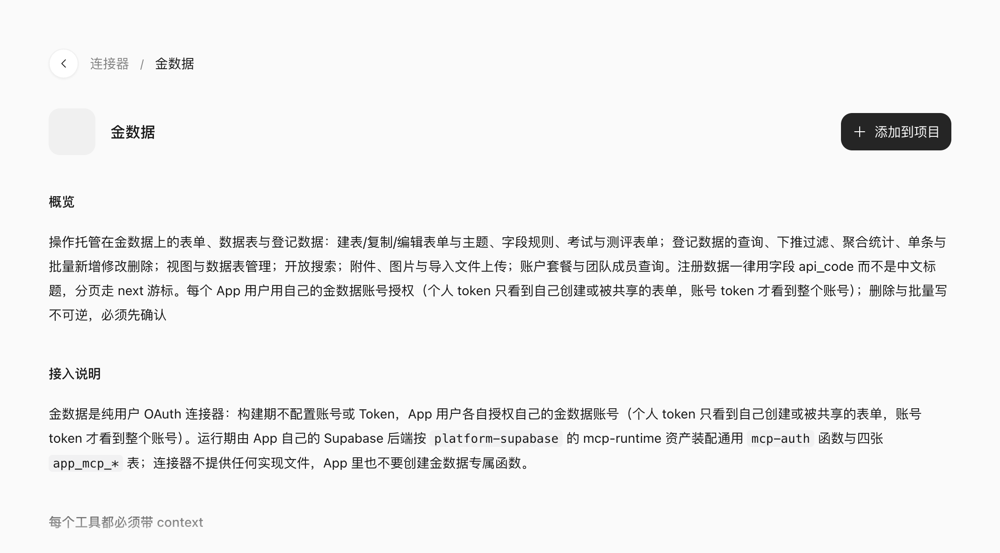

# 金数据：报名统计看板

[课程导航](../README.md) · [连接器总表](../connector-index.md) · [官方详情](https://studio.stepx.com/connectors/ic_jinshuju)

2026-11-17 核对；官方版本 **1.0.0**，当前能力表 **21 项**。本课提供开发步骤与验收方法，尚未代替你完成授权、调用或真机验收。

## 这一课做什么

在授权的测试表单中显示报名总数和选项分布，不公开登记明细。

## 添加与准备

1. 打开官方 Step Studio，新建或进入一个测试用应用项目。
2. 打开「连接器」，搜索「金数据」，查看详情后选择「添加到项目」。选择刚建的测试项目。
3. 在项目中添加连接器，选择「网页授权」，由使用者登录自己的服务账号；授权范围与额度随该账号。不要把密码或令牌写入提示词、前端代码。
4. 让 Studio 读取当前连接器说明与参数，先完成一个最小动作。资料不足时先显示待配置，不用假数据冒充成功。



2026-11-17 官方详情页。

## 按顺序实现

先列表单，再读字段 api_code；只需要总数时调用统计接口，需要分布时聚合，不拉全量答卷。

选择某个字段生成筛选，验证中文字段标题变更后仍按 api_code 正常查询。

| 起步能力 | 用途 | 当前必填参数 |
| --- | --- | --- |
| `list_forms` | 列出表单 | context |
| `get_form` | 获取表单 | form_token, context |
| `count_entries` | 统计登记数 | form_token, context |
| `aggregate_entries` | 聚合统计 | form_token, context |

参数类型、可选值和返回字段，以项目内当前 schema 为准；复制名字不等于接口已经接通。

## 可复制提示词

```text
使用官方「金数据」连接器做「报名统计看板」。
目标：在授权的测试表单中显示报名总数和选项分布，不公开登记明细。
先读取当前能力、inputSchema 和返回格式，不猜工具名和参数。
先展示页面及调用计划；只接入实现本目标所需的能力。
先列表单，再读字段 api_code；只需要总数时调用统计接口，需要分布时聚合，不拉全量答卷。
页面显示未连接、执行中、成功、无结果与失败状态；成功以真实返回为准。
修改、发送、支付、删除或批量操作前显示目标与影响，等待确认。
每次调用按实际 schema 填 context，说明用户目标且不包含个人信息；当前页面列出 21 项能力，正文部分示例提到 65 项，不把未列出的方法当可用。
完成后给我逐项测试方法，并明确哪些只是代码完成、哪些已实际运行。
```

## 验收与下一步

- 正常输入：记录一次调用的输入、真实返回与页面结果；数字、单位和对象相互一致。
- 未授权或拒绝权限：显示需要连接或授权，不能显示成功。
- 空结果、无网络或服务错误：保留可理解的说明，恢复条件后再由用户重试。
- 写操作：只用测试对象；完成后在原服务或手机中读回，不把按钮点击视作成功。

每次调用按实际 schema 填 context，说明用户目标且不包含个人信息；当前页面列出 21 项能力，正文部分示例提到 65 项，不把未列出的方法当可用。

<details>
<summary>本次官方能力名称（开发者查阅）</summary>

- `list_forms`
- `get_form`
- `get_schema`
- `list_entries`
- `get_entry`
- `count_entries`
- `aggregate_entries`
- `get_form_data_summary`
- `list_folders`
- `get_current_user`
- `create_form`
- `edit_form`
- `copy_form`
- `move_form`
- `create_entry`
- `update_entry`
- `check_field_data`
- `prepare_entry_attachment_upload`
- `prepare_form_image_upload`
- `edit_theme`
- `get_current_billing_account`

</details>
