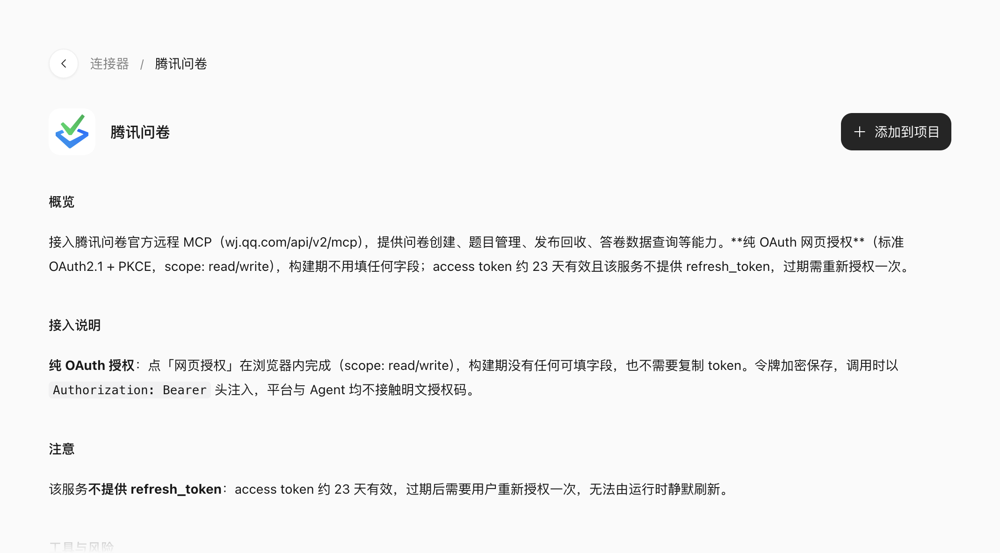

<!--
[INPUT] 官方腾讯问卷能力及 DSL 参数说明。
[OUTPUT] 提供建题、读回与追加练习。
[POS] 办公协作连接器课程。
[PROTOCOL]: Update this header on change, then check AGENTS.md
-->

# 腾讯问卷：三题满意度问卷

[课程导航](../README.md) · [连接器总表](../connector-index.md) · [官方详情](https://studio.stepx.com/connectors/ic_tencent_survey)

2026-11-23 核对；官方版本 **1.0.0**，当前能力表 **9 项**。本课提供开发步骤与验收方法，尚未代替你完成授权、调用或真机验收。

## 这一课做什么

制作不收集姓名和联系方式的三题活动满意度问卷。

## 添加与准备

1. 打开官方 Step Studio，新建或进入一个测试用应用项目。
2. 打开「连接器」，搜索「腾讯问卷」，查看详情后选择「添加到项目」。选择刚建的测试项目。
3. 在项目中添加连接器，选择「网页授权」，由使用者登录自己的服务账号；授权范围与额度随该账号。不要把密码或令牌写入提示词、前端代码。
4. 让 Studio 读取当前连接器说明与参数，先完成一个最小动作。资料不足时先显示待配置，不用假数据冒充成功。



2026-11-17 官方详情页。

## 按顺序实现

先生成三题 DSL 草稿，确认后通过 create_survey 的 text 参数一次创建含题目的测试问卷。取得返回的真实 survey_id 后，调用 get_survey 检查题型、选项和页面。需要追加题目时，再读取目标 page_id，并按 batch_create_question 的 text 参数提交新增题目。

先预览再决定是否开放回收；用测试答卷观察统计，不公开答卷原文。

| 起步能力 | 用途 | 当前必填参数 |
| --- | --- | --- |
| `create_survey` | 创建问卷 | 无必填字段（仍核对可选项） |
| `batch_create_question` | 批量建题 | survey_id, text |
| `get_survey` | 问卷详情 | survey_id |
| `list_answers` | 答卷列表 | survey_id |

参数类型、可选值和返回字段，以项目内当前 schema 为准；复制名字不等于接口已经接通。

## 三题草稿与追加顺序

`create_survey.text` 的第一行是问卷标题。题目之间空一行，选项各占一行。

```text
课堂活动体验调查

你更想练习哪种小应用[单选题]
计数器
作品目录

你希望增加哪些内容[多选题]
图片
声音
图表

你的建议[多行文本题]
```

先用这段文本创建问卷，再读回真实结构。追加练习使用 `get_survey` 返回的 `survey_id` 与目标 `page_id`，把一题 DSL 传入 `batch_create_question.text`，最后再次读回核对题数。

官方参数说明指出，空问卷未指定页面而直接批量加题会出现 `survey_has_no_questions`。本课从含题目的问卷开始。追加时只提交目标页的题目文本，避免把多页 DSL 一次交给只处理第一页的批量接口。

## 可复制提示词

```text
使用官方「腾讯问卷」连接器做「三题满意度问卷」。
目标：制作不收集姓名和联系方式的三题活动满意度问卷。
先读取当前能力、inputSchema 和返回格式，不猜工具名和参数。
先展示页面及调用计划；只接入实现本目标所需的能力。
先生成三题 DSL 草稿，确认后通过 create_survey 的 text 参数一次创建含题目的测试问卷。取得返回的真实 survey_id 后，调用 get_survey 检查题型、选项和页面。需要追加题目时，再读取目标 page_id，并按 batch_create_question 的 text 参数提交新增题目。
页面显示未连接、执行中、成功、无结果与失败状态；成功以真实返回为准。
修改、发送、支付、删除或批量操作前显示目标与影响，等待确认。
该服务令牌过期需重新网页授权，不能假定可静默刷新；删题不作为默认练习。
完成后给我逐项测试方法，并明确哪些只是代码完成、哪些已实际运行。
```

## 验收与下一步

- 正常输入：记录一次调用的输入、真实返回与页面结果；数字、单位和对象相互一致。
- 未授权或拒绝权限：显示需要连接或授权，不能显示成功。
- 空结果、无网络或服务错误：保留可理解的说明，恢复条件后再由用户重试。
- 写操作：只用测试对象；完成后在原服务或手机中读回，不把按钮点击视作成功。

该服务令牌过期需重新网页授权，不能假定可静默刷新；删题不作为默认练习。

<details>
<summary>本次官方能力名称（开发者查阅）</summary>

- `batch_create_question`
- `check_skill_update`
- `create_survey`
- `delete_question`
- `get_survey`
- `list_answers`
- `update_logic`
- `update_question`
- `update_settings`

</details>
