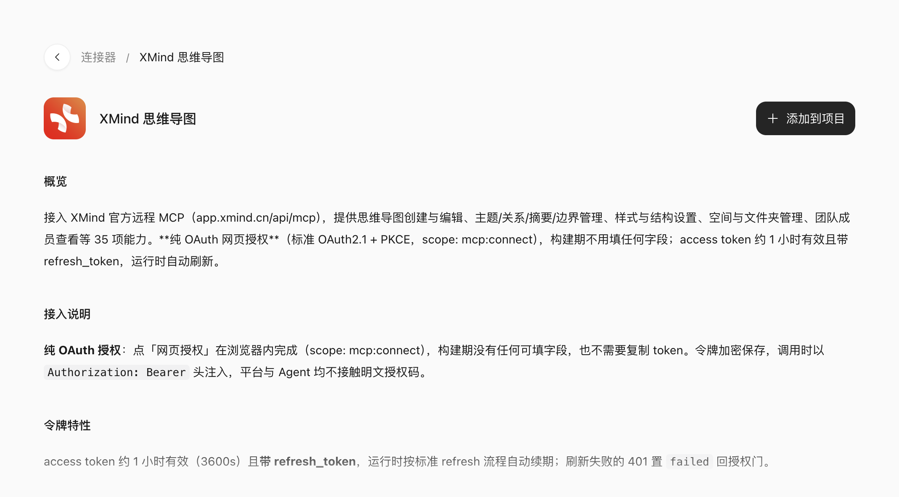

# XMind 思维导图：学习大纲导图

[课程导航](../README.md) · [连接器总表](../connector-index.md) · [官方详情](https://studio.stepx.com/connectors/ic_xmind)

2026-11-17 核对；官方版本 **1.0.0**，当前能力表 **35 项**。本课提供开发步骤与验收方法，尚未代替你完成授权、调用或真机验收。

## 这一课做什么

用一段三层学习大纲生成导图，再读取核对主题层级。

## 添加与准备

1. 打开官方 Step Studio，新建或进入一个测试用应用项目。
2. 打开「连接器」，搜索「XMind 思维导图」，查看详情后选择「添加到项目」。选择刚建的测试项目。
3. 在项目中添加连接器，选择「网页授权」，由使用者登录自己的服务账号；授权范围与额度随该账号。不要把密码或令牌写入提示词、前端代码。
4. 让 Studio 读取当前连接器说明与参数，先完成一个最小动作。资料不足时先显示待配置，不用假数据冒充成功。



图：官方详情页的接入说明与能力列表，2026-11-17。

## 按顺序实现

先读创作指南，再创建；把新导图的链接显示出来。读回主题树并对照输入的层级。

新增分支后再读回核对；初学练习不删除已有导图。

| 起步能力 | 用途 | 当前必填参数 |
| --- | --- | --- |
| `xmind_get_mindmap_guide` | 导图创作指南 | guide |
| `xmind_create_mindmap` | 创建导图 | markdown |
| `xmind_read_mindmap` | 读取导图 | fileId |
| `xmind_show_mindmap` | 展示导图 | fileId |

参数类型、可选值和返回字段，以项目内当前 schema 为准；复制名字不等于接口已经接通。

## 可复制提示词

```text
使用官方「XMind 思维导图」连接器做「学习大纲导图」。
目标：用一段三层学习大纲生成导图，再读取核对主题层级。
先读取当前能力、inputSchema 和返回格式，不猜工具名和参数。
先展示页面及调用计划；只接入实现本目标所需的能力。
先读创作指南，再创建；把新导图的链接显示出来。读回主题树并对照输入的层级。
页面显示未连接、执行中、成功、无结果与失败状态；成功以真实返回为准。
修改、发送、支付、删除或批量操作前显示目标与影响，等待确认。
网页授权后先核对团队；取消授权应回到连接提示。
完成后给我逐项测试方法，并明确哪些只是代码完成、哪些已实际运行。
```

## 验收与下一步

- 正常输入：记录一次调用的输入、真实返回与页面结果；数字、单位和对象相互一致。
- 未授权或拒绝权限：显示需要连接或授权，不能显示成功。
- 空结果、无网络或服务错误：保留可理解的说明，恢复条件后再由用户重试。
- 写操作：只用测试对象；完成后在原服务或手机中读回，不把按钮点击视作成功。

网页授权后先核对团队；取消授权应回到连接提示。

<details>
<summary>本次官方能力名称（开发者查阅）</summary>

- `xmind_whoami`
- `xmind_get_mindmap_guide`
- `xmind_create_mindmap`
- `xmind_list_mindmaps`
- `xmind_list_spaces`
- `xmind_list_folders`
- `xmind_create_folder`
- `xmind_move_file`
- `xmind_rename_file`
- `xmind_rename_folder`
- `xmind_trash_file`
- `xmind_restore_file`
- `xmind_list_teammates`
- `xmind_read_mindmap`
- `xmind_show_mindmap`
- `xmind_get_topic`
- `xmind_edit_mindmap`
- `xmind_set_topic_attrs`
- `xmind_set_topic_image`
- `xmind_add_relationship`
- `xmind_add_boundary`
- `xmind_remove_topic`
- `xmind_remove_annotation`
- `xmind_update_relationship`
- `xmind_add_summary`
- `xmind_add_topic_link`
- `xmind_set_todo`
- `xmind_set_planned_task`
- `xmind_clear_task`
- `xmind_list_sheets`
- `xmind_list_resources`
- `xmind_add_sheet`
- `xmind_set_structure`
- `xmind_set_color_theme`
- `xmind_set_topic_style`

</details>
