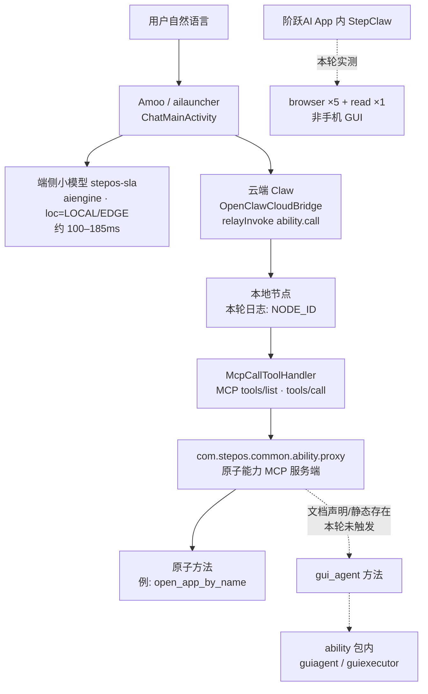
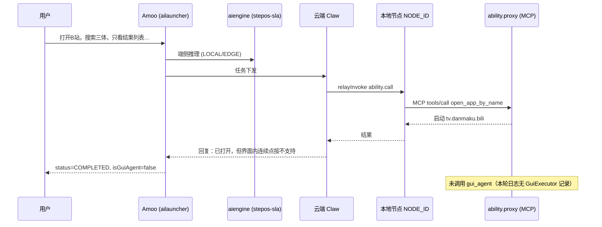

# Amoo 能力研究 · 专业版

> 本文整理自 2026-10-19 研究稿；“本轮”“运行证实”指原稿记录的测试，本次发布未重新开展设备测试。原始日志、截图与固件提取材料未随本文发布。

**作者：** StepX Neo 研究  
**日期：** 2026-10-19（Asia/Shanghai）  
**权威来源：** `findings.md`（本轮）；固件技能文档与历史资料仅作标注口径引用

---

## 0. 范围与证据等级

研究重心是 **Amoo（StepOS 系统级 AI 助手）能力**；GUI 自动化是其中一部分，不是唯一主题。

| 等级 | 含义 | 本轮示例 |
|------|------|----------|
| **运行证实** | 本轮真机日志/界面观察到调用与结果 | `open_app_by_name`、`common_ability_get_app_list`；Amoo 自述不支持连续点按 |
| **静态存在** | APK/字符串/类/权限/内置 md 存在，本轮未触发执行 | `gui_agent` 文档与 GUI 相关类；A2A 支付宝相关类 |
| **文档声明** | `android-abilities/*.md` 写明 method/params | 13 类目数百个 method 名 |
| **历史资料** | `local/` 2026-10-17/18 清单与报告 | Excel 104 方法/29 应用；HTML 69 应用；能力清单 v4 |

**硬性区分：**

- **Amoo 对话入口** = `com.stepos.ailauncher`（ChatMainActivity）  
- **阶跃AI / 跃问 App** = `cn.yuewen.ywapp`（**不是**阅文阅读 App）  
- **StepClaw 入口** = 可在阶跃AI App 内部署的 Claw 对话；端侧包 `com.stepos.stepclaw`

下文凡不确定处写 **未验证**，不推断灰度原因。

---

## 1. 架构与调用链

### 1.1 逻辑架构（本轮运行观察 + 固件静态）



### 1.2 调用链逐步（第二次实测摘要 · 运行证实）

1. 用户在 Amoo 输入约束完整的 B 站任务。  
2. `AIEngine` 审计：`ability=stepos-sla`，`loc=LOCAL` / `EDGE`，`pkg=com.stepos.ailauncher`。  
3. `AgentChatLayout.onFirstAssistantResponse isGuiAgent=false`。  
4. `OpenClawCloudBridge: Cloud claw relayInvoke ability.call` → `local node invoke : ability.call → node=NODE_ID`。  
5. `McpCallToolHandler` → `servicePkg:com.stepos.common.ability.proxy`，`toolName:open_app_by_name`。  
6. `ActivityTaskManager` 启动 `tv.danmaku.bili/.MainActivityV2`。  
7. `AgentSession ... status=COMPLETED`；助手文本声明无法界面内连续点按（截图 `s4s.png`）。

### 1.3 时序：试验 2（Amoo × B 站 · 运行证实）



**MCP 与 GUI 关系（findings 结论）：** MCP 是工具协议；`gui_agent` 在文档中亦是 proxy 暴露的一个 ability 方法，即「GUI 被包装成 MCP/ability 工具」。本轮该工具**未被调用**。

---

## 2. 包、版本与权限

### 2.1 关键系统包（versionName · findings）

| 包名 | 版本 | 角色（摘要） |
|------|------|----------------|
| `com.stepos.ailauncher` | — | Amoo 本体/AI 桌面；ChatMainActivity、AssistantService、WakeService、AIHOmeBarService |
| `com.stepos.ability` | — | AgentService、VoiceWakeupService、TaskRobotService（运行中）；含 `stepai.aios.guiagent`、`guiexecutor.api`；官方 MCP Java SDK |
| `com.stepos.common.ability.proxy` | — | 原子能力 MCP 服务端（运行证实）；`GuiAgentAbilityAdapter`；支付宝 A2A 实现类 |
| `com.stepos.aiengine` | — | AIEngineManagerService；`GuiAgentAbility`（doInfer/doFlowInfer）；stepos-sla 推理日志 |
| `com.stepos.stepclaw` | — | ClawX / 端侧 OpenClaw 网关；GatewayForegroundService；assets 内 android-abilities |
| 其他 | `agentbus` 等 | agentpack、agentcache、alphame、agentsafetycenter 等 |


### 2.2 系统特权（静态 · findings）

`ability` / `stepclaw` / `agentbus` / `aiengine` 共用系统共享 UID，已授予包括但不限于：

`INJECT_EVENTS`、`READ_FRAME_BUFFER`、`CAPTURE_VIDEO_OUTPUT`、`CAPTURE_SECURE_VIDEO_OUTPUT`、`ACCESS_SURFACE_FLINGER`、`REAL_GET_TASKS`、`INTERNAL_SYSTEM_WINDOW`、`BIND_ACCESSIBILITY_SERVICE`

→ findings 推论：GUI 执行**可不依赖**无障碍服务。因 GUI 未触发，运行层**未验证**。

### 2.3 ability 包内 GUI 相关符号（静态存在）

- guiagent：`StepGelabModelCell`、`StepPlanTreeModelCell`、`LocalInferenceEngine`/`LocalLlmService`、`GuiAgentTraceManager`  
- guiexecutor.api：`GuiActionExecutor`、`GuiCommand`、`TouchAction`、`GestureType`、`ScrollDirection`、`SystemNavigationAction`、`InputMethod`、`ElementSelector`、`AccessibilityNodeInfo` 查询、`WaitCondition`、`FailurePolicy`、`ValidationResult`、`BatchGuiResult`  
- 字符串：`long_click`、`input_text`、`screenshot`、`gui_agent_call`  
- **未见**对外公开的独立 click/swipe 原子 GUI 工具文档；对外是高层 `gui_agent(app_name, task)`。

---

## 3. MCP / ability.list / ability.call 格式

来源：`android-abilities/SKILL.md`、`gui_agent.md`（文档声明）。

### 3.1 发现

```
nodes action=invoke node="<节点ID>" invokeCommand="ability.list" invokeParamsJson='{"query":"<一句话描述用户意图>"}'
```

从返回的 `abilities[].method` **原样复制**方法名，禁止猜测。

### 3.2 调用

```
nodes action=invoke node="<节点ID>" invokeCommand="ability.call" invokeParamsJson='{"method":"<方法名>","params":{...}}'
```

耗时操作（如 gui_agent）**必须**：

```
invokeTimeoutMs=600000
```

### 3.3 必填字段

| 字段 | 要求 |
|------|------|
| `action` | `"invoke"` |
| `node` | 真实节点 ID；先 `nodes action="status"`；**禁止 `node="auto"`**（否则 `node required`） |
| `invokeCommand` | `ability.list` 或 `ability.call` |
| `invokeParamsJson.method` / `params` | 无参传 `{}` |

禁止绕过 ability 层直接调底层 nodes action（如文档点名的 `location_get`、`camera_snap`）。

### 3.4 本轮实际 MCP 工具名（运行证实）

| toolName | 结果 |
|----------|------|
| `open_app_by_name` | 失败：目标APP不存在「阅文」（code=10001）；成功：打开 `cn.yuewen.ywapp`、`tv.danmaku.bili` |
| `common_ability_get_app_list` | 成功调用（用于纠正应用名） |

云端中继日志关键字：`OpenClawCloudBridge: Cloud claw relayInvoke ability.call` / `local node invoke : ability.call → node=NODE_ID`。

---

## 4. gui_agent 接口规格与路由规则

### 4.1 接口（`gui_agent.md` · 文档声明）

| 项 | 内容 |
|----|------|
| method | `gui_agent` |
| 来源 | `com.stepos.common.ability.proxy` |
| params | `app_name` (string, Required)；`task` (string, Required，自然语言含约束) |
| 超时 | `invokeTimeoutMs=600000` |
| 错误 | `node required` / `gateway timeout after 30000ms` / `ABILITY_NOT_FOUND`（用 ability.list 查） |

模板：

```
nodes action="invoke" node="<节点ID>" invokeCommand="ability.call" invokeTimeoutMs=600000 invokeParamsJson='{"method":"gui_agent","params":{"app_name":"<App中文名>","task":"<详细任务描述，含约束条件>"}}'
```

### 4.2 路由规则（`SKILL.md` · 文档声明）

1. 第三方 App 内任何屏幕交互（搜/浏览/加购/下单/关注/评论等）→ **立即 read `gui_agent.md`**，不能只 `open_app_*`。  
2. 「打开 B 站搜 xxx」也走 gui_agent。  
3. `app_device` 范围极窄：仅纯启动、日历、音乐、剪贴板、卸载、Widget、计算器、录音机、工具箱、反馈等。  
4. 提醒/待办：有明确时间 → `app_device` 日历；无明确时间 → `file_memory` 待办/笔记。  
5. 类目路由器**只返回类目 ID**；method 必须从对应 `.md` 读取。

### 4.3 本轮运行对照

| 期望（文档） | 实际（运行证实） |
|--------------|------------------|
| B 站内搜索 → gui_agent | Amoo 仅 `open_app_by_name`；`isGuiAgent=false` |
| 显式「用 gui_agent…」 | StepClaw 入口走 browser×5+read×1；无本地 GUI 节点调用 |
| 日志应有 GuiExecutor / gui_agent | 缓冲约 8.5 万行 + 测试期约 1.8 万行，**均无** |

结论（findings）：代码、模型单元、特权、技能文档都在；两入口未触发；Amoo 自述不支持 → **原稿所述测试中已内置但未触发（或被灰度/开关关闭）**。原因 **未验证**。

---

## 5. A2A 发现

- **静态存在：** `com.stepos.common.ability.proxy` 含支付宝 A2A：`A2ARequestBuilder`、`A2AResponseParser`、`AgentCard`、JSON-RPC 与 SSE、`enter/exitA2aCommunicationScene`。  
- **范围：** findings 写明限于支付宝场景。  
- **本轮：** **未运行验证**。

---

## 6. 十三类目与代表性 method（文档声明）

方法计数为各类目 md 中显式列出的 method/工具名，**≠ 实时注册数**。

| 类目 | 约数 | 代表性 method |
|------|------|----------------|
| system_settings | ~121 | `settings_wifi_switch`、`settings_set_brightness`、`screen_capture_screenshot` |
| phone_comm | ~80 | `dialer_call_to`、`sms_send`、`sms_query` |
| media_gallery | ~51 | `gallery_intelligent_search`、`gallery_create_highlight_task` |
| app_device | ~40 | `open_app_by_name`、`calendar_add_event`、`app.openUrl` |
| file_memory | ~31 | `phone_note_todo_add`、`file_safe_delete`（动态 ability.list） |
| contacts | ~22 | `dialer_contacts_query`、`dialer_add_number_to_blocked_list` |
| map_navigation | ~18 | `get_current_location`、`maps_weather`、`maps_text_search`（多云侧） |
| scheduled_tasks | ~14 | `alarm_clock_add`、`cron create`（云侧） |
| session_runtime | ~12 | `sessions_list`、`assistant_change_voice_id`、`exec`（云侧） |
| web_search | ~6 | `web_search`、`fetch_trending_news`（云侧） |
| log_report | 2 | `start_record_log`、`stop_record_log` |
| gui_agent | 1 | `gui_agent` |
| （+ TOOL-SPEC） | — | `stepclaw.exec`：ls/stat/find/read/write/pull/push… |

StepClaw 平台约束（`openclaw-config/references/stepclaw-platform-constraints.md` · 文档声明）：chroot 与宿主共享网络；端口 18789 Gateway / 18790 webhook / 18791 LLM 代理；`gateway.auth.mode` 须为 token 等——**本轮未改配置、未验证认证握手**。

---

## 7. 三次实测过程与日志证据

### 7.1 试验 1 — Amoo ×「阅文」搜索

| 项 | 内容 |
|----|------|
| 入口 | Amoo ChatMainActivity |
| 现象 | `open_app_by_name`×2 失败「阅文」→ `common_ability_get_app_list` → `open_app_by_name` 启动 `cn.yuewen.ywapp`（阶跃AI/跃问） |
| GUI | `isGuiAgent=false`；App 内无操作 |
| 证据 | `run_trace_redacted.txt` 对应时段；findings §运行实测.1 |

### 7.2 试验 2 — Amoo × B 站约束搜索

| 项 | 内容 |
|----|------|
| 调用 | 仅 `open_app_by_name` → `tv.danmaku.bili` |
| 助手原话要点 | 已打开；搜索不可执行；不支持界面内连续点按；无直达搜索深链 |
| 证据 | `s4s.png`；trace 中 bili MainActivityV2；COMPLETED |

### 7.3 试验 3 — StepClaw × 显式 gui_agent

| 项 | 内容 |
|----|------|
| 入口 | 阶跃AI App 内 StepClaw |
| 工具卡片 | browser×5 + read×1（`s11s.png`） |
| 前台 | ~3 分钟未离开阶跃AI；未启动 B 站 |
| 本机日志 | 无本地节点 gui 调用 → 结果来自云端/桌面浏览器 |

### 7.4 去标识日志摘录（结构保留）

```
AIEngine_Inference_*: ability=stepos-sla loc=LOCAL|EDGE status=SUCCESS e2eMs≈100–185
Amoo/.../AgentChatLayout: onFirstAssistantResponse isGuiAgent=false
OpenClawCloudBridge: Cloud claw relayInvoke ability.call
OpenClawCloudBridge: local node invoke : ability.call → node=NODE_ID
McpCallToolHandler: servicePkg:com.stepos.common.ability.proxy toolName:open_app_by_name|common_ability_get_app_list
McpError code=10001 目标APP不存在: 阅文
ActivityTaskManager: START ... pkg=cn.yuewen.ywapp | tv.danmaku.bili
AgentSession: status=COMPLETED
```

（已去除 messageId / traceId / session 细节；去标识后的完整摘录见 `pack/run_trace_redacted.txt`。）

### 7.5 界面截图证据

> 原稿引用的两张界面截图未随本文提供；此处保留文字描述。

---

## 8. 历史资料口径（禁止与本轮混用）

| 资料 | 日期 | 数字/要点 | 用法 |
|------|------|-----------|------|
| Amoo能力清单 PDF v4 | 2026-10-17 | 购物/出行/社交概述；边界写明「无法在应用界面内像真人一样连续点按」 | 产品概述，非 method 表 |
| 手机应用 MCP 对照 HTML | 2026-10-17 | 69 第三方：11 直接 / 5 间接 / 53 未接入 | 粗分类 |
| 已对接应用能力明细 Excel | 2026-10-18 01:14 CST | **104** 方法 / **29** 应用服务；验证状态多为「历史能力检索回执」 | 路由草案；≠实时 |
| 晚间 AI 测试报告 | 2026-10-17 | 84 主场景；80 判定：37/34/3/5/1… | 历史场景，非本轮复测 |
| Amoo应用控制 README | 2026-10-18 | 曾称对 gui_agent 精确查询 `results: []`；原生打开计算器、飞行模式查询通过；自定义技能未安装 | 历史；本轮未重复 ability.list |

`综合速查与差异.md`：**69、29、104 不是同一统计口径，不能相加。**

---

## 9. 未知项与不下结论之处

1. gui_agent 未开放的**具体原因**（服务端开关 / 账号权限 / 灰度 / 注册表缺失）— **未验证**。  
2. 本轮**未执行** `ability.list` 查询 gui_agent 是否注册。  
3. A2A 支付宝链路 — 仅静态，**未运行验证**。  
4. 关闭无障碍时 GUI 执行器是否真可注入 — 特权静态存在，**运行未验证**。  
5. 文档数百 method 的**实时注册与业务成功率** — 未逐条测。  
6. 完全断网下原子能力可用性 — **未验证**（历史报告有断网失败记载，口径不同）。  
7. GELab-Zero 静态代码风险（`shell=True` 拼接、空格转下划线）— findings 记为**未复现**。  
8. 云端 browser 返回的 B 站列表与 App 内一致性 — 未做逐条比对。

---

## 10. 复现教程（ADB 只读核验 · 通用占位符）

> 仅只读观察与对话触发；不 ROOT、不改权限、不装持久 APK。占位符：`<DEVICE>` 指代目标设备，`<WORKDIR>` 指代本地工作目录。

### 10.1 准备

```bash
adb devices
# 确认仅连接预期设备；下文以 <DEVICE> 指代

adb -s <DEVICE> shell getprop ro.build.version.release
adb -s <DEVICE> shell getprop ro.build.version.sdk
adb -s <DEVICE> shell getprop ro.build.display.id
adb -s <DEVICE> shell getprop ro.product.brand
adb -s <DEVICE> shell settings get secure enabled_accessibility_services
```

### 10.2 包版本

```bash
for p in com.stepos.ailauncher com.stepos.ability com.stepos.common.ability.proxy \
         com.stepos.aiengine com.stepos.stepclaw com.stepos.agentbus; do
  adb -s <DEVICE> shell dumpsys package "$p" | grep -E 'versionName|versionCode' | head -5
done
```

### 10.3 清日志并开窗口（可选）

```bash
adb -s <DEVICE> logcat -c
adb -s <DEVICE> logcat -v threadtime \
  | tee "<WORKDIR>/logcat_raw.txt"
# 另开终端用关键词过滤副本（勿把完整私人聊天打进报告）：
# OpenClawCloudBridge|McpCallToolHandler|isGuiAgent|stepos-sla|gui_agent|GuiExecutor
```

### 10.4 触发对话（推荐手工；若用输入辅助须知会占用剪贴板）

1. 打开 Amoo 对话，输入试验 2 同款提示词。  
2. 观察是否仅打开 B 站、助手是否声明不支持连续点按。  
3. （可选）打开阶跃AI → StepClaw，输入「用 gui_agent在B站里搜索…」，观察工具卡片是否为 browser/read。

### 10.5 前台与启动证据

```bash
adb -s <DEVICE> shell dumpsys activity activities | grep -E 'mResumedActivity|topResumedActivity' | head
# 或在 logcat 中检索 ActivityTaskManager START ... tv.danmaku.bili / cn.yuewen.ywapp
```

### 10.6 静态抽查（可选 · 需本机已有包拆解副本时）

在**已提取的** stepclaw assets 中核验 `android-abilities/gui_agent.md` 与 `SKILL.md` 路由段落；与 `pack/stepclaw-skills/` 对照。不要在报告中粘贴设备上的私人文件路径内容。

### 10.7 清理

若曾向 `/data/local/tmp` 推送临时输入工具，测后删除；勿留持久后门。

---

## 11. 提示词工程建议

### 11.1 原子能力（当前有效路径）

- 单意图、单动词：「打开…」「把亮度…」「加日程：时间+标题」。  
- App 名用桌面显示名；失败时先「列出已安装应用」。  
- 高风险动作加约束：「先草稿不要发送」「不要删除」。

### 11.2 避免误路由

| 用户说法 | 文档期望路由 | 本轮实际风险 |
|----------|--------------|--------------|
| 「打开 B 站搜 xxx」 | gui_agent | 易变成只 open_app；或 StepClaw 走 browser |
| 「用网页查 B 站上的 xxx」 | web_search | 更贴近真实可用路径 |
| 「提醒我」无时间 | file_memory | 勿写成日历 |
| 「打开浏览器访问 URL」 | app_device / `app.openUrl` | 勿指望桌面 browser 工具控手机 |

### 11.3 若未来 gui_agent 开放时的 task 写法（文档示例风格）

```
app_name: 美团
task: 搜索附近奶茶店，选评分最高的，点一杯招牌奶茶加到购物车，不要下单
```

把地址、人选、**禁止项**写进 task。当前环境下此类提示**不能**当作可复现成功案例。

---

## 12. 下一步路线（与 findings 对齐）

1. **只读：** 经 StepClaw 会话对节点 `ability.list`，`query` 如「在第三方App内操作」，检查是否返回 `gui_agent`。可逆、不改系统。  
2. **若不可用：** 评估电脑端 **GELab-Zero + ADB** 补齐 GUI（独立方案；注意 findings 所提静态代码风险，**未复现**）。  
3. **再评估** 手机端执行服务是否必要。  
4. **风险：** 任意 GUI 自动化涉及误触支付/社交；需人机确认策略。技能私装路径（历史 README）普通 ADB 无权写入系统技能目录——**勿**为安装去 ROOT。

---

## 13. 参考路径（素材）

- `findings.md`  
- `pack/stepclaw-skills/android-abilities/`、`pack/TOOL-SPEC.md`  
- `pack/run_trace_redacted.txt`、`pack/s4s.png`、`pack/s11s.png`、`pack/s3s.png`  
- `pack/stepclaw-skills/openclaw-config/references/stepclaw-platform-constraints.md`  
- `local/综合速查与差异.md` 等历史口径

---

*作者：StepX Neo 研究 · 2026-10-19*
