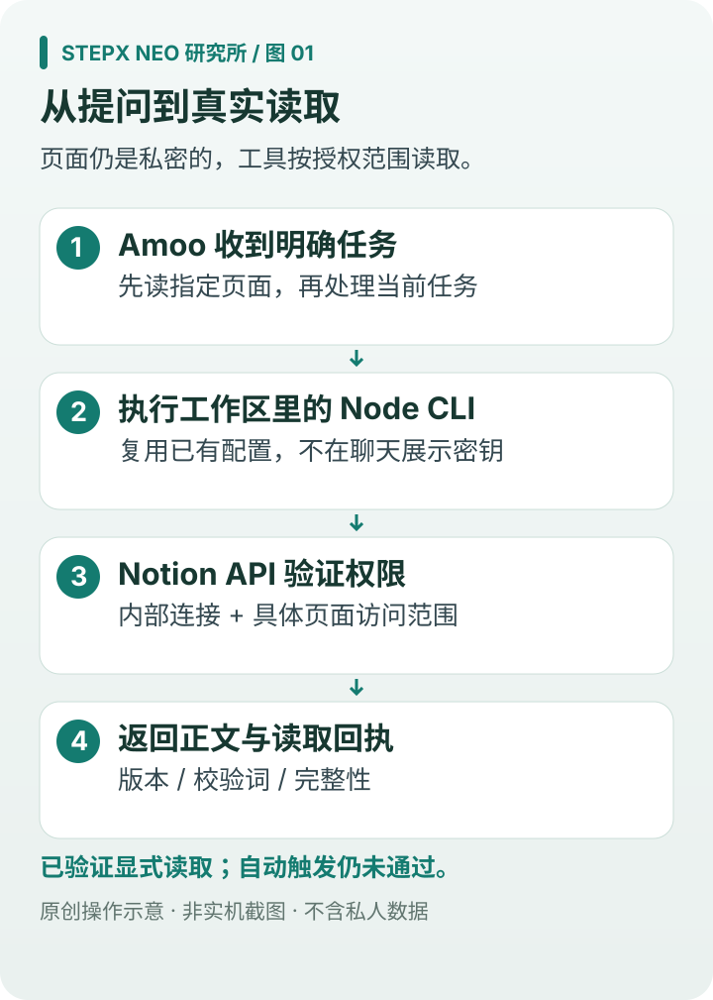
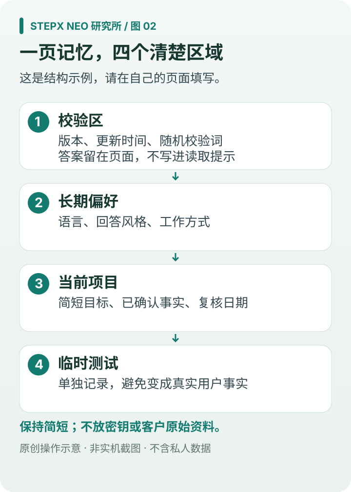
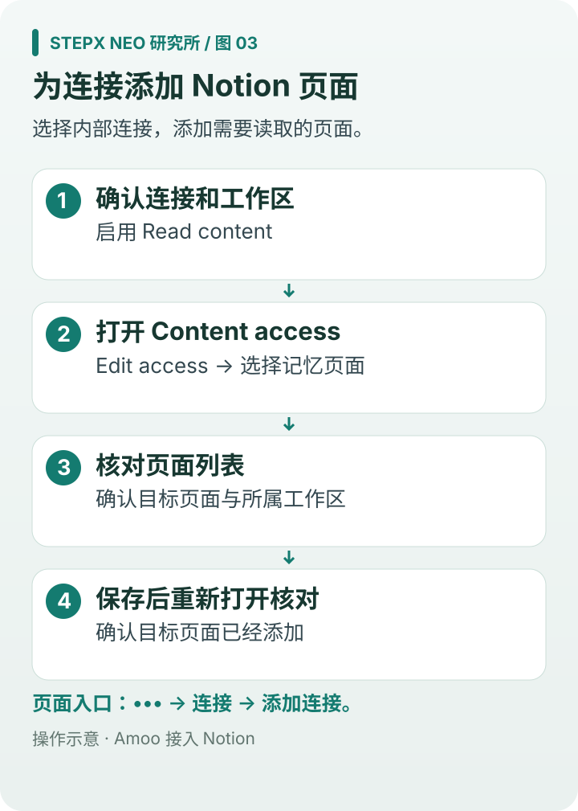
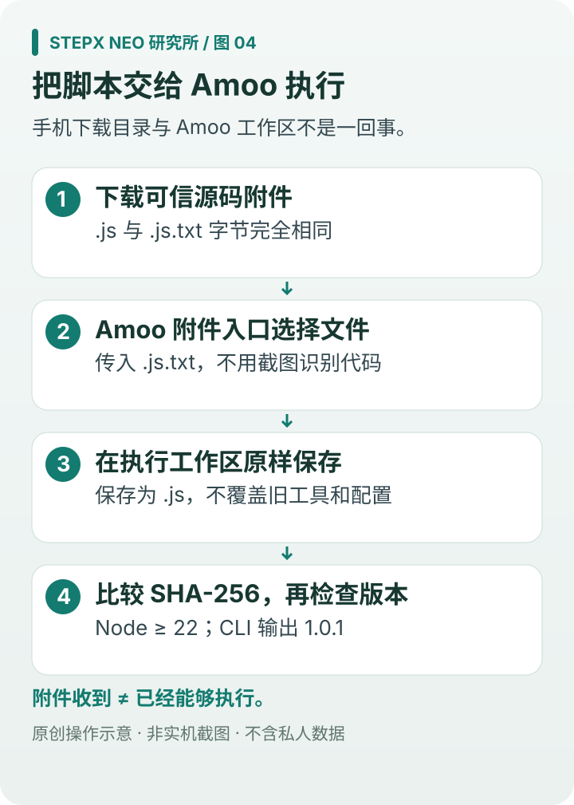
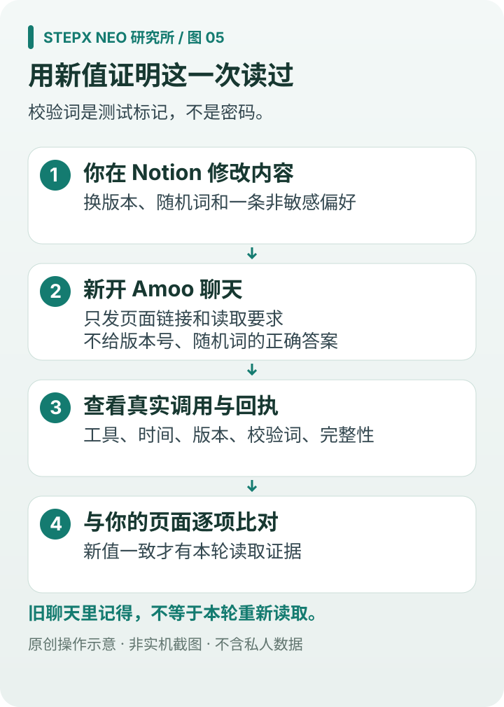
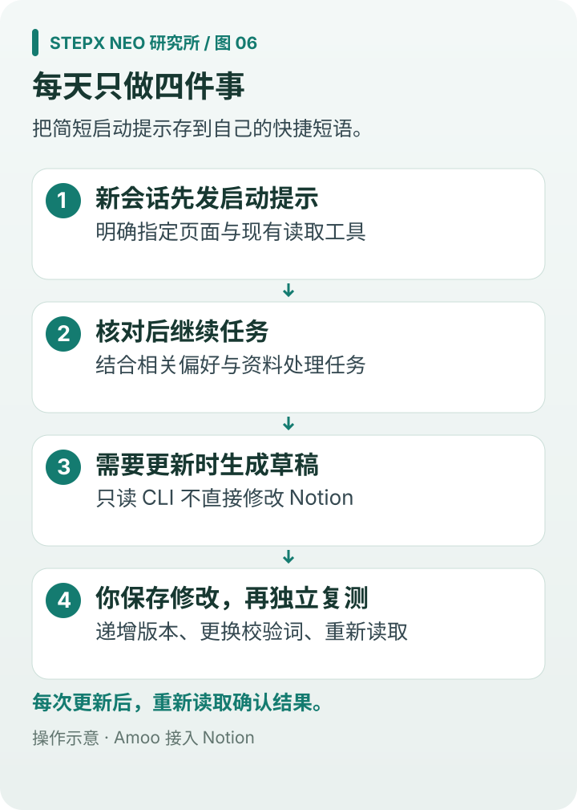

# Amoo 接入 Notion：图文教程与可复用提示词

让 Amoo 在任务开始时读取你维护的 Notion 页面，结合最新偏好和项目资料处理任务。

**v1.0.1 · 2026-10-18 · StepX Neo 研究所**

[返回研究所](../../README.md) · [复制提示词](prompts.md) · [记忆页面模板](templates/memory-page.md) · [下载 CLI](../../downloads/amoo-notion/README.md) · [离线图文版](https://github.com/JiayuStudio/stepx-neo-lab/releases/download/amoo-notion-v1.0.1/Amoo-Notion-Guide-v1.0.1.html) · [实测记录](verification.md)

## 功能与准备条件

本教程使用 **Amoo → Node CLI → Notion API**，支持读取页面、按标题搜索和查询数据库。日常使用在手机上完成。

| 项目 | 状态或要求 |
| --- | --- |
| 指定页面读取、新聊天复用配置 | 已在 STEPX Neo 上通过 |
| 执行环境 | Amoo 支持附件读取、命令执行和 Node.js 22+ |
| Notion 连接 | 内部连接具备 Read content 能力，并获准访问目标页面 |
| 首次配置 | 需要执行环境中的凭据设置或可交互终端 |
| 每个新聊天自动读取 | 当前未通过，使用手动启动提示 |
| 修改 Notion 内容 | 当前 CLI 只读，更新时生成草稿后手动粘贴 |

全新 Neo 从零开始的纯手机首次配置尚未完整独立复测；已有配置后的手机读取与跨聊天复用已通过。配图为操作示意，菜单名称以实际版本为准。



## 1. 建立 Notion 工作记忆页

在手机 Notion App 或浏览器中新建页面，例如 **Amoo 工作记忆**。

1. 打开 [页面模板](templates/memory-page.md)，复制到 Notion。
2. 填写使用语言、回答风格、常用工具等长期偏好。
3. 在“当前项目”填写目标、进度与待处理事项。
4. 在校验区填写版本号、更新时间和一个自选校验词；以后用它们判断 Amoo 是否读取了新版。
5. 复制页面链接，保存到快捷短语中。

把日常需要的信息集中在这一页，子页面可按需单独读取。



## 2. 检查 Amoo 的执行环境

先发送 [P0：环境检查](prompts.md#p0)，根据结果继续：

| 检查结果 | 下一步 |
| --- | --- |
| 已有 CLI，配置就绪 | 复用现有入口，检查页面访问后直接读取 |
| 有 Node 22+ 和附件读取，尚无 CLI | 按第 4 节导入脚本 |
| 有已能调用的 Notion 连接器 | 使用该连接器读取页面，并按第 6 节核对结果 |
| 没有 Node 或命令执行工具 | 当前环境暂不支持本教程的 CLI 路线 |

本次验证使用的是 Node CLI；MCP 和 Notion Skill 的加载未获确认。

## 3. 创建连接并添加页面

已有连接时，可以直接复用。先运行 `config` 查看配置状态，再运行 `self` 确认连接。

### 新建内部连接

1. 在手机浏览器打开 Notion [Developer portal](https://www.notion.so/developers)。
2. 进入 **Internal connections**，创建连接，选择对应工作区，命名为 **Amoo Reader**。
3. 在能力设置中启用 **Read content**。

创建内部连接需要工作区所有者权限。手机浏览器菜单显示不完整时，可切换“桌面版网站”。[创建连接说明](https://developers.notion.com/guides/get-started/internal-connections) · [能力设置](https://developers.notion.com/reference/capabilities)

### 添加目标页面

下面两个入口任选一个：

- **连接设置**：打开连接 → **Content access** → **Edit access** → 选择“Amoo 工作记忆” → 保存。
- **Notion 页面**：右上角 **•••** → **Connections / 连接**（部分版本在 **More / 更多** 下）→ **Add connections / 添加连接** → 选择 Amoo Reader。

重新打开授权列表，确认目标页面已添加。父页的访问权限也可能覆盖子页面。此方式支持私密页面。[页面连接说明](https://www.notion.com/help/add-and-manage-connections-with-the-api)



## 4. 用手机导入 CLI

脚本为 `amoo-notion-1.0.1.js`，需要 Node.js 22+。它在 Amoo 的执行工作区运行，手机下载目录中的文件需要先通过附件传入。

1. 下载 [手机附件 .js.txt](https://github.com/JiayuStudio/stepx-neo-lab/releases/download/amoo-notion-v1.0.1/amoo-notion-1.0.1.js.txt) 或 [JavaScript 原文件](https://github.com/JiayuStudio/stepx-neo-lab/releases/download/amoo-notion-v1.0.1/amoo-notion-1.0.1.js)。手机文件选择器不显示 `.js` 时，使用 `.js.txt`。
2. 在 Amoo 输入框的附件入口选择文件，发送 [P1：导入脚本](prompts.md#p1)。
3. Amoo 将附件原样保存为 `.js`，比较文件大小和 SHA-256，再执行 `--version` 与 `--help`。
4. 确认版本输出为 **1.0.1**，即可继续配置。

两份附件字节相同，大小均为 **18,823 字节**，SHA-256：

```text
bc1fa570e86bd2b23b72d6f3d2f979f8b6934d0a3fba873d3e9e9ec1003717b3
```

已有可用 CLI 时直接复用；旧版 `notion-cli.js` 可先通过帮助命令确认用法。详细命令见 [CLI 说明](../../downloads/amoo-notion/README.md)。



## 5. 配置连接

先检查当前状态：

```sh
node ./amoo-notion-1.0.1.js --version
node ./amoo-notion-1.0.1.js config --json
```

`configured=true` 表示已找到配置。凭据来源顺序为 `NOTION_TOKEN` → `NOTION_API_TOKEN` → 配置文件。Amoo / Linux 默认配置文件为 `~/.config/notion-cli/config.json`，权限要求 `0600`。

首次配置时，从 Notion 连接设置取得 token，在执行环境的凭据设置中录入；使用可交互终端时，运行下面的命令并按提示输入：

```sh
node ./amoo-notion-1.0.1.js init
```

`init` 采用不回显输入，并保存本地配置。可以发送 [P2：配置连接](prompts.md#p2) 查看当前环境提供的配置入口。若没有凭据录入或交互终端入口，需要先完成一次环境初始化，之后即可复用。

配置完成后，依次检查连接和目标页面：

```sh
node ./amoo-notion-1.0.1.js self --json
node ./amoo-notion-1.0.1.js read "替换为自己的完整 Notion 页面链接" --json
```

`self` 返回连接身份，`read` 返回页面正文。身份检查成功但读取失败时，重点检查第 3 节的页面授权。

## 6. 确认读到了最新内容

发送 [P3：完整启动提示](prompts.md#p3)，填写页面链接和任务。版本号、校验词留在 Notion 页面中，读取提示只提供链接。

核对以下结果：

1. 实际调用的工具与读取时间。
2. 返回的记忆版本、校验词与页面一致。
3. 返回一条页面中的偏好及所在小节。
4. `truncated`、`unknown_block_ids` 和警告信息表明正文是否完整。

遇到截断或未知块时，可简化页面结构或分页面读取。[Markdown 读取接口](https://developers.notion.com/reference/retrieve-page-markdown)

再做一次更新测试：修改 Notion 中的版本、校验词和一项偏好，等待保存，新开 Amoo 聊天发送 [P6：更新读取测试](prompts.md#p6)。返回新值即可确认跨聊天读取到了更新内容。



## 7. 日常使用

把下面的提示保存成输入法快捷短语，每次新会话替换任务后发送：

```text
请先使用现有 Notion CLI 和配置，读取【Notion 记忆页链接】的最新正文。
简要报告页面版本、校验词与读取完整性，再结合相关偏好处理任务。
读取失败时说明原因。
本次任务：【填写任务】。
```

目前需要手动触发。实测中，“每次自动读取”交流偏好保存返回 `rejected:ungrounded`，新聊天也曾直接回答而未读取。可用 [P7：自动读取检查](prompts.md#p7) 检查后续版本是否支持自动触发。

## 8. 常见问题

| 现象 | 处理方式 |
| --- | --- |
| 以前成功，现在要求重新配置 | 用 [P5](prompts.md#p5) 找回既有 CLI，依次检查 `config`、`self`、`read` |
| `self` 成功，`read` 返回 404 | 核对链接、工作区和页面访问权限；404 也可能表示无权访问 |
| 401 / unauthorized | 检查 token 是否有效，以及环境变量是否覆盖配置文件 |
| 403 / restricted_resource | 检查 Read content 能力与目标页面授权 |
| 找得到标题，读不到正文 | 使用页面链接执行 `read`；`find` 是标题搜索 |
| `truncated=true` 或存在未知块 | 简化复杂块或按页面分次读取 |
| 文件在手机里，Amoo 找不到 | 通过附件传入 Amoo 执行工作区，再保存为 `.js` |
| `node` 不存在 | 当前执行环境需要提供 Node.js 22+ |
| 新聊天没有自动读取 | 发送日常启动提示 |
| 想更新记忆 | 使用 [P8](prompts.md#p8) 生成草稿，再粘贴到 Notion |

更多查询命令和分页说明见 [CLI 使用说明](../../downloads/amoo-notion/README.md)。

## 9. 更新工作记忆

长期偏好与当前项目分开维护。项目有进展时，用 [P8：记忆更新草稿](prompts.md#p8) 整理需要调整的内容，粘贴到 Notion，并更新版本号与校验词。随后重新读取，确认结果。



## 版本与实测

设备为 STEPX Neo / StepX PZ261A，Android 16 / StepAOS 1.0.0.2；CLI 为 1.0.1。接入步骤依据 2026-10-18 的手机执行回执与上文 Notion 官方文档整理。

本版更新教程、配图和提示词，CLI 程序保持原实测版本。9 组优化后的提示词尚未逐套重新做真机测试，详细结果见 [实测记录](verification.md)。
