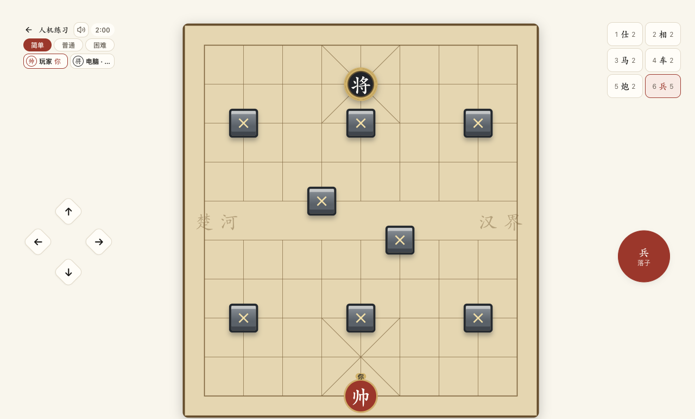

# 用 Step Studio 开发象棋泡泡堂：从需求到真实试玩

**开发教程 · 更新至 0.15.2**  
整理：JIAYU STUDIO · 更新 2026-10-21  
案例版本：应用 0.15.2；地图与回放规则版本 3。

这是一篇真实迭代案例：用官方 Step Studio 开发一个把象棋走法变成炸弹范围的对战游戏，再由独立操作者检查网页、连接手机测试、制作 Suno 配乐和宣传片。重点是如何提出可验收的要求、发现问题并修正，而不是一次提示词生成完整产品。

本文由研究所原创整理。**Step Studio 是第三方开发平台，Suno 是第三方音乐服务**；游戏由 JIAYU STUDIO 组织设计与迭代。本案例使用官方网页 Studio，不要与研究所自研的 StepX Neo Studio Android 工具混淆。本游戏是正面屏幕上的网页游戏，没有在本案例中实现 Neo 背屏游戏功能。

> 已有成果包括可玩的 Studio 预览、账户与大厅、回放、音乐，以及 真实 AI 对战宣传片。公开发布与 APK 的交付状态以研究所下载条目为准；Studio 预览不等于安装包。手机真正同时双指输入、完整多人真机对战和长期网络稳定性仍有待验项。此文不提供他人的私有编辑入口或登录凭据。

## 学完可以做什么

- 把“做个游戏”拆成核心规则、输入、布局、状态、账号、音频与验收任务。
- 指挥 Studio 在同一工程逐轮修复，而不是反复生成新项目。
- 区分视觉范围与实际伤害，处理移动和放弹的多点触控。
- 为倒数、超时、回放及地图变更定义一致的数据规则。
- 从 Suno 原始音乐到游戏资源，再到真实画面宣传片完成交付。

## 阅读顺序

| 章节 | 产物 |
| --- | --- |
| [1. 需求、规则与开发分工](01-rules-and-plan.md) | 规则表、地图、分阶段目标 |
| [2. 在 Studio 中逐轮开发](02-studio-workflow.md) | 可玩的原型及具体修复方式 |
| [3. 账号、联机、计时与回放](03-state-and-services.md) | 跨页面和跨回合一致的状态设计 |
| [4. Suno 音乐与宣传片](04-audio-and-video.md) | 场景曲库、音效及60秒成片流程 |
| [5. 网页、手机与回归测试](05-verification.md) | 可复现检查步骤、通过范围与待验项 |
| [可复制的 Studio 提示词](prompts.md) | 按阶段使用的任务模板 |
| [案例来源与版本演进](sources.md) | 证据口径、关键修订及阅读限制 |

第一次接触官方平台，可先读研究所的[Step Studio 新手课程](../../courses/official-step-studio/README.md)，再做本案例。课程界面可能随平台变化；本文记录的是本次实际工作方法，不承诺按钮和菜单永远不变。

## 成品地图

图中已有八个障碍。上、下中路各新增一格，保留两侧和楚河汉界障碍。图片是网页测试画面，不是手机截图；没有用图像生成代替实际游戏结果。

## 本教程的范围

完整可编辑工程留在 Studio。开发时保存的本地材料包含前端核心文件快照、测试脚本、动作记录和媒体源文件，**不是完整可独立构建的工程仓库**。本文是可复用的开发教程，不是直接下载源码后运行的开源发布包。

教程整理时没有再次从空项目逐步执行所有提示词。模板依据真实需求与修复过程重写，具体名称、页面及数据结构需要按自己的项目调整。

## 0.15.2 新增与修正

- 半透明危险格提示复用引擎的危险图，考虑连锁；障碍、棋子和角色仍在提示上方，触控不受遮挡。
- 大厅公开房间可直接进入观战；可以查看玩家战绩与对局回顾。
- 回放导出优先使用 MP4；浏览器不支持时按真实编码回退 WebM，不仅改扩展名。
- 玩法说明明确提示：朝炸弹移动可以踢弹，受阻时推不动。
- 只使用玩家自主填写的游戏称呼，不从平台资料自动填入昵称。失效会话收到明确 401 后回到注册页；网络错误不会擅自清除账号。
- 维护提示已移除，正常进入称呼页或大厅。

[查看本次版本核对与 90 秒宣传片设计](06-latest-and-vcr.md)。
