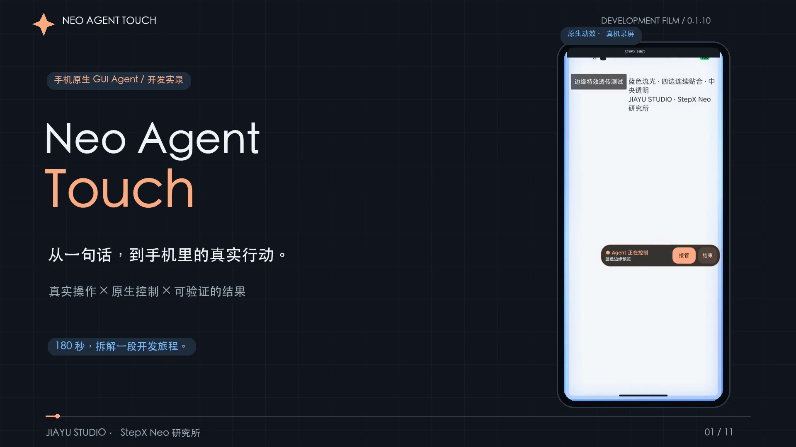

# Neo Agent Touch · 手机里的目标型 Agent

JIAYU STUDIO 自研 · **0.1.11-beta.1 内测** · 更新 2026-10-23

从聊天提出目标，在手机内观察应用、选择动作并核对结果。Android 原生运行时负责截图、系统控件语义与触控；模型通过用户自行配置的 HTTPS API 推理。蓝色边缘显示控制状态，可拖动胶囊支持接管与交还。

- [▶ 180 秒开发实录](https://github.com/JiayuStudio/stepx-neo-lab/releases/download/neo-agent-touch-v0.1.11-beta.1/neo-agent-touch-development-180s.mp4)：淘宝商品探索、电影场次与座位图、WPS 合同生成及修改占 110 秒，另含架构、触点变化、开发过程和参考资料。
- [↓ Beta 内测 APK · 0.1.11-beta.1](https://github.com/JiayuStudio/stepx-neo-lab/releases/download/neo-agent-touch-v0.1.11-beta.1/Neo-Agent-Touch-0.1.11-beta.1.apk)
- [↓ 可编辑影片工程 · 1.0.1](https://github.com/JiayuStudio/stepx-neo-lab/releases/download/neo-agent-touch-v0.1.11-beta.1/neo-agent-touch-film-editable-v1.0.1.zip)：处理后的片内素材、完整 Suno 器乐配乐、动画脚本、时间轴与代码阅读样例。
- [版本说明与 SHA-256](https://github.com/JiayuStudio/stepx-neo-lab/releases/tag/neo-agent-touch-v0.1.11-beta.1) · [校验文件](https://github.com/JiayuStudio/stepx-neo-lab/releases/download/neo-agent-touch-v0.1.11-beta.1/SHA256SUMS.txt)
- [开发学习手册](development.md) · [关键实现阅读样例](examples/README.md) · [本次验证数据](verification.json)

## 怎么开始

1. 在 Android 手机上安装 APK。最低 Android 11；WPS 文档输入使用 Android 13 及以上接口，当前业务实测来自 StepX Neo，其他设备兼容性待验证。
2. 打开 API 设置，填写自己的 HTTPS 接口、支持视觉输入的模型及 API Key。包内没有内置 Key。OpenAI 兼容、Anthropic、Gemini 等协议适配与所有服务商真实账号验收是两件事；后者尚未全部完成。
3. 在“交给 Agent 的应用”搜索并勾选允许操作的应用，开启系统中的 Neo Agent Touch 无障碍服务。每个接口接收哪些应用画面，按应用内提示确认；相同范围会记住，系统服务被关闭时仍需重新开启。
4. 从聊天发送目标，例如“打开哔哩哔哩搜索航拍中国”，或“在 WPS 新建一份测试租赁合同，未知资料保留占位符”。执行时可拖动右侧控制胶囊、接管或交还。

截图和系统控件信息会发给当前配置的模型服务；API Key 和限定偏好保存在本机加密存储。运行控制不依赖电脑 ADB，模型调用需要网络。内测建议先用查询、页面导航和新建测试文件核对兼容性。

同包名、同签名的已有测试安装可覆盖升级；保留聊天与设置。不同签名无法覆盖；不要为安装而先删除仍需保留的数据。首次安装与升级后的实际表现分别记录在验证数据中。

## 自选应用与通用适配

首次未配置时进入应用选择页，读取手机中有桌面启动入口的应用，显示真实名称、图标与包名；支持搜索、已选筛选、批量选择、自定义分类和同类常用应用。微信、高德地图、QQ 音乐、企业微信、百度网盘等可自行勾选，不再受固定支持名单限制。

已选应用通过当前截图与系统控件语义进行通用探索。新应用可被选择与启动，不等于它的导航、聊天、下载、播放等全部复杂功能已验证；登录、验证码和平台限制仍会影响执行。完整安装列表只在手机用于选择，规划器接收的是用户已选的相关候选。

[实现、适配范围与测试说明](application-selection.md)

## 已验证到哪里

| 场景 | 实际结果 | 仍待验证 |
| --- | --- | --- |
| 淘宝 | 搜索保留指定型号和规格，进入商品详情、图片与规格选择；一类无编号底部坐标候选已被拦截 | 标准订单核对、加入购物车与成交闭环 |
| 电影票 | 美团电影入口、影院、切换日期与场次、打开座位图 | 选座、锁座、订单核对与购票 |
| WPS | 手机模型生成合同占位符模板，保存、重开，将付款日期从每月 10 日改为 5 日，再保存读回 | 任意已有文档的安全改写、独立全文差异检查、云端持久化 |
| 控制与偏好 | 贴边动效、拖动及接管机制；8 类咖啡／饮食偏好规则 | 长期跨日使用、多应用整批目标与各机型稳定性 |

影片记录的是 **0.1.10 开发阶段**。本次 Beta 基于该版本整理发布构建，新增自选已安装应用、搜索、分类和同类常用，更新版本标识，移除开发用 Key 引导导入入口，不包含调试活动与探针；没有新增交易成功声明。历史购物探索曾拉起收银台并停止，未付款，是否生成待付款订单尚未独立核验，详见手册。

当前 MCP 为**进程内 JSON-RPC 适配层**；外部网络 MCP、官方 Amoo / Step AOS 网关没有作为已验能力发行。Laya、StartLux 未作为运行依赖接入。宣传片中的偏好值是隔离测试资料。

## 学习与反馈

[学习手册](development.md)说明视觉与系统语义如何配合、如何避免失效目标继续点击、如何实现有边界的触点变化、如何保存检查点与验证文档，以及 AndroidWorld、MobileAgent、LongMemEval、MCP、LangGraph 等参考的采用原因和范围。触点变化用于交互表现，不承诺隐藏无障碍服务或绕过验证。

影片与工程素材由研究所整理，第三方应用界面归其各自权利人。配乐为 Suno 生成的《Touch to Tomorrow — Full Journey》，使用单首完整器乐曲连续适配三分钟。代码样例依赖原工程接口，不能当作完整可构建 App 源码。

内测反馈请提供应用版本、目标、复现步骤与错误文字，并先遮盖账号、文件内容和地址等个人资料。

[研究所首页](../../README.md) · [自研应用](../../sections/apps.md) · [教程与研究](../../sections/guides.md)
