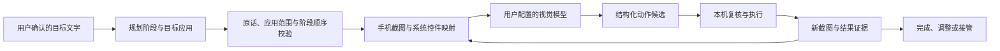
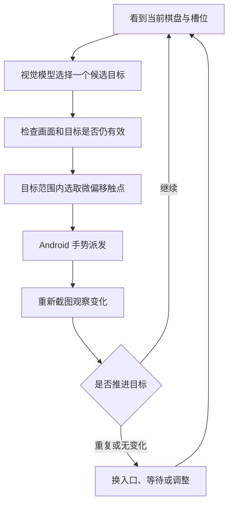
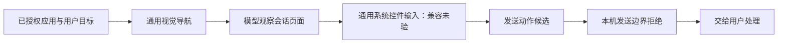

# 功能原理：从画面到下一步动作

本文对应 0.1.15 源码。图中分开说明现有机制、历史实测与未实现部分；动画里的节点是解释，不是新一轮真机回放。

## 总链路

手机负责执行循环；视觉推理由用户配置的 API 提供。模型收到原画和同一画面的系统编号标注，结合控件的系统文字、类别、边界与可点击状态选择动作。当前控制以视觉为主，不是单独依靠 OCR；系统没有提供的按钮用途不能凭编号补造。

模型返回 `tap`、`type`、`submit_search`、`swipe` 等 JSON 候选，或进程内 MCP 适配格式。候选不是直接执行的脚本：手机先校验格式、当前任务归属、目标应用、画面版本和动作范围。坐标动作使用整个屏幕的 0…1000 归一化坐标，再映射到手机像素。

代码入口：[ControlService](source/src/studio/jiayu/neoagent/ControlService.java)、[VisionGrounding](source/src/studio/jiayu/neoagent/VisionGrounding.java)、[DeviceMcp](source/src/studio/jiayu/neoagent/DeviceMcp.java)、[ActionEnvelopeRules](source/src/studio/jiayu/neoagent/ActionEnvelopeRules.java)。外部网络 MCP 网关尚未验收。

## 小游戏：逐步观察，而非预录点击

这是一套通用 GUI 闭环。`GameplayIntent` 只识别真实试玩请求并调整探索预算，没有内置羊了个羊求解器、隐藏棋盘信息或通关脚本。历史记录只证明短时试玩和观察到的一次消除，不证明通关或所有关卡兼容。

无系统控件的画布元素可以用视觉坐标；派发前会重新检查画面和路径。`VisualActionRules` 的图像比较用于判断画面是否变化、坐标是否还可信，不等于判断游戏已经获胜。点击后的业务结果仍需新画面确认。

`TouchPointPicker` 在目标边界与给定半径的交集内随机选择落点，同一轮不复用已使用的精确像素，并跳过锚点本身。可用位置耗尽会停止该次点击。它提供有限的触点变化，不证明等同真人，也不保证任何平台检测结果。

代码入口：[GameplayIntent](source/src/studio/jiayu/neoagent/GameplayIntent.java)、[VisualActionRules](source/src/studio/jiayu/neoagent/VisualActionRules.java)、[TouchPointPicker](source/src/studio/jiayu/neoagent/TouchPointPicker.java)、[RecoveryPolicy](source/src/studio/jiayu/neoagent/RecoveryPolicy.java)。

## 微信：现有通用机制与发送边界

这是机制示意，联系人查找和草稿输入没有在本版独立实测，也没有专门的收件人核验。草稿若能输入，使用的是通用 `type(id)` 对应用支持的可编辑非密码节点执行 `ACTION_SET_TEXT`，不能据此保证微信版本兼容。专用输入连接桥当前只处理 SEARCH，不是微信消息发送通道。

当前普通任务明确禁止发送消息；可识别且带“发送”标签的目标会被本机边界拒绝，不能外推所有无标签画布元素都可可靠识别。项目没有专用 `send_message` 工具、绑定收件人与正文的发送授权流程，也没有“已发送”回执核验，所以不能把本图宣传为自动发微信已经实现。

若未来加入发送功能，收件人、正文、明确授权、提交与回执必须成为单独实现和验收的步骤；目前这些仅是待实现设计。

代码入口：[ActionGuard](source/src/studio/jiayu/neoagent/ActionGuard.java)、[ControlService.checkTarget / execute](source/src/studio/jiayu/neoagent/ControlService.java)、[SearchInputBridge](source/src/studio/jiayu/neoagent/SearchInputBridge.java)、[AgentImeInputBridge](source/src/studio/jiayu/neoagent/AgentImeInputBridge.java)。

## 输入、文档与接管

| 场景 | 实现方式 | 证据边界 |
| --- | --- | --- |
| 聊天语音入口 | 调起当前系统输入法，由用户核对转写后发送 | release 不含内置 ASR；搜狗准确率与本版入口 UI 未验 |
| 应用内搜索 | 聚焦编辑器、写入关键词、独立提交 SEARCH、重新读画面 | IME 回执只代表动作派发；历史 QQ 音乐到播放页且进度增长，未独立听音 |
| WPS 文案 | 生成文本、写入、保存，再重开核对与修改 | 新建、保存、重开、修改是历史版本实录，本版完整回归待验 |
| 接管与交还 | 使旧执行代次失效、暂停并交还输入法；恢复时重新观察 | 不直接沿用旧截图编号或坐标 |

相关源码：[DocumentRuntime](source/src/studio/jiayu/neoagent/DocumentRuntime.java)、[DocumentReadback](source/src/studio/jiayu/neoagent/DocumentReadback.java)、[AgentImeLease](source/src/studio/jiayu/neoagent/AgentImeLease.java)、[RunOwnership](source/src/studio/jiayu/neoagent/RunOwnership.java)。

## 三种不同的记忆

- `TaskMemory` 保存当前阶段的模型简记，标明来源画面和动作是否派发；它不是当前页面事实或操作权限。
- `UserMemory` 从聊天提取限定类别的口味偏好。明确表述可直接记录；重复选择需在近 30 天至少出现 3 个不同日期才形成推测，当前明确要求优先，用户可编辑或清除。
- `TaskCheckpoint` 在本地加密保存目标和进度。恢复后先处于暂停状态，重新观察，不持久复用截图、控件节点或输入连接；完整进程重启恢复仍待独立验收。

这不等于已经完成任意应用按钮位置的永久学习，也不是面向所有生活领域的无限记忆。详见 [UserMemory](source/src/studio/jiayu/neoagent/UserMemory.java)、[TaskMemory](source/src/studio/jiayu/neoagent/TaskMemory.java)、[TaskCheckpoint](source/src/studio/jiayu/neoagent/TaskCheckpoint.java) 与[本版验证记录](verification-v15.json)。

## 为什么参考这些项目

| 主源 | 对本项目的启发 | 实际复用范围 |
| --- | --- | --- |
| [Android 原生接口](https://developer.android.com/guide/topics/ui/accessibility/service) | 取得系统控件信息、派发手势，管理输入与服务生命周期 | 调用平台 API；Android 原生运行时自行实现 |
| [Set-of-Mark](https://github.com/microsoft/SoM) | 在图像上增加可引用编号，帮助视觉模型明确指向目标 | 方法参考；未引入该仓库分割模型或代码，编号来自系统控件 |
| [AndroidWorld](https://github.com/google-research/android_world) | 把任务、动作与结果核验分开，避免“模型说完成”充当证明 | 评估思路参考；没有导入桌面执行器或运行整套基准 |
| [Cradle](https://github.com/BAAI-Agents/Cradle) | 用画面输入、动作输出和后续反馈理解通用软件与游戏控制 | 架构思路参考；未搬入其框架或游戏技能，不代表专用解谜能力 |

Ego Lite 提供可见控制范围、接管胶囊与边缘反馈的交互参考；没有取得或复制其内部框架。论文、项目或许可证的存在不等于本应用已得到相同实验结果。[主源记录](research/sources.json)保留查阅范围和代码复用区分。
