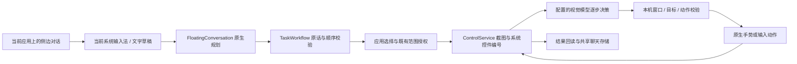

# Neo Agent Touch：Agent 源码入口

先读 README.md 的当前版本与验收边界，再读 tests/acceptance-v20.json。构建成功、私有夹具通过、实际目标完成和正式包安装摘要是不同证据；不要从其中一个推导其他结果。

## 执行链

运行时在手机内。电脑安装、被动录像与读取调试证据不属于手机业务执行器。正式包没有私有 DUMP 测试入口；DeviceMcp 是模型可调用的手机内工具路由，不是开放给局域网的无鉴权控制服务器。

## 代码导航

- `FloatingChat`：可拖动入口、原生编辑器、面板与控制胶囊避让、锁屏隐藏。
- `FloatingVoiceInput` / `VoiceShortcutRules`：唤起当前键盘，仅对它暴露的明确语音入口尝试激活；无法识别时手动点麦克风。
- `FloatingConversation` / `FloatingPlanRules`：规划取消、会话与服务 epoch、暂停目标替换、已有授权复用。
- `MainActivity` / `ChatStore`：主界面互锁、加密聊天日志三方合并与结果去重。
- `TaskWorkflow` / `StageSourceRules` / `SharedComparisonPlan`：原话覆盖、任务顺序及跨应用比价规划。
- `ControlService` / `NativeWindowState` / `GuiRevision`：画面观察、系统语义、窗口和瞬时节点引用复核。
- `ContainerLabelProof` / `NativeLabels`：小面积可点击容器的完整原生子树指纹；动作前完整重读比对，不缓存永久坐标。
- `TouchPointPicker` / `VisualActionRules`：控件内微小坐标变化、动作新鲜度与手势派发前复核；不会把旧坐标当作永久按钮记忆。
- `SearchQueryPolicy` / `SearchInputBridge` / `SearchFinishRules`：搜索对象检查、输入/提交/结果观察分离。节点与系统端口共享账本；带 id 的系统回退重核聚焦节点和 EditorInfo，不重放未知写入。
- `RoutineAccessRules` / `RoutineAccess`：按接口与每个应用保存授权，文本范围不会继承其他应用的视觉授权。
- `AppNameRules`：精确包名、别名和安装名称优先，避免微信与企业微信身份混淆。
- `AgentImeLease`：系统启用与自动切换是两个状态，自动切换默认为关闭。
- `DocumentNameRules` / `DocumentReadback`：本轮文件来源、冲突拒绝、精确全文与请求类型分别核验。
- `FinishObservationGate` / `FinishObservationRules`：仅大麦只读详情；原严格结束校验失败后，比较本轮冻结和当前原生标题/场馆、节点身份及窗口，仍仅 reported。
- `RuntimeHealth` / `HealthRules`：原采样和超时预算保持；超时诊断绑定本轮运行，不含页面文字。
- `DocumentRuntime` / `PurchaseRuntime`：文档及交易的专用本机状态约束；不以普通点击绕过其结果核验。

## 构建和验收

纯规则：`bash tests/run-unit.sh`。正式构建：设置 `ANDROID_SDK_ROOT`、`JAVA_HOME`、`R8_JAR`、`NEO_AGENT_SIGNING_DIR` 后运行 `bash build.sh release`。环境值、现有签名文件和模型凭据由使用者在本机提供；源码包不包含它们。覆盖升级必须继续使用同一签名。

当前实际输入法保留为用户选择的搜狗；没有新增录音权限或独立音频上传链路。要验证语音准确率仍需要真人实际试说，合成文字只能用于规划和执行回归。

本轮逐应用实测覆盖11个已授权应用。详细状态见当前验收：WPS 保存/重开/全文一致读回具有内置证据；其他业务的模型报告与人工录屏观察分别记录。B站关键词及播放成立，但严格第一条选择未通过；美团人机验证未完成；拼多多未在本轮授权范围中。旧失败证据保留，不从一次成功推断所有页面已适配。

私有夹具用合成目标填写真实原生侧边编辑器并点击发送；后续业务由手机的正常规划与执行链完成。正式 APK 不包含该 DUMP 入口。隔离的原生搜索节点合成契约若失败，单独记录，不能被其他 App 成功掩盖，也不自动把 ACTION_IME_ENTER 改成可用。测试结束需恢复正式包并回读安装文件摘要，保持既有输入法和无障碍选择。

下一步优先级：严格列表顺序选择、动态详情的可靠结束、真实语音准确率、通用文档修改、异常恢复与长时间稳定性。不要把当前验收扩大为微信发消息、交易完成或所有第三方应用任意页面可控。
