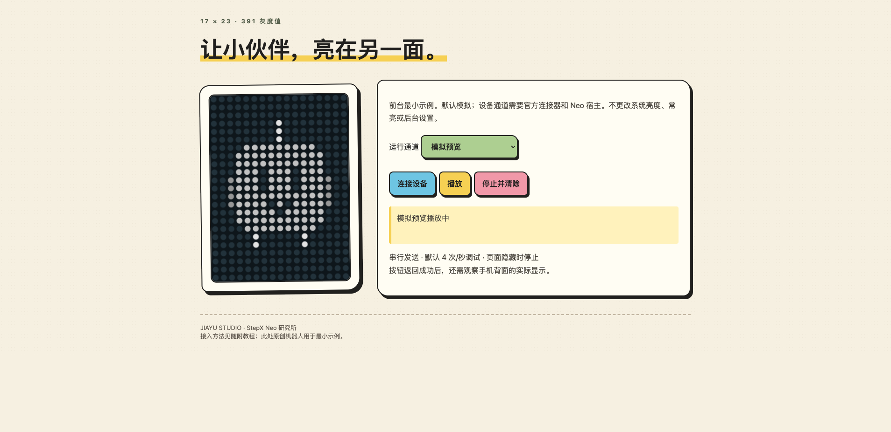
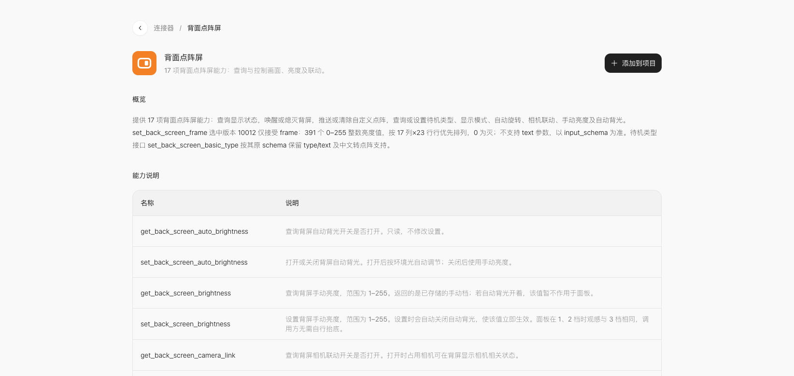

# Neo 背屏开发：原理、Step Studio 与点阵伙伴

JIAYU STUDIO · StepX Neo 研究所 · 1.0.0 · 2026-10-26

[在线教程](https://stepxneo.jiayustudio.dpdns.org/tutorials/neo-matrix/) · [试用马克笔示例](https://stepxneo.jiayustudio.dpdns.org/tutorials/neo-matrix/example/) · [观看90秒视频](https://stepxneo.jiayustudio.dpdns.org/downloads/tutorials/neo-matrix/1.0.0/neo-matrix-tutorial-90s-1.0.0.mp4) · [下载示例包](https://stepxneo.jiayustudio.dpdns.org/downloads/tutorials/neo-matrix/1.0.0/neo-matrix-starter-1.0.0.zip) · [GitHub发行备用](https://github.com/JiayuStudio/stepx-neo-lab/releases/tag/neo-matrix-tutorial-v1.0.0)

把角色变成 17×23 的灰度数组，再通过官方连接器或原生接口发送到 Neo 背屏。本教程讲清数据格式、两条调用路线、游戏状态联动、动画调度与后台运行条件，并提供能直接打开的彩色马克笔示例。



## 从这里开始

1. 阅读[完整教程](guide.md)，先理解 391 个亮度值的排列方式。
2. 打开[在线示例](https://stepxneo.jiayustudio.dpdns.org/tutorials/neo-matrix/example/)，或下载示例包后打开 `examples/index.html`。点击播放、停止，验证模拟点阵。
3. 在自己的 Step Studio 项目添加[背面点阵屏连接器](https://studio.stepx.com/connectors/ic_atomic_990001)，保留平台引导，再合并示例逻辑。
4. 在 Neo 上先验收单帧、连续动画与停止，再增加常亮和后台陪伴。

普通浏览器只提供模拟预览。物理背屏需要官方支持的 Neo 宿主及项目授权；缺少宿主时示例会明确报错，不会把模拟当作设备成功。

## 教程内容

- 17列×23行、391个0–255整数，行优先 `y * 17 + x`。
- Step Studio 的 `window.mcp.connect()`、`set_back_screen_frame` 与 `clear_back_screen_frame`。
- 当前逐帧版本10012只接受 `frame`，以及17项背屏能力清单。
- 原生 `display_ext` 路线、保存与恢复显示模式、串行调度和后台冻结限制。
- 荒野游戏如何通过本地状态快照选择队伍伙伴，再由独立动画时钟出帧。



## 文件与修改

| 文件 | 用途 |
| --- | --- |
| [guide.md](guide.md) | 完整原理、Step Studio步骤、提示词与排查 |
| [examples/index.html](examples/index.html) | 自包含的马克笔页面，直接打开可模拟 |
| [examples/matrix-player.mjs](examples/matrix-player.mjs) | 数据校验、MCP错误处理、串行播放及清帧逻辑 |
| [examples/matrix-player.test.mjs](examples/matrix-player.test.mjs) | 6项播放器检查 |
| [tools/sync_example.py](tools/sync_example.py) | 将原始逻辑同步到单文件页面 |
| [verification.json](verification.json) | 验证范围与待验项 |

在本目录或解压后的示例包中运行：

```sh
python3 tools/sync_example.py
node --test examples/matrix-player.test.mjs
```

## 视频与已验证范围

90秒、1920×1080、30fps，配乐为 Suno v6 生成的《Pixel Pathfinder》本地剪辑版。前屏为游戏实机录屏，背屏为点阵资源动画示意；快闪展示528项伙伴与不同形态，不代表528个独立物种。

示例通过6项自动检查；浏览器中验证了持续模拟动画、停止清除、缺少宿主报错和390像素窄屏布局。视频通过完整解码、实际播放和中段/片尾跳转检查。新示例的官方MCP物理背屏、长期锁屏运行及跨固件兼容仍待验；发送计数不等于面板实测帧率。

## 引用的项目、库与服务

- [官方背面点阵屏连接器](https://studio.stepx.com/connectors/ic_atomic_990001)：官方能力说明与Step Studio接入。
- [研究所原生点阵实现](https://github.com/JiayuStudio/stepx-neo-studio/tree/main/shared-src/studio/jiayu/matrix)与[荒野适配源码](../pokewilds/source/README.md)：原生调用及游戏联动参考。
- [PokeWilds](https://github.com/SheerSt/pokewilds)：视频游戏与点阵角色来源；形象及第三方素材权利归原权利方，本教程不另行授予其商业使用权。
- 示例播放器使用浏览器原生 JavaScript 和 Canvas，没有第三方网页运行库；示例机器人由教程代码绘制。
- 在线正文由 [Marked](https://github.com/markedjs/marked) 17.0.5（MIT）生成静态HTML，网页无需加载Markdown运行库。
- [Pillow](https://python-pillow.github.io/)、[NumPy](https://numpy.org/)、[FFmpeg](https://ffmpeg.org/)为视频制作工具；[Suno](https://suno.com/)用于本次配乐生成。

研究所原创教程与示例代码保留版权；第三方资料、软件和素材按各自声明使用。
