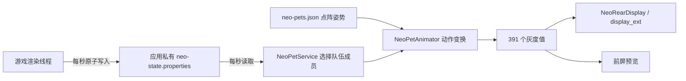

# 把游戏伙伴带到背屏：Neo 点阵与 Step Studio 实现

JIAYU STUDIO · StepX Neo 研究所 · 2026-10-26 · 教程 1.0.0

背屏动画的核心是：把角色转换成 **17 列 × 23 行的亮度数组**，再按时间顺序向手机提交一帧帧画面。游戏状态决定显示谁、播放哪种动作；动画时钟决定什么时候换帧。图片转换、播放调度和系统后台管理是三个不同环节。

## 1. 一帧数据长什么样

| 项目 | 值 |
| --- | --- |
| 宽 × 高 | 17 × 23 |
| 数组长度 | 391 |
| 排列 | 从上到下逐行；每行从左到右 |
| 下标 | `index = y * 17 + x` |
| 亮度 | 0–255 整数；0 熄灭，255 最亮 |
| 颜色 | 本教程使用单通道灰度 |

```js
const frame = new Array(17 * 23).fill(0);
frame[11 * 17 + 8] = 255; // 中央一颗灯
```

制作宠物时保留耳朵、头形、尾巴等识别特征，眼睛要留出明显的暗像素，避免缩小时五官连成一片。先在 17×23 预览，再放大成圆点查看；不要只看原始大图。等比缩小并留边，不拉伸角色。使用透明图时先处理透明度，避免透明背景被误当成亮色。

## 2. 两条调用路线

| 路线 | 适合用途 | 入口 | 运行条件 |
| --- | --- | --- | --- |
| 官方 Step Studio | 网页应用、低频状态画面、前台互动原型 | `window.mcp.callTool` | 项目添加背面点阵屏连接器，运行于平台支持的设备宿主 |
| 原生 Android APK | 游戏状态联动、可控的动画调度、后台陪伴 | `getSystemService("display_ext")` | 固件实际提供接口，完成生命周期与后台策略适配 |

两条路线最终控制同一块背屏。一次只让一个播放器发送，避免应用之间抢画面。官方连接器也支持“始终显示”；原生路线的优势是能自己管理动画线程和服务生命周期。

普通电脑浏览器里的 Canvas 预览只证明图片与时钟正常。`auth_type: none` 也不表示任意网页都有硬件权限。官方能力授权依赖平台宿主及应用身份，不要复制其他应用的能力密钥，也不要填入模型 API Key。

## 3. 在官方 Step Studio 中实现

1. 打开 [Step Studio](https://studio.stepx.com/)，新建自己的应用项目，先做点阵预览、连接、播放、停止三个按钮。
2. 打开“连接器”，搜索“背面点阵屏”，点击“添加到项目”，选中自己的项目。官方入口：[背面点阵屏连接器](https://studio.stepx.com/connectors/ic_atomic_990001)，编号 `ic_atomic_990001`。
3. 保留平台生成的 `capsule.js` 引导和初始化流程。不要用一个空白 HTML 覆盖它；把本教程的页面逻辑合并进现有入口，并按项目构建方式打包 JS。
4. 由用户点击连接，等待 `window.mcp.connect()`。初始化失败就显示原因，不自动冒充模拟成功。
5. 首先只发一帧，确认方向、亮度和眼睛，再加动画。每次发送只带 `{ frame }`。
6. 在 Neo 上通过平台支持的调试或构建入口安装运行。先确认系统背屏总开关已开，再实际观察背面。电脑预览不能替代这一步。
7. 点击停止：先停时钟，等待在途发送结束，再 `clear_back_screen_frame`。如果应用主动改过常亮模式，恢复之前保存的模式。

最小调用：

```js
await window.mcp.connect();
const frame = Array(391).fill(0);
frame[11 * 17 + 8] = 255;
const result = await window.mcp.callTool('set_back_screen_frame', { frame });
// 检查当前 SDK 返回值；success:false 或 isError:true 都要作为失败。
// SDK 若把工具结果放在 content[].text / data / result 内，也要解析并检查。
await window.mcp.callTool('clear_back_screen_frame', {});
```

**接口版本注意：** 2026-10-26 官方页面概览明确指出，`set_back_screen_frame` 选中版本 **10012 仅接受 frame**，不支持 `text`。同页下方仍有旧版“frame/text 二选一”的描述；实际以项目所选版本的 `input_schema` 为准。本教程统一自己生成 391 个亮度值。文字显示可另用 `set_back_screen_basic_type`，不要把文字参数塞进这一版逐帧接口。

完整示例在 [examples/index.html](examples/index.html) 与 [matrix-player.mjs](examples/matrix-player.mjs)。示例默认只预览；选择设备通道后才会发硬件调用。它不自动更改亮度、常亮模式或后台设置。

示例页面采用研究所主页的彩色马克笔样式。核心脚本已内嵌，直接打开 HTML 也能模拟运行；修改原始 mjs 后，运行 `python3 tools/sync_example.py` 同步页面。在 Step Studio 接入时仍要保留平台自己的引导与授权流程。

### 可以直接交给 Step Studio 的提示词

> 为我的 Neo 应用添加背屏点阵伙伴。使用已添加的官方“背面点阵屏”连接器 ic_atomic_990001，保留现有 capsule.js 和项目初始化。固定 17×23 单通道点阵，每帧恰好 391 个 0–255 整数，行优先 index=y*17+x。先提供前台预览、连接设备、播放、停止清除。通过 window.mcp.connect() 和 window.mcp.callTool('set_back_screen_frame', {frame}) 调用，当前所选版本不传 text。检查 SDK 外层和工具内容中的错误。动画先用每秒 4 帧作为调试起点，上一帧完成后才调度下一帧，不堆积并发请求；这是保守调试值，不是硬件帧率上限。停止时等在途帧完成再清除。页面隐藏时停止前台播放。设备调用失败要显示原因，模拟预览明确标记。未经用户选择不改系统亮度或常亮；若以后加常亮，先持久保存原模式，停止恢复，异常退出后下次进入补恢复。先在 Neo 上验证单帧、方向、动画和停止，再增加游戏状态联动。

### 官方能力清单（本次页面列出 17 项）

| 能力 | 作用 |
| --- | --- |
| `set_back_screen_frame` | 提交一帧 391 个亮度值 |
| `clear_back_screen_frame` | 清除自定义帧，回到当前 agent 状态 |
| `get_back_screen_display_info` | 查询显示状态、逻辑尺寸、旋转和亮度 |
| `wake_up_back_screen` | 请求立即点亮，不修改总开关 |
| `sleep_back_screen` | 请求熄灭，不修改总开关 |
| `get_back_screen_display_mode` | 查询 auto / always / custom 及定时窗口 |
| `set_back_screen_display_mode` | 设置智能、始终或定时显示 |
| `get_back_screen_basic_type` | 查询 agent / time / text 待机类型 |
| `set_back_screen_basic_type` | 设置待机类型；text 类型须提供文字 |
| `get_back_screen_brightness` | 查询保存的手动亮度 |
| `set_back_screen_brightness` | 设置 1–255 手动亮度，同时关闭自动背光 |
| `get_back_screen_auto_brightness` | 查询自动背光 |
| `set_back_screen_auto_brightness` | 开关自动背光 |
| `get_back_screen_auto_rotate` | 查询自动旋转 |
| `set_back_screen_auto_rotate` | 开关自动旋转 |
| `get_back_screen_camera_link` | 查询相机联动 |
| `set_back_screen_camera_link` | 开关相机联动 |

显示模式示例（参数仍须核对所选版本 schema）：

```js
const before = await window.mcp.callTool('get_back_screen_display_mode', {});
// 按当前 SDK 的实际数据结构提取 mode、customStart、customEnd 并持久保存。
// 保存成功后才允许修改；无法解析原模式时停止，不猜测默认值。
await window.mcp.callTool('set_back_screen_display_mode', { mode: 'always' });
// 定时示例：{ mode:'custom', customStart:480, customEnd:1320 }，即 08:00–22:00。
// 停止时先清帧；若当前仍为本次设置的 always，再恢复 before 中的原值。
// 用户期间已主动改成其他模式，就保留用户选择。
```

上段说明恢复流程，**不是完整的可直接粘贴常亮控制器**；完整的最小前台播放器刻意不改全局模式。

## 4. 原生 Android 的调用原理

本游戏目前通过固件扩展服务 `display_ext`，反射调用以下方法。它是当前固件观察到的接口，不是 Android 标准 SDK，也不是官方承诺跨固件稳定的公开 SDK。

```java
Object display = context.getSystemService("display_ext");
if (display == null) throw new IllegalStateException("没有 Neo 背屏接口");
Class<?> type = display.getClass();
boolean enabled = (Boolean) type.getMethod("isBackScreenEnabled").invoke(display);
if (!enabled) throw new IllegalStateException("请先打开系统背屏总开关");

int before = (Integer) type.getMethod("getBackScreenDisplayMode").invoke(display);
// 必须先持久保存 before 和待恢复标记，保存失败就停止。
// 当前已观察固件：0=auto，1=always，2=custom。
type.getMethod("setBackScreenDisplayMode", int.class).invoke(display, 1);
int[] pixels = new int[17 * 23];
pixels[11 * 17 + 8] = 255;
type.getMethod("setBackScreenAgentFrame", int[].class, android.os.Bundle.class)
    .invoke(display, pixels, null);

// 停止时：先结束发送线程，再清帧、检查当前模式、恢复原值。
type.getMethod("clearBackScreenAgentFrame").invoke(display);
int current = (Integer) type.getMethod("getBackScreenDisplayMode").invoke(display);
if (current == 1)
    type.getMethod("setBackScreenDisplayMode", int.class).invoke(display, before);
// 恢复成功再清除持久标记；崩溃后下次启动补恢复。
```

当前游戏的真机验证使用普通应用安装方式，不需要 root、系统签名或隐藏 API 豁免。不要把这个结果外推到其他固件；初始化时检测服务、方法和异常。以上仅展示接口，正式接入要连同恢复逻辑和服务生命周期一起实现。

## 5. 荒野游戏怎样与宠物联动



- `NeoBridge.tick()` 在游戏渲染线程取状态，避免和游戏更新互相抢数据。每秒通过临时文件与原子改名发布快照。
- 快照包含 `updated`、`activity`、`pet.0…`、`level.0…`、`hp.0…`、`count` 等；这版使用应用私有目录里的本地文件，不是联网推流。
- `NeoPetService` 按所选队伍槽位解析角色；没拿到新状态时保留最近伙伴。游戏状态读取是约 1 次/秒，动画更新是独立时钟。
- `NeoPetCatalog` 缓存 JSON 姿势，不在每一帧反复解码文件。当前资源含 529 项，展示排除 debug 占位后是 **528 项伙伴及不同形态**，不能称为 528 个独立物种。
- `NeoPetAnimator` 用姿势切换、位移采样插值及爱心/休息效果产生动作。它不是为每只角色手绘了几十帧新原画。
- 原生服务可选 15–30 次/秒，默认目标 24；使用独立线程串行发送。`sent` / `fps` 是调用计数，**不是面板光学刷新率测量**。

在纯 Step Studio 网页中，可以把同样的 `petId / action / level / hp / updated` 做成页面状态，状态变化时换动作。要读取独立原生游戏的私有文件，则需要游戏自身提供受控桥接或一起打包；普通网页不能直接访问另一应用的私有目录。

## 6. 后台陪伴需要补上什么

原生实现使用用户主动启动的前台服务、可见通知及“停止陪伴”按钮，动画线程串行调度，持有带超时并续期的 `PARTIAL_WAKE_LOCK`，停止时释放。退出时清帧并恢复模式；本游戏不在开机后或强制停止后自动偷偷重启。

“始终显示”只管理显示策略，不保证 JS、进程或动画时钟一直运行。手机的省电与冻结策略仍可能暂停应用，WakeLock 也不能保证越过厂商冻结。网页计时器在后台可能被限速；要把前台网页原型扩展为稳定陪伴，应做原生服务和相应真机验收，不能仅靠 `setInterval`。

开发调试中，部分固件支持 ADB 的应用级冻结白名单。它属于开发者外部配置，应用不能自行获得；不要求普通用户执行，不改全局冻结设置，也不将其当作普遍可用的发布方案。不同固件需分别核验。

Android 实现还需按目标系统版本声明适用的前台服务类型、权限及通知，并遵守从后台启动服务的限制。可参考 [Android 前台服务](https://developer.android.com/develop/background-work/services/fgs) 和 [WakeLock](https://developer.android.com/reference/android/os/PowerManager.WakeLock)。

## 7. 验证顺序与故障定位

1. **数据**：391 个整数、亮度范围、17×23 方向正确，预览眼睛可辨。
2. **单帧**：Neo 实机看见点阵；API 返回成功不能替代观察。
3. **动画**：至少持续观察 30 秒，检查重影、停顿、方向及抢屏。
4. **停止**：点击停止后无新帧，清帧成功；改过显示模式就核对恢复。
5. **生命周期**：锁前屏、切后台、等待、返回、强制停止后重进分别检查。记录当时固件与设置，但对外证据去掉设备标识。

| 现象 | 先检查 |
| --- | --- |
| 电脑能预览，Neo 不亮 | 是否实际设备宿主、连接器、授权、系统总开关；读取显示信息 |
| 传参报错 | 是否 391 个 0–255 整数；版本 10012 是否误传 text |
| 画面横倒或变形 | 行优先、17 列与 23 行是否颠倒；系统自动旋转设置 |
| 越播越慢 | 是否并发积压；等待上一帧返回再调度，降低发送频率 |
| 熄前屏后停住 | 区分显示策略与进程冻结；检查服务、厂商后台限制 |
| 停止后仍显示 | 是否仍有在途帧或另一个播放器；先停发送再清帧 |

本教程核对了 2026-10-26 官方页面与游戏 0.8.16 源码。随附网页播放器通过模拟与浏览器验证；其官方连接器物理背屏验收仍待完成。视频背屏段为真实资源的**动画示意**，前屏为 Neo 0.8.14 实机录屏。

## 8. 参考与资源边界

- [官方背面点阵屏连接器](https://studio.stepx.com/connectors/ic_atomic_990001)：当前页面于 2026-10-26 读取。
- [StepX Neo Studio 原生点阵实现](https://github.com/JiayuStudio/stepx-neo-studio/tree/main/shared-src/studio/jiayu/matrix)：可参考接口和生命周期；按该仓库实际许可证复用。
- [研究所荒野项目](https://github.com/JiayuStudio/stepx-neo-lab/tree/main/guides/pokewilds)：游戏适配与引用说明。
- [PokeWilds 上游](https://github.com/SheerSt/pokewilds)：游戏与素材来源需分别尊重其声明；本教程不为宝可梦角色素材授予额外商业使用权。
- 随附最小播放器使用原生 JavaScript 与 Canvas，不增加第三方运行库。剪片工具为 Python、Pillow、NumPy、FFmpeg，属于制作工具，不打包进游戏。
- 视频配乐《Pixel Pathfinder》由 Suno v6 按纯音乐目标生成，本地剪成 90 秒；创作提示中的 108 BPM 不作为实测速度。
