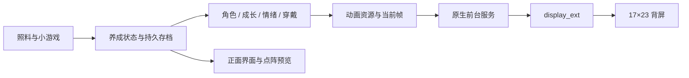

# 从 17×23 点阵到背屏宠物

[研究所](../../README.md) / [教程与研究](../../sections/guides.md) · [游戏安装](README.md) · [配套 Studio 提示词](studio-prompts.md)

本文复盘拓麻歌子 0.3.4：如何把养成游戏的状态变成 Neo 背面的角色动画。接口与文件链接固定到该版本，便于对照。整理日期：2026-10-20。

## 先回答：要上传特殊文件到 Studio 吗？

**关键是接入能执行背屏调用的代码和运行环境。** 图片或动画 JSON 只是素材，上传后不会自行点亮背屏。

想复用本项目，可以下载[0.3.4 源码](https://github.com/JiayuStudio/stepx-neo-pet/tree/v0.3.4)，将需要的源码和资源导入已有 Studio 项目，再让它对照当前构建环境适配。保留平台自己的入口和构建配置。没有必要上传手机固件、系统 APK 或系统签名。

| 需要理解的部分 | 本项目文件 | 作用 |
| --- | --- | --- |
| 点阵驱动 | `RearDisplay.java` | 取得系统服务、提交亮度帧、恢复显示模式 |
| 持续播放 | `PetService.java`、`LockedDisplaySession.java` | 前台服务、动画时钟与运行期间 CPU 唤醒 |
| 角色资源 | `studio-art/mori.ts`、`app/assets/pet-frames.json` | 生成角色、孵化及穿戴动画 |
| 状态到图案 | `MoriMatrix.java`、`PetArt.java` | 决定画谁、画什么状态、当前是哪一帧 |
| 养成与存档 | `mori-engine.js`、`PetStore.java` | 需求、成长、动作及持久化 |
| 正面界面 | `web/`、打包的 Web 资源 | 照料、小游戏、存档及点阵预览 |

这里的 `pet-frames.json` 是本游戏的资源格式，不是 Neo 系统通用协议。其他工具的 `neo-matrix.json` 不能直接当它使用，需要适配。

[Step Studio 网页](https://studio.stepx.com/)与[第三方 StepX Neo Studio 客户端](../neo-studio/README.md)是不同入口。网页平台桥接与原生 Android 系统调用也不同：先检查项目已有能力，不能在普通浏览器里直接运行下面的 Java。本文完整后台方案使用原生 APK；网页用于开发、界面与预览。平台是否能构建当前项目，需要实际构建确认。

## 1. 先点亮一个简单图案

Neo 点阵为 **17 列 × 23 行，共 391 个亮度值**。每个值为 0～255，按行排列：`index = y * 17 + x`。它不是 391 个 RGB 颜色。

先画方框，再与 X 交替，验证方向、尺寸和刷新。不要一开始就同时排查宠物画法、游戏引擎和后台运行。

以下 Java 是“发送单帧”的最小示意，需要在兼容 Neo 的 Android 应用中执行：

```java
import android.content.Context;
import android.os.Bundle;

final class NeoFrameExample {
static void sendFrame(Context context, int[] pixels) throws Exception {
    if (pixels == null || pixels.length != 17 * 23) {
        throw new IllegalArgumentException("Expected 391 brightness values");
    }
    for (int value : pixels) {
        if (value < 0 || value > 255) {
            throw new IllegalArgumentException("Brightness must be 0..255");
        }
    }
    Object display = context.getSystemService("display_ext");
    if (display == null) {
        throw new IllegalStateException("Neo rear display service unavailable");
    }
    display.getClass()
        .getMethod("setBackScreenAgentFrame", int[].class, Bundle.class)
        .invoke(display, pixels, null);
}

// 在 Android Activity/Service 中调用 NeoFrameExample.showBox(this)。
static void showBox(Context context) throws Exception {
int[] pixels = new int[17 * 23];
for (int y = 6; y <= 16; y++) {
    for (int x = 3; x <= 13; x++) {
        if (x == 3 || x == 13 || y == 6 || y == 16) {
            pixels[y * 17 + x] = 180;
        }
    }
}
sendFrame(context, pixels);
}
}
```

该辅助类放入 Android 工程使用，不是一份独立可安装应用。完整会话还要检查系统背屏开关、保存旧模式、启动播放、清帧和恢复模式。对照实际实现：[RearDisplay.java](https://github.com/JiayuStudio/stepx-neo-pet/blob/v0.3.4/app/src/com/diandian/neopet/RearDisplay.java)。

本项目调用固件提供的 `display_ext` 服务，以普通反射调用方法；这是当前兼容固件上的实现经验，不是稳定 Android 标准 SDK。参考开源项目 [backscreen-toolbox](https://github.com/stepx-advance/backscreen-toolbox)。接口不存在时应显示不支持，不能静默伪装成功。

### 显示模式与退出

`getBackScreenDisplayMode()` 读取模式；观察到 0 为自动、1 为常亮、2 为定时。播放前先持久保存旧模式，再临时设置为 1。停止时调用 `clearBackScreenAgentFrame()`，并在当前仍为本应用设置的常亮模式时恢复旧值，避免覆盖用户后来做出的选择。异常退出后的下次启动也要能清理遗留状态。

**调用成功只说明请求送到了系统。** 背屏朝下、遮挡、总开关、省电、温度或更高优先级内容都可能影响物理显示。每一步都要看手机背面。

## 2. 小尺寸专门画，才能可爱

我们曾把角色画得过宽，手臂横向展开，结果像飞机。缩小并重画轮廓后，才有足够空间表现身体、眼睛、短手脚和耳机。

- 在 17×23 画布上先试约 13×15 的主体，给动作与饰品留边距；这是起点，不是所有角色必须遵守的尺寸。
- 星跃保留柔和星形轮廓与两只竖眼；方跃保留台阶头形、方眼与短脚。先让静止剪影可辨认。
- 用整数像素坐标绘制。直接把大图缩成低分辨率，或给整只角色套小数缩放，容易吞掉眼睛和手脚。
- 先做睁眼、眨眼、上下移动一格的呼吸动作；再增加开心、睡觉、饥饿。低帧率也可以可爱。
- 耳机随身体一起移动，不能挡住眼睛；动作最大幅度时检查边界。
- 使用亮度层级表现轮廓和眼睛，在真实灯珠上检查，不能只看彩色网页预览。

本项目由 [mori.ts](https://github.com/JiayuStudio/stepx-neo-pet/blob/v0.3.4/studio-art/mori.ts)生成图案，通过 [export-art.mjs](https://github.com/JiayuStudio/stepx-neo-pet/blob/v0.3.4/tools/export-art.mjs)导出原生资源。正面点阵预览与背屏资源复用这份美术来源；状态选择在前端和 Java 中各有实现，需要对照验证。

[PetArt.java](https://github.com/JiayuStudio/stepx-neo-pet/blob/v0.3.4/app/src/com/diandian/neopet/PetArt.java)按时间取帧：`floor(now / 1000 * fps) % frameCount`。资源包括 `fps` 和 `frames`，每帧 391 个数；耳机还使用叠加资源。不要把任意 GIF 文件名直接传给系统接口。

## 3. 从蛋开始，让游戏状态决定背屏



0.3.4 默认孵化流程为 60 秒：前 50 秒蛋轻晃，50～58 秒裂纹，58～60 秒破壳。使用持久化开始时间与当前时间计算阶段，避免切后台、刷新或重开后又从蛋开始。

角色选择、成长、性格和穿戴决定资源键；新照料动作触发短暂反馈，随后回到需求对应的常态。优先级可按“孵化 → 新动作反馈 → 睡眠/需求/心情”实现。第一次读取存档只记录动作编号，不重播历史动作。

对照 [MoriMatrix.java](https://github.com/JiayuStudio/stepx-neo-pet/blob/v0.3.4/app/src/com/diandian/neopet/MoriMatrix.java)与[前端 matrixScene.ts](https://github.com/JiayuStudio/stepx-neo-pet/blob/v0.3.4/web/src/game/matrixScene.ts)。不要让正面和背面各养一只独立宠物；也不要只靠页面定时器推进状态。

## 4. 锁屏后继续动：把播放放在原生服务

网页预览会动，不代表锁屏后仍能刷新。我们的方案是：用户开启陪伴后启动 Android 前台服务，显示通知和停止入口；原生计时器持续读取状态并送帧，运行期间管理部分唤醒锁，停止时释放。

对照 [PetService.java](https://github.com/JiayuStudio/stepx-neo-pet/blob/v0.3.4/app/src/com/diandian/neopet/PetService.java)、[LockedDisplaySession.java](https://github.com/JiayuStudio/stepx-neo-pet/blob/v0.3.4/app/src/com/diandian/neopet/LockedDisplaySession.java)和 [AndroidManifest.xml](https://github.com/JiayuStudio/stepx-neo-pet/blob/v0.3.4/app/AndroidManifest.xml)。Android 的前台服务类型、权限和启动限制需要按目标版本配置，参见[官方服务类型文档](https://developer.android.com/develop/background-work/services/fgs/service-types)。唤醒锁需要正确获取和释放，参见 [WakeLock 文档](https://developer.android.com/reference/android/os/PowerManager.WakeLock)。

在已测试的 Neo 环境中，仅有服务与唤醒锁还不够：系统可能冻结应用。下面是该固件曾使用的单应用例外命令，需要已授权 ADB；普通 APK 不能自行执行它。先核对实际包名，固件不支持时停止并检查返回，不要关闭全局冻结策略。

```sh
# 本项目包名；别的项目应替换为自己的包名。
adb shell dumpsys activity freeze whiteAdd com.diandian.neopet
adb shell dumpsys activity freeze whitelist

# 不再需要时撤销。
adb shell dumpsys activity freeze whiteRemove com.diandian.neopet
```

不使用静音音频保活，也不要求主屏常亮。`START_STICKY`、忽略电池优化、唤醒锁都不等于永远不会被系统停止。常亮模式负责显示策略，原生服务负责送帧，两者要分别检查。

## 5. 怎么知道真的成功了？

| 检查 | 合格表现 |
| --- | --- |
| 数据 | 每帧 391 个整数，亮度合法，眼睛和轮廓未越界 |
| 前台 | 手机背面确实显示指定图案，方框/X能切换 |
| 养成 | 换角色、照料、孵化和穿戴与背屏一致，重开保留进度 |
| 锁屏 | 主屏关闭后观察至少两分钟，宠物本体仍眨眼或上下运动 |
| 停止 | 停止入口可用，清帧、释放唤醒锁并恢复旧显示模式 |
| 长时 | 另测拔线深度待机、耗电和重启；短时成功不能替代这些结果 |

可辅助查看服务和系统状态：

```sh
adb shell dumpsys activity service com.diandian.neopet/.PetService
adb shell dumpsys display_ext back_screen
```

观察主屏是否关闭、送帧计数是否增长、宠物本体帧是否变化，再结合人工观察。只看到角落事件标记闪烁，不能判定宠物在动；本项目将本体变化与整帧变化分别计数。日志只作辅助，不能代替物理显示。

**本项目已有结果：** 0.3.4 完成同签名覆盖安装和 5600 项点阵检查，用户确认背屏及锁屏持续动画成功；该轮未独立计时。长期耗电、拔线深度待机、自动重启恢复、全部固件仍待测。本次文章整理没有重新执行手机测试。

## 继续开发时保留什么？

保留原生播放服务、退出恢复、包名与存档兼容性。升级要用原有签名；不要把签名私钥作为 Studio 项目素材上传。先核对现有平台构建流程，再修改，避免把可用的原生版本退回只有网页演示的项目。

Mori 养成、场景和小游戏来自 MIT 开源 [Tamagochi / Mori](https://github.com/Tech-aficionado/Tamagochi---Open-Source-Game)，背屏实现参考和复用范围见[来源声明](https://github.com/JiayuStudio/stepx-neo-pet/blob/v0.3.4/NOTICE.md)。复用时保留对应许可证和声明。

下一步：[按阶段复制 Studio 提示词](studio-prompts.md)。
