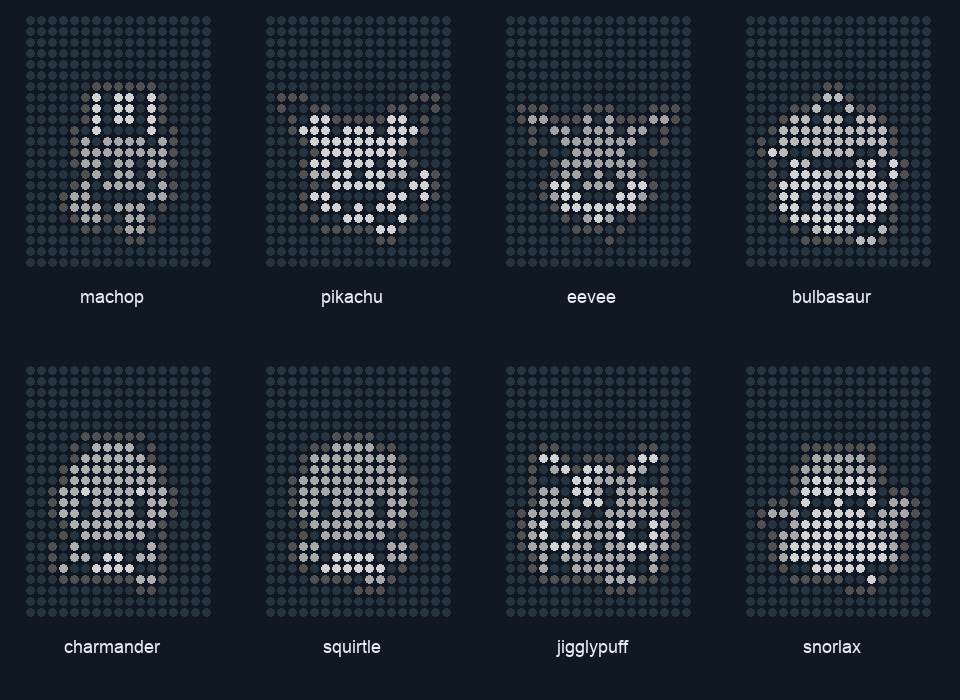

# 宝可梦荒野 · Neo 中文适配

在手机正面探索荒野，把队伍伙伴带到背面的点阵屏。JIAYU STUDIO 基于 **PokeWilds 0.8.11** 和已有 Android 运行环境制作的非官方中文适配，当前公开测试版 **0.8.15**。

[下载 Android APK](https://github.com/JiayuStudio/stepx-neo-lab/releases/download/pokewilds-neo-v0.8.15/PokeWilds-Neo-0.8.15.apk) · [观看 60 秒宣传片](https://github.com/JiayuStudio/stepx-neo-lab/releases/download/pokewilds-neo-v0.8.15/PokeWilds-Neo-60s-1080p.mp4) · [本版发行与校验文件](https://github.com/JiayuStudio/stepx-neo-lab/releases/tag/pokewilds-neo-v0.8.15) · [源代码与构建](source/README.md)

## 荒野里的日常

探索程序生成的世界，与野生宝可梦相遇、战斗、捕捉和组队；借助伙伴的场地技能采集资源、建造居所、发展自己的营地。这些核心玩法来自 PokeWilds 原作；本适配增加中文显示、掌机式触摸界面、保存桥接及 Neo 背屏陪伴。

## 两种掌机布局

- **竖屏 Game Boy**：经典灰色机身、酒红 A/B、大号十字键、Select / Start；游戏在上，操作区在下。
- **横屏 GBA**：银色掌机布局、两侧主操作，保留原有大游戏视口。
- 单击工具栏即可切换横竖屏，游戏会话继续运行。下方保留 L / R、保存、读档、技能、设置和方向切换；技能集中在一个菜单，其余辅助功能收进设置。

方向键移动，A 确认 / 交互，B 返回，Start 打开游戏菜单，Select 查看地图。L / R 对应原游戏 C / V，随场景切换材料或执行启用的肩键功能。

## 背屏伙伴是核心

设置里选择跟随队伍中的伙伴，或固定一个喜欢的形象，启动背屏陪伴。通过喂食、抚摸、玩耍和睡眠动作，让它在手机另一面陪着你；后台播放由用户启动的前台服务维持，也可随时停止。

点阵为 Neo 的 **17×23**，使用原作精灵的轮廓、灰度与五官，包含 **529 个目录项、972 个源姿态帧**。宣传片快速展示的是排除开发占位项后的 **528 项伙伴及形态**，不是 528 个互不重复的物种。可选目标刷新率为 15 / 24 / 30；程序动作在源姿态之间推进，实际物理刷新与后台状态仍受固件影响。

宣传片前屏来自 0.8.14 真机录制，背屏部分按实际点阵数据渲染，**不是背屏实拍**。配乐使用游戏内 `national_park1.ogg`，片中持续标注 `JIAYU STUDIO · StepX Neo 研究所`。

## 保存、读档与安装

自动保存每 60 秒检查一次，在可安全保存的游戏状态执行；战斗或菜单期间会等待。工具栏保存可主动请求保存。读档列出已有世界，在世界内切换前会先保存当前进度，再重新启动读取目标世界。覆盖地图、退出和读档使用中文原生提示。

APK 约 **306 MiB**，面向 ARM64 Android 8.0 及以上；已验证设备系列是 STEPX Neo，其他设备兼容性待验。首次按提示安装内置中文游戏和运行环境，需额外解压空间。Neo 背屏需要兼容固件接口；游戏不需要另装 Termux。

更新前导出存档，卸载会删除应用私有数据。0.8.15 沿用本项目测试签名，可覆盖同签名旧版；本版仍是测试包。应用包名为 `studio.jiayu.pokewilds.neo`。SHA-256 见 [release.json](release.json) 及发行附件 `SHA256SUMS.txt`。

## 验证与当前边界

0.8.14 已在 Neo 实机完成四向移动、A/B、Start / Select、存读档、技能和设置菜单、横竖屏切换、保存退出；宣传片录制时也实际用 L/R 切换过建造材料。用户观察到背屏形象持续动作，后续录制中的前台 / 后台播放另有运行记录。

0.8.15 为公开整理修订：移除不用的 macOS 库、开发辅助记录和 X11 调试段，游戏 7326 个类文件与 0.8.14 一致，X11 已分配的代码和数据节一致。本轮完成重新构建、签名及包内容检查，**尚未重新安装 0.8.15 做真机回归**。多指组合、所有技能、长期深待机、物理光学帧率、耗电和温控仍待验，目标刷新率不作为这些项目的验收结果。

原游戏、原 Android 运行层和本次 Neo 适配分别署名；这是爱好者适配项目，与宝可梦、任天堂及 StepX 官方无隶属关系。源码、声明和固定输入见下方链接。

## 引用的项目与库

以下为实际使用的来源；游戏、图像与音乐不因本仓库公开而变更权利归属。许可文本按组件保留，原生完整来源、固定子模块及包级清单见 [源码说明](source/README.md#运行环境的对应来源)。

| 项目 / 库 | 用途与固定版本 | 来源 / 许可 |
| --- | --- | --- |
| **PokeWilds** | 游戏核心、宝可梦素材、地图与游戏内音乐；0.8.11 | [原项目](https://github.com/SheerSt/pokewilds) · [原版发行](https://github.com/SheerSt/pokewilds/releases/tag/v0.8.11)；上游快照未提供统一游戏再分发许可 |
| **Pokewilds-Android** | 独立 ARM64 运行层与基础触摸 / 控制集成；v1.0.0 / `50a7eb0` | [固定来源](https://github.com/NoNoseYaKnow/Pokewilds-Android/tree/50a7eb0c1857c3e2b592bf447147678672f28ab1)；各部件分别保留许可 |
| **PokeWilds 0.8.11 BugFix Patcher** | 游戏修复代理；`93f633a`，含本地精确楼层存档扩展 | [Divinakra140 原项目](https://github.com/Divinakra140/PokeWilds-0.8.11-BugFix-Patcher)；MIT |
| **Termux:X11 / Lorie** | 显示与输入桥；`bd1cfadd` | [固定源码](https://github.com/termux/termux-x11/tree/bd1cfadd74f98b548662a48b6e1d564aa434c86e)；GPLv3，子模块分别声明 |
| **PRoot** | Linux 客体运行；v5.1.107.92 | [固定源码](https://github.com/termux/proot/tree/7266fb3e8516535682f5a9c8f3a7e70f6506eddb)；GPL，见原文及包内 COPYING |
| **talloc** | PRoot 内存管理；2.4.2 | [Samba 源码](https://download.samba.org/pub/talloc/talloc-2.4.2.tar.gz)；LGPLv3 |
| **libandroid-shmem** | Android 共享内存；0.7，含运行目录补丁 | [固定源码](https://github.com/termux/libandroid-shmem/tree/v0.7)；BSD 3-Clause |
| **libGDX** | 原游戏引擎及相应原生库 | [原项目](https://github.com/libgdx/libgdx)；Apache-2.0，依赖另有声明 |
| **ASM** | 中文 / Neo 字节码补丁 9.8；修复代理内使用 9.7 | [OW2 ASM](https://asm.ow2.io/)；BSD 3-Clause |
| **PokeAPI 数据与中文图鉴** | 中文名称核对；PokeAPI `bc92d3b` 和 2026-10-05 图鉴快照 | [固定数据来源](https://github.com/PokeAPI/pokeapi/tree/bc92d3b6029ef1abe9e7ad424c400b338f3c11fe) · [中文宝可梦图鉴](https://pokedex.pokemon.cn/)；来源与译名处理见本目录中文补丁，数据及品牌权利分别适用 |
| **旧汉化包的中文 8×8 字形** | 沿用用户提供的 `pokemon-wilds-v0.8.3-cn-v0.1.zip` 中基础字形，重新组织显示 | [素材来源说明](RESOURCE_SOURCES.md)；原作者与统一许可未在收到材料中完整标明，不宣称原字形为本项目原创 |
| **AndroidX AppCompat / Preference / Lifecycle** | 原生界面与生命周期；1.7.1 / 1.2.1 / 2.11.0 | [AndroidX](https://android.googlesource.com/platform/frameworks/support/)；Apache-2.0 |
| **Kotlin standard library** | Lorie 依赖；2.4.20 | [Kotlin](https://github.com/JetBrains/kotlin)；Apache-2.0 |
| **Apache Commons Compress** | 档案读取；1.27.1 | [原项目](https://commons.apache.org/proper/commons-compress/)；Apache-2.0 |
| **Ubuntu Base / Ubuntu Ports** | ARM64 客体系统；24.04.3 与锁定的 133 个包 | [Ubuntu Base](https://cdimage.ubuntu.com/ubuntu-base/releases/24.04.3/release/)；各软件包版权文件及清单分别适用 |
| **Eclipse Temurin JRE** | 客体 Java；17.0.15+6 | [Adoptium](https://github.com/adoptium/temurin17-binaries/releases/tag/jdk-17.0.15%2B6)；JRE `legal/` 与 NOTICE 保留 |
| **VirGL / ANGLE / PulseAudio 及 Termux 依赖** | 图形与音频；1.3.0-1 / 2.1.24923-f09a19ce-2 / 17.0-4 | [29 包精确锁定清单](source/runtime-recipes/packaging/host-packages.lock.json) · [Termux 构建配方](https://github.com/termux/termux-packages)；许可按组件分别适用 |
| **JUnit** | Android 源码测试依赖；4.13.2 | [原项目](https://github.com/junit-team/junit4)；EPL-1.0，不是游戏运行时引擎 |

控制轮 / 缩放提案由项目已有补丁继续适配，来源和未明确的授权边界保留在 [PROVENANCE](source/runtime-recipes/control-patches/PROVENANCE.md)。本次另查阅 [Android Games Samples](https://github.com/android/games-samples)，仅作参考，没有从该查询新增复用代码。
