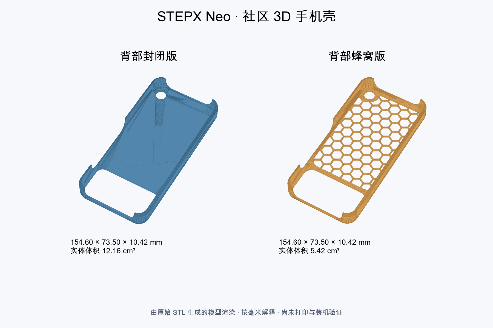

# 3D 打印与配件

[研究所首页](../README.md) · [社区 APK 与网页游戏](community-apks.md)

展示 Neo 手机壳、打印模型与实体配件资料。社区原模型与研究所参考尺寸重建的设计分别标明来源、许可和验证范围。

| 条目 | 款式与资源 | 已验证 | 待验证 |
| --- | --- | --- | --- |
| [STEPX Neo 纯边框 v0.1.4](../community/neo-slim-bumper/README.md) | 一体、无五金；STEP / STL / 3MF、R3.5 圆角、参数化源码 | STEP 有效单体、限位 7.9 mm、开孔通道与旧版抽样对比 | 本版打印、实机松紧、按键与声孔对位 |
| [STEPX Neo 社区 3D 手机壳](../community/3d-cases/README.md) | 封闭版、蜂窝版；原始 STL、模型渲染、尺寸与截面图 | 外形、参考内腔、局部壁厚、体积和网格拓扑 | 单位确认、切片、打印与实机装配 |

两款模型外形均约 **154.60 × 73.50 × 10.42 mm**，按毫米解释；这是壳体尺寸，不能当作裸机规格。完整测量、下载和验证范围见条目详情。

未声明许可的模型不视为开源或可自由商用；几何检查与真实打印、装机验收分开记录。
